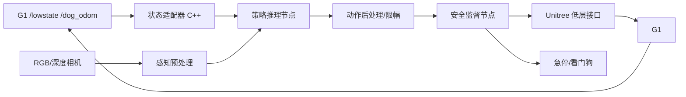

# G1-EDU + Orin NX 部署可行性分析

> 目标：从硬件、系统软件、模型格式、机器人接口、实时性与安全六个层面，判断五条主线的模型到底能不能在现有 G1 上运行。  
> 结论标签：**可直接复现 / 需适配后复现 / 需较大改造 / 暂不建议复现**。

---

## 1. 平台基线

### 1.1 硬件

| 项目 | 现有配置 | 对部署的影响 |
|---|---|---|
| 机器人 | Unitree G1-EDU，29DoF（以实际机型/配置为准） | 动作维度、关节顺序、限位、PD 增益必须与训练配置一致 |
| 机载计算 | Jetson Orin NX，16 GB 统一内存 | GPU 与 CPU 共享内存；“显存”不是独立 16 GB |
| CPU | 8 核 Cortex-A78AE | Python 后处理/多进程会挤占控制线程 |
| OS | Ubuntu 22.04.5 | 满足 ROS 2 Humble、多数 JetPack 依赖 |
| ROS 2 | Humble + CycloneDDS | 与 Unitree SDK2/ROS 2 消息需核对 |
| JetPack | 6.2.3 | 决定 CUDA/cuDNN/TensorRT 版本上限 |
| CUDA | 12.6 | 与预编译 wheel/ONNX Runtime 版本强相关 |
| TensorRT | 10.3 | 不支持论文中所有自定义量化算子 |
| 架构 | ARM64/aarch64 | x86 wheel、部分 PyTorch 扩展、CUTLASS 插件不能直接用 |

### 1.2 已具备的机器人能力

- `/lowstate` 可持续获取关节与 IMU；
- `/dog_odom` 可持续获取里程计；
- 已有 C++ ROS 2 语音路由节点；
- 已有 G1 预设动作白名单调用与真机验证。

### 1.3 尚不具备（或未验证）的能力

- 29DoF 全身运动策略的可用权重；
- 策略输出到 Unitree 低层控制的完整安全链路；
- 仿真中与真机一致的关节顺序/符号/PD 参数；
- 机载 GPU 推理节点的延迟与抖动基线；
- 跨机器 DDS 的 QoS 与网络隔离；
- 真机摔倒保护、吊装条件、急停联动。

---

## 2. 软件兼容性矩阵

| 组件 | 现有版本 | 论文/项目常见要求 | 风险 | 处理建议 |
|---|---|---|---|---|
| Ubuntu | 22.04.5 | 22.04 | 低 | 保持 |
| ROS 2 | Humble | Humble | 低 | 保持 |
| CUDA | 12.6 | 12.1/12.4/12.6 不等 | 中 | 以 JetPack 官方组合为准，不随意升级 |
| TensorRT | 10.3 | 10.x/11.x；FoldQuant 要求特定插件 | 高 | 所有 engine 必须在目标机重建 |
| PyTorch | 笔记本 2.14.1+cu130 | 项目常要求 2.x + CUDA 12.x | 高 | 机载端尽量不依赖 PyTorch，导出 ONNX 后只带运行时 |
| ONNX | 1.23.2 | 多数项目兼容 | 低 | 固定 opset，记录导出参数 |
| ONNX Runtime | 1.31.0 | instinct_onboard 未锁版本 | 中 | 机载使用 `onnxruntime-gpu` 的 ARM64 匹配版本 |
| Python | 3.12（笔记本） | 机载 Ubuntu 22.04 默认 3.10 | 中 | 训练/导出与机载运行分环境 |
| DDS | CycloneDDS | 项目可能用 FastDDS | 高 | 明确 `RMW_IMPLEMENTATION`，避免混用 |
| 编译器 | 系统 gcc | C++17 | 低 | 核心节点用 C++17 |

> **重要**：TensorRT engine 与 GPU 架构、TensorRT 版本、插件 ABI 绑定。任何“在笔记本生成 engine 后拷贝到 Orin NX”的做法都不可靠。

---

## 3. 模型/项目逐项可行性

### 3.1 SmolVLA

| 项目 | 判断 |
|---|---|
| 代码/权重 | LeRobot 官方生态，较完整 |
| 输入 | 多视角 RGB + 语言 + 机器人状态 |
| 输出 | 连续动作块（flow matching） |
| 导出 | PyTorch → ONNX 可能受动态 shape、注意力算子、动作专家结构影响；需逐层验证 |
| TensorRT | 无官方端到端 engine；视觉主干与动作专家可能需要分开 |
| Orin NX | 450M 级模型有希望，但需实测；不能保证官方支持 |
| G1 | 官方训练是机械臂，不是 G1；动作维度和语义不匹配 |
| 结论 | **需适配后复现**：适合做高层 VLA，不适合直接输出 29DoF |

### 3.2 OpenVLA

| 项目 | 判断 |
|---|---|
| 模型规模 | 7B，超出 Orin NX 实时闭环的合理范围 |
| 量化 | 官方主要是 bitsandbytes 4/8-bit，不是 TensorRT INT8 |
| 输入输出 | RGB + 指令 → 离散动作 token；动作空间为机械臂 7DoF |
| Orin NX | 可尝试离线/低频率推理，但不适合 50 Hz 控制 |
| 结论 | **暂不建议作为 G1 实时闭环**；可作为量化/微调对照基线 |

### 3.3 MiniCPM-RobotTrack

| 项目 | 判断 |
|---|---|
| 官方部署 | Go2 + Orin NX，Python HTTP 服务 + TCP JPEG 客户端 |
| 视觉加速 | DINOv3/SigLIP 使用 TensorRT engine（官方验证栈 TensorRT 10.7） |
| 输出 | 导航 waypoint/速度，不是 G1 关节动作 |
| 依赖 | CycloneDDS、Unitree SDK2、ROS 2 Humble、RealSense |
| 与 G1 差异 | 机器人 SDK、相机、网络接口、动作接口均不同 |
| 结论 | **需较大改造**：可借鉴服务拆分与 TRT 视觉编码，但不能直接控制 G1 |

### 3.4 Evo-1

| 项目 | 判断 |
|---|---|
| 模型规模 | 0.77B |
| 真机 | xArm6 + 平行夹爪；不是人形 |
| 推理开销 | 论文报告 RTX 4090D 上 2.3 GB、16.4 Hz，不是 Orin NX |
| 导出 | 交叉调制 DiT + 流匹配，ONNX/TensorRT 需验证动态维度和算子 |
| 结论 | **需较大改造**：适合作为轻量 VLA 架构参考，不是 G1 策略 |

### 3.5 NaVILA

| 项目 | 判断 |
|---|---|
| 架构 | VLM 高层 + 底层视觉运动策略 |
| 输出 | 中层语言动作（转向角度/前进距离） |
| 真机 | 腿式机器人；需核对是否含 G1 |
| 机载 | 高层 VLM 可外部服务；底层策略需机载实时 |
| 结论 | **需较大改造**：可借鉴分层协议，不能直接端到端上 G1 |

### 3.6 Uni-NaVid / Mobility VLA

| 项目 | 判断 |
|---|---|
| 资源 | 论文/代码可查，但训练数据与仿真环境门槛高 |
| 真机 | 非 G1；Mobility 依赖拓扑图与环境先验 |
| 结论 | **暂不建议复现**：适合阅读与架构参考 |

### 3.7 PredActor

| 项目 | 判断 |
|---|---|
| 论文指标 | G1 + Orin NX，16.790 ms 中位数、19.383 ms p95、20 ms 周期 |
| 代码/权重 | 项目页存在，未确认 GitHub/权重 |
| 架构 | 本体感知历史 + 可选任务上下文 → 动作 + 未来状态 |
| 结论 | **暂不建议直接复现**；可作为目标性能基线，需自行重实现 |

### 3.8 instinct_onboard

| 项目 | 判断 |
|---|---|
| 官方性 | Project Instinct 官方部署仓库 |
| 机器人 | G1 29DoF（`G1_29Dof_TorsoBase`） |
| 系统 | 官方 README 声明 Ubuntu 22.04 + ROS 2 Humble |
| 推理 | Python + ONNX Runtime；模型路径 `<logdir>/exported/actor.onnx` |
| 控制 | 主循环 50 Hz；dry-run 默认；关节越限会关电机并退出 |
| 权重 | 文件树未发现 ONNX/权重；无 LICENSE |
| 依赖 | `unitree_hg`、`crc_module`、ROS 2、`ros2_numpy` |
| 结论 | **需适配后复现**，且必须先解决权重与依赖；是最优先拆解对象 |

### 3.9 Embrace Collisions

| 项目 | 判断 |
|---|---|
| 类型 | CoRL 2025 论文，接触丰富人形运动 |
| 训练 | 仿真 + RL/影子跟踪，训练栈重 |
| 真机安全 | 接触/碰撞场景风险高 |
| 结论 | **暂不建议作为首项真机复现**；适合学术拓展 |

### 3.10 FoldQuantVLA

| 项目 | 判断 |
|---|---|
| 量化 | W4A4/W8A8，原生 INT4/INT8 TensorRT 插件 |
| 平台 | Ada GPU、Jetson AGX Orin（sm_87） |
| G1 平台 | Orin NX 与 AGX Orin 同为 sm_87，但算力/带宽不同；engine 与 TensorRT 版本/插件 ABI 绑定，应在目标机重建 |
| 依赖 | CUDA、CUTLASS submodule、TensorRT 头文件、自行编译 plugin |
| 结论 | **需较大改造**：可学习量化方法，不建议首项直接移植 |

### 3.11 SQIL / QVLA

| 项目 | 判断 |
|---|---|
| SQIL | 4-bit 权重 QAT，需微调；有官方代码；边缘 GPU 结果 |
| QVLA | 通道级混合精度，主要是 fake-quant 评估，不等于 TensorRT 原生 |
| 结论 | **需适配后复现**：适合在 SmolVLA/OpenVLA 上做算法对照，不宜直接上 G1 |

---

## 4. 实时性预算

### 4.1 50 Hz 控制周期的硬约束

50 Hz 对应 20 ms 周期。一个完整链路包括：

```text
传感器采样 → 状态打包 → DDS → 推理 → 后处理 → 安全检查 → DDS → 底层控制 → 执行
```

即使推理本身 10 ms，也可能因以下原因超周期：

- Python GIL / 垃圾回收；
- DDS 序列化/反序列化；
- 图像解码、缩放、颜色转换；
- 多线程锁竞争；
- GPU 与 CPU 统一内存带宽；
- TensorRT engine 首次加载/预热；
- 日志 I/O。

### 4.2 建议的分层频率

| 模块 | 建议频率 | 说明 |
|---|---|---|
| 底层关节控制 | 500–1000 Hz | 由 Unitree 底层负责，不在应用层重实现 |
| 策略推理 | 25–50 Hz | 视模型和动作块而定 |
| 高层 VLA | 1–10 Hz | 输出技能/waypoint，不必每帧推理 |
| 状态监控/安全 | 100 Hz 独立线程 | 不能被推理阻塞 |
| 日志 | 10–20 Hz 采样 | 避免高频磁盘写入 |

### 4.3 指标定义

- **单次推理延迟**：从输入张量就绪到输出张量完成。
- **端到端延迟**：从图像曝光/状态采样到动作真正下发。
- **控制周期抖动**：相邻控制周期的时间差分布，关注 p95/p99。
- **动作块执行延迟**：生成 K 步动作后，执行到第 k 步的时间。
- **任务成功率**：闭环任务完成次数/总次数，必须与延迟同时报告。

---

## 5. 机器人接口与安全设计

### 5.1 推荐数据流



### 5.2 必备安全机制

1. **dry-run 默认开启**：只发布到独立话题，不进入真实电机。
2. **关节顺序/符号校验**：启动时对比仿真配置与真机配置。
3. **位置/速度/力矩限幅**：独立于模型输出。
4. **变化率限制**：限制相邻周期目标差值。
5. **通信看门狗**：状态超时、推理超时、DDS 断连立即回退。
6. **独立急停**：不依赖推理进程存活。
7. **异常检测**：NaN、Inf、维度错误、越界、温度/电流异常。
8. **低增益冷启动**：从固定姿态缓慢过渡，不直接执行策略大步动作。
9. **物理防护**：吊装/护人/空旷场地，首次测试不作为负重或高动态任务。

### 5.3 不推荐的做法

- 在应用层直接持续写 `/lowcmd` 而不经过底层安全策略；
- 用 Python 推理线程直接控制电机；
- 把论文的关节顺序直接套到 G1；
- 没有 dry-run 就直接跑策略；
- 只测单帧推理，不测端到端抖动；
- 用笔记本 engine 拷贝到 Orin NX。

---

## 6. 可行性结论汇总

| 对象 | 结论 | 首要阻塞 |
|---|---|---|
| instinct_onboard 骨架 | 需适配后复现 | 权重、License、依赖、关节配置 |
| PredActor | 暂不建议直接复现 | 代码/权重未开放 |
| SmolVLA 高层部署 | 需适配后复现 | 非 G1 动作空间、ONNX/TRT 支持 |
| OpenVLA 实时闭环 | 暂不建议 | 7B 规模、非 TensorRT 量化 |
| MiniCPM-RobotTrack | 需较大改造 | Go2 专用、waypoint 输出、TRT 10.7 |
| Evo-1 | 需较大改造 | xArm6、非 Orin 验证 |
| NaVILA | 需较大改造 | 分层系统、导航栈缺失 |
| Uni-NaVid/Mobility | 暂不建议 | 数据/环境/平台门槛 |
| Embrace Collisions | 暂不建议首项真机 | 训练栈、接触安全 |
| FoldQuantVLA | 需较大改造 | 自定义插件、SM 差异、TRT 版本 |
| SQIL/QVLA | 需适配后复现 | QAT/fake-quant 与 TensorRT 差距 |

---

## 7. 最终建议

**第一步不是部署某个论文模型，而是建立 G1 的“可观测、可回退、可复现”部署骨架。**

骨架验收标准：

- 能在 dry-run 下稳定读取 `/lowstate`、`/dog_odom`；
- 能把一个 dummy ONNX 模型的输出经过限幅/变化率限制后发布到测试话题；
- 能记录 30 分钟以上的周期抖动、CPU/GPU/内存；
- 能在状态超时、NaN、越界时自动回退；
- 能在仿真/回放中重复同一段状态序列并得到确定输出；
- 通过后才考虑接入真实策略。

完成骨架后，再按 `实验路线规划.md` 推进。
