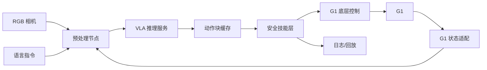

# 实验 01：端侧轻量 VLA 部署

## 1. 实验名称

SmolVLA 高层动作在 G1-EDU 上的边缘部署与端到端延迟评估

## 2. 实验目的

验证一个约 450M 参数的轻量 VLA 能否在 RTX 4070 Laptop 与 Orin NX 上完成：

```text
RGB + 语言 + 机器人状态 → 高层动作块 → ROS 2 安全技能层 → G1 低风险动作
```

重点不是让 VLA 直接输出 29DoF，而是验证 **VLA 推理与底层控制解耦** 的工程可行性。

## 3. 要验证的核心问题

1. SmolVLA 能否稳定导出 ONNX？
2. Orin NX 上能否达到 ≥ 5 Hz 的高层推理（目标值，需实测）？
3. 端到端延迟的主要瓶颈在视觉预处理、推理还是 DDS？
4. 高层动作经过安全层后，是否仍能完成任务？
5. 动作块长度/异步推理如何影响控制平滑度？

## 4. 参考论文与代码

| 资源 | 链接 | 用途 |
|---|---|---|
| SmolVLA 论文 | https://arxiv.org/abs/2506.01844 | 架构、异步推理、动作块 |
| LeRobot 官方代码 | https://github.com/huggingface/lerobot | 模型、训练、推理 |
| SmolVLA 模型 | HuggingFace（以 LeRobot 页面为准） | 权重 |
| OpenVLA（对照） | https://arxiv.org/abs/2406.09246 | 大模型对照 |
| G1 接口 | 本地 `~/unitree_ros2/cyclonedds_ws` | 状态/动作 |

## 5. 模型与数据来源

- 模型：SmolVLA 官方预训练权重；若官方权重不可用，使用 LeRobot 提供的小型基线。
- 数据：先用公开桌面操作数据/仿真数据；真机数据只采低风险技能。
- 不在 G1 上训练，只在笔记本/服务器训练或微调。

## 6. 硬件需求

| 设备 | 用途 | 必要性 |
|---|---|---|
| RTX 4070 Laptop | 推理/导出/初步验证 | 必需 |
| Orin NX | 目标部署平台 | 必需 |
| G1-EDU | 低风险闭环 | 后期必需 |
| 相机 | RGB/深度 | 必需 |
| 外部 GPU/Windows 主机 | 备选远程推理 | 可选 |

## 7. 软件环境

- 笔记本：Python 3.12、PyTorch 2.14.1+cu130、ONNX 1.23.2、ONNX Runtime 1.31.0；
- Orin NX：Ubuntu 22.04、JetPack 6.2.3、CUDA 12.6、TensorRT 10.3、ROS 2 Humble；
- 导出与运行环境分离，记录所有版本；
- 机载核心节点用 C++17，Python 只用于推理服务/离线工具。

## 8. 系统架构



### 节点划分

| 节点 | 语言 | 运行位置 | 职责 |
|---|---|---|---|
| `camera_node` | C++ | Orin NX | 采集/时间戳 |
| `state_adapter` | C++ | Orin NX | `/lowstate`、`/dog_odom` → 观测 |
| `vla_service` | Python/C++ | Orin NX 或笔记本 | 模型推理 |
| `action_cache` | C++ | Orin NX | 动作块缓存/插值 |
| `safety_skill` | C++ | Orin NX | 白名单、限速、限幅、超时 |
| `robot_io` | C++ | Orin NX | Unitree SDK2/ROS 2 接口 |
| `logger` | C++/Python | Orin NX | bag/CSV/延迟 |

## 9. 模型输入输出

### 输入

- RGB：分辨率以模型配置为准；
- 语言：任务指令字符串；
- 状态：G1 关节位置/速度、IMU、末端位姿（按模型要求裁剪/填充）；
- 历史：若模型需要多帧，明确帧率与时间戳。

### 输出

- 动作块：形状 `[H, D]`；
- 若 D≠29：映射为高层技能（前进/转向/停止/抓取）或末端目标，不直接映射为关节；
- 明确单位、坐标系、归一化方式。

## 10. 部署流程

1. 在笔记本加载官方权重，跑通单帧推理；
2. 记录 PyTorch 输出作为数值基准；
3. 导出 ONNX（固定 opset，记录动态轴）；
4. ONNX Runtime 验证数值一致性；
5. 在 Orin NX 安装匹配的 ONNX Runtime；
6. 测 FP32/FP16（若支持）；
7. 用 `trtexec`/TensorRT 构建 engine，逐层对比输出；
8. 封装 ROS 2 服务；
9. 接安全技能层，在 dry-run/仿真中闭环；
10. 真机低风险验证。

## 11. 实验对照组

| 组 | 模型 | 精度 | 推理位置 | 输出 |
|---|---|---|---|---|
| A | SmolVLA | FP32 | 笔记本 | 动作块 |
| B | SmolVLA | FP16 | Orin NX | 动作块 |
| C | SmolVLA | INT8 | Orin NX | 动作块 |
| D | 小型 BC 基线 | FP16 | Orin NX | 高层动作 |
| E | 固定动作 | - | - | 下限 |

## 12. 性能指标

- 单帧推理 p50/p95/p99；
- 端到端延迟（图像→动作）；
- 高层推理频率；
- 动作块执行平滑度；
- 峰值内存/显存；
- 任务成功率；
- 失败模式。

## 13. 预期结果

- SmolVLA 在 Orin NX 上可能达到个位数 Hz，不一定满足 50 Hz；
- 视觉预处理可能占端到端延迟的显著比例；
- 高层动作经安全层后成功率下降，但安全性提高；
- INT8 若校准不当，动作误差可能明显增大。

## 14. 风险与难点

| 风险 | 影响 | 缓解 |
|---|---|---|
| ONNX 导出失败 | 无法上 TensorRT | 拆分子图/使用 TorchScript/保留 PyTorch 服务 |
| 动态 shape 不支持 | engine 构建失败 | 固定分辨率/批量 |
| 模型输出非 G1 动作 | 无法闭环 | 只做高层技能 |
| 图像预处理瓶颈 | 端到端慢 | 硬件加速/零拷贝 |
| Orin 内存不足 | OOM | 降低分辨率/FP16/分模块 |
| DDS 不稳定 | 控制抖动 | 同机 IPC/固定 QoS |

## 15. 回退方案

1. 只部署视觉编码器 + 分类头；
2. 将 VLA 放笔记本，G1 通过 ROS 2 接收高层目标；
3. 改用小型 CNN/MLP 基线完成系统闭环；
4. 只做离线评估，不接真机。

## 16. 最终交付物

- ONNX 模型与导出脚本；
- TensorRT engine 构建记录（若成功）；
- ROS 2 节点源码与 launch；
- 延迟/资源/成功率报告；
- 失败模式分析；
- 一段低风险真机演示视频（若通过安全验收）。
