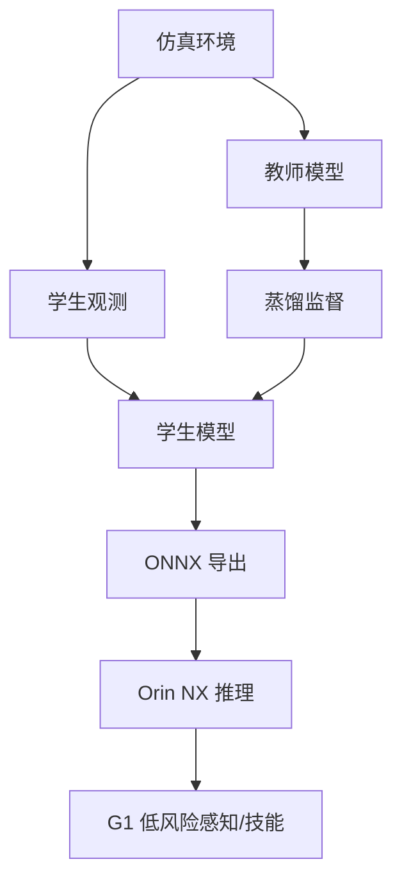

# 实验 02：感知蒸馏与 Sim-to-Real 协同

## 1. 实验名称

特权信息教师 → 可部署学生：小型感知策略的蒸馏与边缘推理验证

## 2. 实验目的

验证在只给学生可部署观测（RGB/深度/本体感知）的条件下，能否通过教师蒸馏保留真实环境鲁棒性，并满足 Orin NX 的推理预算。

本实验是 **选做拓展**，不作为首项真机项目。

## 3. 要验证的核心问题

1. 教师用特权信息、学生只用可部署观测的蒸馏是否有效？
2. feature/logit/动作蒸馏哪种监督信号更适合小型策略？
3. 蒸馏后模型在域偏移（光照、纹理、噪声）下是否更稳？
4. 学生模型在 Orin NX 上的延迟/显存是否满足目标？
5. 蒸馏与 INT8 量化叠加是否进一步损伤鲁棒性？

## 4. 参考论文与代码

| 资源 | 链接 | 用途 |
|---|---|---|
| Miki et al., Science Robotics 2022 | https://arxiv.org/abs/2201.08117 | 教师—学生、特权信息、Sim-to-Real |
| VITA-VLA | https://arxiv.org/abs/2510.09607 | 动作专家蒸馏 |
| Evo-1 | https://arxiv.org/abs/2511.04555 | 语义保持（非蒸馏，作反例对照） |
| ANYmal 代码/项目 | 以论文官方链接为准 | 参考训练栈 |

> 注意：Evo-1 不是知识蒸馏；不要把两阶段训练写成蒸馏。

## 5. 模型与数据来源

### 教师

- 小型 CNN/Transformer 策略或公开预训练感知模型；
- 输入可包含特权信息（仿真地面真值、地形高度、对象位姿）；
- 教师只在训练时使用，不部署。

### 学生

- 输入：RGB/深度 + 本体感知；
- 输出：动作/技能/目标；
- 参数量控制在 Orin NX 可实时范围（先以 < 50M 为目标，需实测）。

### 数据

- 仿真：公开机器人仿真环境或自建简单场景；
- 真实：公开数据集或小规模自采；
- 必须区分训练/验证/测试场景，避免同一轨迹泄漏。

## 6. 硬件需求

| 设备 | 用途 |
|---|---|
| RTX 4070 Laptop | 教师/学生训练、导出 |
| Orin NX | 学生推理 |
| G1 | 仅低风险感知验证，不直接跑高速运动 |

## 7. 软件环境

- PyTorch + CUDA；
- ONNX/ONNX Runtime；
- 仿真环境（Isaac/MuJoCo 等，按可用性）；
- 机载 C++17 + ROS 2；
- 记录所有随机种子与数据版本。

## 8. 系统架构

## 9. 模块划分

| 模块 | 职责 |
|---|---|
| 数据生成 | 仿真 rollout、域随机化、真实数据 |
| 教师训练 | 特权信息输入，冻结后产生监督 |
| 学生训练 | 仅可部署观测，蒸馏损失 + 任务损失 |
| 评估 | 精度、鲁棒性、延迟、显存 |
| 导出 | ONNX/TRT |
| 机载节点 | 推理 + 安全层 |

## 10. 模型输入输出

- 教师输入：可部署观测 + 特权信息；
- 学生输入：只含真实可获得的观测；
- 学生输出：动作/技能/目标；
- 明确归一化、坐标系、时间对齐。

## 11. 部署流程

1. 建立仿真基线；
2. 训练教师；
3. 冻结教师，训练学生（无蒸馏对照 + 蒸馏组）；
4. 在域偏移测试集评估；
5. 导出 ONNX；
6. Orin NX 推理；
7. 与方向 5 联合做 INT8 对照（选做）；
8. 低风险真机感知验证。

## 12. 对照组

| 组 | 教师 | 蒸馏 | 学生输入 | 说明 |
|---|---|---|---|---|
| A | 无 | 无 | 可部署 | 学生直接训练 |
| B | 有 | logit | 可部署 | logit KD |
| C | 有 | feature | 可部署 | feature KD |
| D | 有 | 动作/轨迹 | 可部署 | behavior KD |
| E | 有 | 无 | 特权 | 性能上限（不可部署） |

## 13. 性能指标

- 域内/域外成功率；
- 动作误差；
- 模型大小；
- Orin NX p50/p95 延迟；
- 显存/内存；
- 不同光照/纹理/噪声下的鲁棒性；
- 与量化叠加后的退化。

## 14. 预期结果

- 蒸馏学生通常优于同规模直接训练；
- 特权信息教师能显著提升仿真性能，但学生不一定完全继承；
- 域偏移下蒸馏的收益可能大于域内精度；
- 小模型 + INT8 可能进一步放大鲁棒性问题。

## 15. 风险与难点

| 风险 | 缓解 |
|---|---|
| 教师过强/学生容量不足 | 调整学生规模/蒸馏温度 |
| 仿真—现实差距大 | 域随机化 + 真实微调 |
| 数据泄漏 | 按场景/轨迹划分 |
| 训练成本高 | 小教师、小数据、先离线 |
| 无法真机验证 | 只做仿真/公开数据集，明确结论边界 |

## 16. 回退方案

- 只做离线蒸馏对照，不部署；
- 用公开小型数据集，不训练大教师；
- 把蒸馏替换为“预训练 + 微调”；
- 将本实验降级为方向 1 的模型压缩章节。

## 17. 最终交付物

- 教师/学生训练配置；
- 蒸馏损失与数据划分说明；
- 域内/域外评估表；
- ONNX/延迟报告；
- 明确的“可部署/不可部署”结论。
