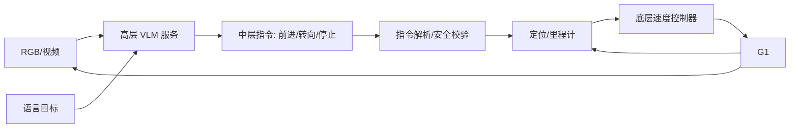

# 实验 03：分层 VLA 与腿式视觉语言导航

## 1. 实验名称

高层 VLM 中层导航指令 + G1 低速底层控制的分层闭环仿真

## 2. 实验目的

验证“高层 VLM 低频输出中层动作、底层控制器高频执行”的架构，在 G1 上是否比端到端 VLA 更可部署、更安全、更容易调试。

## 3. 要验证的核心问题

1. NaVILA 式中层语言动作（方向/距离/停止）是否足以驱动 G1 完成简单导航？
2. 高层推理频率 1–5 Hz 是否满足室内低速导航？
3. 指令解析错误和底层控制误差哪个是主要失败源？
4. 分层架构能否将 VLM 放在外部 GPU，而 G1 只跑底层控制？
5. 与端到端 VLA 相比，分层方案的延迟/成功率/安全性如何？

## 4. 参考论文与代码

| 资源 | 链接 | 用途 |
|---|---|---|
| NaVILA | https://arxiv.org/abs/2412.04453；RSS 2025 DOI 10.15607/RSS.2025.XXI.018 | 两级架构、中层语言动作 |
| Uni-NaVid | https://arxiv.org/abs/2412.06224；RSS 2025 DOI 10.15607/RSS.2025.XXI.013 | 视频型统一导航 |
| Mobility VLA | https://proceedings.mlr.press/v270/xu25b.html | 长上下文 VLM + 拓扑图 |
| NaVILA 官方代码 | https://github.com/AnjieCheng/NaVILA | 训练/评估参考 |

## 5. 模型与数据来源

- 高层：NaVILA 或可访问的 VLM（优先用官方权重；无法获取时用开源 VLM 复现接口）；
- 底层：G1 低速运动控制器/白名单技能；
- 数据：仿真室内场景 + 公开 VLN 数据；
- 不使用真实楼梯、复杂地形、人群场景作为首测。

## 6. 硬件需求

| 设备 | 用途 | 必要性 |
|---|---|---|
| RTX 4070 Laptop | 高层 VLM 推理/仿真 | 必需 |
| Orin NX | 底层控制/传感器 | 必需 |
| G1 | 低风险导航闭环 | 后期 |
| 外部 GPU/Windows | 备选 VLM 服务 | 可选 |

## 7. 软件环境

- 仿真：Isaac Sim/MuJoCo/Habitat（按可用性）；
- ROS 2 Humble；
- VLM 推理服务（HTTP/gRPC/ROS 2 service）；
- C++17 底层控制节点；
- 记录 DDS/RMW 配置。

## 8. 系统架构

### 节点划分

| 节点 | 位置 | 职责 |
|---|---|---|
| `vlm_service` | 笔记本/Orin | 图像+语言→中层指令 |
| `command_parser` | Orin | 指令合法性/超时/限幅 |
| `localization` | Orin | `/dog_odom` + 地图 |
| `nav_controller` | Orin | 速度/waypoint 跟踪 |
| `safety_supervisor` | Orin | 碰撞/超时/急停 |
| `robot_io` | Orin | Unitree 接口 |

## 9. 模型输入输出

### 高层输入

- 单帧/多帧 RGB；
- 语言指令；
- 历史动作/位置（按模型）。

### 高层输出

- 中层动作：`前进 x 米`、`左转 y 度`、`停止`；
- 或 waypoint `(x, y, yaw)`；
- 必须带置信度/有效期。

### 底层输入输出

- 输入：中层指令 + 里程计 + 障碍物；
- 输出：低速速度指令或白名单技能；
- 不直接输出 29 关节目标。

## 10. 部署流程

1. 离线视频回放，验证 VLM 指令格式；
2. 仿真中闭环，记录碰撞/超时；
3. 将 VLM 服务与底层控制分离；
4. Orin NX 跑底层控制，笔记本跑 VLM；
5. 测跨机 DDS/HTTP 延迟；
6. 低风险真机直行/转向；
7. 加入障碍物/人员，验证安全层。

## 11. 对照组

| 组 | 架构 | VLM 位置 | 底层 |
|---|---|---|---|
| A | 分层 | 笔记本 | 仿真控制器 |
| B | 分层 | Orin NX | 仿真控制器 |
| C | 分层 | 笔记本 | G1 低速 |
| D | 端到端 VLA（对照） | 笔记本 | 仿真 |
| E | 固定指令 | - | 仿真 |

## 12. 性能指标

- 指令准确率；
- 导航成功率；
- 碰撞次数；
- 人工干预次数；
- 高层延迟/频率；
- 跨机通信延迟；
- 底层控制周期抖动；
- 安全事件数。

## 13. 预期结果

- 分层方案在长程任务上更稳，端到端延迟更易控制；
- 中层指令解析是主要错误源；
- 跨机 VLM 服务增加网络延迟，但可降低机载算力压力；
- G1 低速直行/转向可完成，复杂场景仍需地图/避障。

## 14. 风险与难点

| 风险 | 缓解 |
|---|---|
| 官方权重/数据不可得 | 用开源 VLM 复现接口 |
| 仿真—现实差距 | 先低速/简单场景 |
| 定位漂移 | 融合里程计/外部定位 |
| 指令歧义 | 结构化 schema + 置信度 |
| 跨机网络不稳定 | 超时回退/本地缓存 |
| 碰撞风险 | 独立安全层/物理防护 |

## 15. 回退方案

- 只做离线视频理解与指令生成；
- 用固定 waypoint 代替 VLM；
- 只做仿真，不接 G1；
- 将实验降级为方向 1 的“高层接口设计”。

## 16. 最终交付物

- 中层指令 schema；
- VLM 服务与 ROS 2 接口；
- 仿真闭环视频/日志；
- 跨机延迟报告；
- 安全事件分析；
- 分层 vs 端到端对照表。
