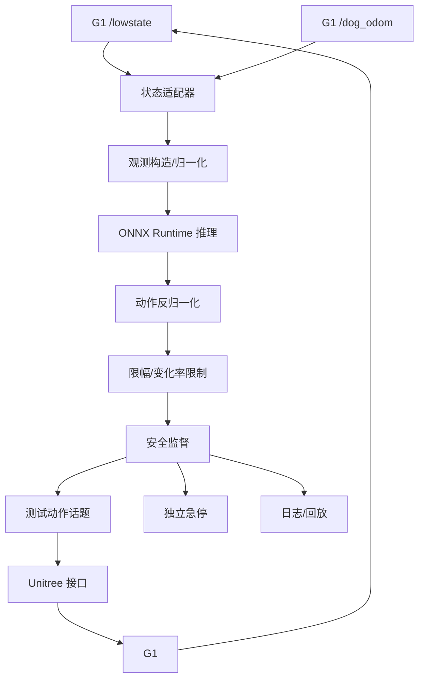

# 实验 04：人形机器人机载实时控制

## 1. 实验名称

G1-EDU 机载策略推理骨架与 50 Hz 实时性评估

## 2. 实验目的

在不直接冒险运行未验证运动策略的前提下，建立 G1 的机载推理与控制骨架，验证：

- 状态获取、观测构造、ONNX 推理、动作后处理、安全监督的完整链路；
- Orin NX 上的推理延迟、控制周期抖动、CPU/GPU/内存占用；
- 关节顺序、符号、限幅、看门狗、急停等安全机制；
- 后续接入 instinct_onboard / PredActor 类策略的接口契约。

## 3. 要验证的核心问题

1. Orin NX 能否稳定维持 50 Hz 应用层控制循环？
2. ONNX Runtime 在 ARM64 + JetPack 6.2.3 上是否可用 GPU provider？
3. 端到端延迟的主要瓶颈在哪里？
4. 现有关节状态/动作接口能否与训练时的 29DoF 顺序对齐？
5. 故障注入时能否在 1 个周期内进入安全状态？
6. instinct_onboard 的模型接口如何映射到自有骨架？

## 4. 参考论文与项目

| 资源 | 类型 | 用途 |
|---|---|---|
| **instinct_onboard** | 官方部署仓库 | G1 29DoF、ONNX、50 Hz、dry-run、安全保护 |
| **PredActor** | 论文（预印本） | 目标性能基线：16.790 ms 中位数 / 19.383 ms p95 / 20 ms 周期 |
| **Embrace Collisions** | CoRL 2025 | 接触丰富运动的系统参考 |
| **ExBody** | RSS 2024 | 人形全身控制的架构参考（H1 19DoF，不可直接套 G1） |

## 5. 参考代码

- `https://github.com/project-instinct/instinct_onboard`
- 重点文件：
  - `scripts/g1_track.py`
  - `instinct_onboard/agents/tracking_agent.py`
  - `instinct_onboard/ros_nodes/unitree.py`
  - `instinct_onboard/agents/base.py`
- 注意：仓库文件树未发现 ONNX 权重或 LICENSE；不得把仓库代码等同于完整可运行策略。

## 6. 模型与数据来源

### 模型

- 阶段 A：dummy MLP ONNX（输入固定维度观测，输出 29 维动作）；
- 阶段 B：公开可用的 G1 策略权重（若可获得）；
- 阶段 C：instinct_onboard 训练仓库导出的 `actor.onnx`（需解决权重）；
- 阶段 D（研究）：按 PredActor 论文重实现的轻量动作扩散模型（仅离线/仿真）。

### 数据

- G1 `/lowstate`、`/dog_odom` 回放；
- 仿真状态序列；
- 不收集大规模真机运动数据。

## 7. 硬件需求

| 设备 | 用途 | 必要性 |
|---|---|---|
| G1-EDU | 状态读取、低风险动作 | 必需 |
| Orin NX | 目标推理平台 | 必需 |
| RTX 4070 Laptop | 模型导出/离线验证 | 必需 |
| 吊装/护人设备 | 真机安全 | 必需 |
| 外部显示器/键盘 | 急停/监控 | 必需 |

## 8. 软件环境

- Ubuntu 22.04.5、ROS 2 Humble、CycloneDDS；
- CUDA 12.6、TensorRT 10.3；
- ONNX Runtime（ARM64，版本需与 CUDA 匹配）；
- C++17、CMake、Eigen；
- Python 仅用于模型导出/离线工具；
- 记录 `RMW_IMPLEMENTATION=rmw_cyclonedds_cpp`、`ROS_DOMAIN_ID=0`。

## 9. 系统架构

### 节点划分

| 节点 | 语言 | 频率 | 职责 |
|---|---|---|---|
| `state_adapter` | C++17 | 100–500 Hz | 读取状态、时间戳、关节映射 |
| `obs_builder` | C++17 | 50 Hz | 构造观测、归一化、历史缓存 |
| `policy_runner` | C++17 + ORT | 25–50 Hz | ONNX 推理 |
| `action_post` | C++17 | 50 Hz | 反归一化、限幅、平滑 |
| `safety_supervisor` | C++17 | 100 Hz | 看门狗、NaN、越界、超时 |
| `robot_io` | C++17 | 50–500 Hz | Unitree 接口 |
| `logger` | C++17 | 10–20 Hz | bag/CSV |

> 关键：推理线程与安全监督线程分离；安全监督不能被推理阻塞。

## 10. 模块划分

### 10.1 状态适配

- 读取 `/lowstate`：关节 `q/dq/tau`、IMU；
- 读取 `/dog_odom`：位置/速度/朝向；
- 按训练配置重排关节；
- 处理符号（左/右、前后）；
- 时间戳对齐，拒绝过期状态。

### 10.2 观测构造

- 关节位置 - 默认姿态；
- 关节速度；
- 上一帧动作；
- IMU 角速度/投影重力；
- 历史帧（若模型需要）；
- 归一化统计量必须与训练一致。

### 10.3 推理

- ONNX Runtime session 预加载；
- 输入形状固定；
- warm-up ≥ 20 次；
- 记录 provider、线程数、arena 配置；
- 推理超时监控。

### 10.4 动作后处理

- 反归一化；
- 关节限位；
- 速度/加速度限制；
- 低通滤波；
- 冷启动插值。

### 10.5 安全监督

见第 15 节。

## 11. 模型输入输出

| 项目 | 示例 | 说明 |
|---|---|---|
| 输入 | `[1, obs_dim]` | obs_dim 以模型配置为准 |
| 输出 | `[1, 29]` 或 `[1, H, 29]` | 关节目标或动作块 |
| 关节顺序 | 训练配置 | 必须与真机映射表一致 |
| 单位 | rad / rad·s⁻¹ | 明确 |
| 归一化 | mean/std | 与训练一致 |
| 控制模式 | 位置/速度/力矩 | 与底层接口匹配 |

## 12. 部署流程

### 阶段 A：离线

1. 导出 dummy ONNX；
2. 在笔记本 ONNX Runtime 验证；
3. 在 Orin NX 验证 CPU provider；
4. 再验证 GPU provider；
5. 记录 p50/p95/p99。

### 阶段 B：dry-run

1. 启动状态适配；
2. 启动推理；
3. 动作只发布到 `/debug/policy_action`；
4. 与状态同步记录；
5. 30 分钟稳定性测试；
6. 故障注入。

### 阶段 C：仿真/回放

1. 用记录的状态序列回放；
2. 检查动作维度/限幅；
3. 对比不同 provider 输出；
4. 检查冷启动。

### 阶段 D：真机低风险

1. 吊装/护人；
2. 固定姿态；
3. 单关节小幅度；
4. 双臂低幅度；
5. 固定轨迹回放；
6. 策略动作经安全层；
7. 逐步增加幅度。

## 13. 实验对照组

| 组 | 模型 | Provider | 频率 | 说明 |
|---|---|---|---|---|
| A | dummy MLP | CPU | 50 Hz | 链路基线 |
| B | dummy MLP | GPU | 50 Hz | GPU 开销 |
| C | 公开 G1 策略 | GPU | 50 Hz | 真实策略 |
| D | 动作块模型 | GPU | 25 Hz + 插值 | 异步 |
| E | 无安全层（仿真） | GPU | 50 Hz | 安全层开销对照 |

## 14. 性能指标

- 推理 p50/p95/p99；
- 控制周期 p50/p95/p99、抖动；
- 端到端延迟；
- CPU/GPU/内存/温度/功耗；
- 状态丢失次数；
- 安全回退次数；
- 真机动作跟踪误差（低风险条件下）。

## 15. 安全设计（必须）

1. **dry-run 默认**：只有显式参数才进入真机。
2. **关节映射单元测试**：29 关节逐一验证。
3. **硬限位**：独立于模型输出。
4. **变化率限制**：相邻周期目标差不超过阈值。
5. **看门狗**：状态超时 > 50 ms 回退。
6. **推理超时**：> 1 个周期回退到保持/阻尼。
7. **NaN/Inf 检查**：拒绝并回退。
8. **独立急停**：物理/手柄/独立进程。
9. **冷启动**：从当前姿态缓慢过渡。
10. **物理防护**：吊装/护人/空旷场地。
11. **日志**：所有输入输出与安全事件可回放。
12. **权限隔离**：推理进程不得直接持有电机写权限。

## 16. 预期结果

- dummy MLP 在 Orin NX 上应远快于 20 ms，可验证骨架；
- 真实策略可能接近或超过 20 ms，需动作块/异步；
- Python 实现可能引入额外抖动，C++ 核心更稳；
- 安全层会增加少量延迟，但必须保留；
- 关节映射错误是最常见、最危险的失败源。

## 17. 风险与难点

| 风险 | 影响 | 缓解 |
|---|---|---|
| 权重缺失 | 无法跑真实策略 | 先用 dummy/公开权重 |
| 关节顺序错误 | 真机危险 | 单元测试 + 低速单关节 |
| ONNX Runtime GPU 不可用 | 延迟高 | CPU/TRT/TorchScript 备选 |
| DDS 不稳定 | 状态丢失 | 固定 QoS/同机 IPC |
| Python 抖动 | 周期超标 | C++ 核心 |
| 真机摔倒 | 损坏/伤人 | 吊装/护人/低增益 |
| TensorRT 版本不匹配 | engine 失败 | 目标机重建 |

## 18. 回退方案

- 只做 dry-run 与回放，不接真机；
- 用 CPU provider 完成链路验证；
- 用固定轨迹回放代替策略；
- 用仿真环境验证策略；
- 若 instinct_onboard 依赖无法满足，改用自有 C++ 骨架 + dummy 模型。

## 19. 最终交付物

- C++17 ROS 2 节点源码；
- 关节映射表与单元测试；
- ONNX 模型/engine；
- 延迟/抖动/资源报告；
- 故障注入报告；
- 安全操作手册；
- 低风险真机视频（若通过）；
- 与 instinct_onboard/PredActor 的接口对照表。
