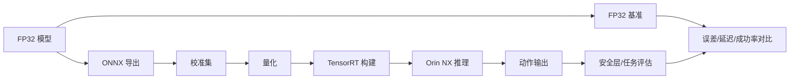

# 实验 05：VLA 低比特量化与混合精度

## 1. 实验名称

VLA 在 Orin NX 上的 FP16 / INT8 / W4A16 公平对照与闭环影响评估

## 2. 实验目的

在同一模型、同一输入、同一任务上，量化比较不同精度方案的：

- 显存/内存；
- p50/p95 延迟；
- 动作误差；
- 闭环任务成功率；
- 失败模式。

本实验依附方向 1 的 SmolVLA 或方向 4 的策略，不单独做“量化工具链练习”。

## 3. 要验证的核心问题

1. TensorRT 10.3 标准 INT8 能否在 Orin NX 上带来端到端收益？
2. 哪些层对量化敏感，需要保留 FP16？
3. W4A16 是否比 INT8 更划算？
4. W4A4/通道混合精度是否值得自定义插件成本？
5. 量化后动作误差如何影响闭环成功率？
6. 论文中的加速比能否在 Orin NX 上复现？

## 4. 参考论文与代码

| 资源 | 链接 | 用途 |
|---|---|---|
| FoldQuantVLA | https://arxiv.org/abs/2609.24433 | W4A4/W8A8、TensorRT 插件、AGX Orin |
| SQIL | https://arxiv.org/abs/2505.15304 | 显著性 QAT、4-bit 权重 |
| QVLA | https://arxiv.org/abs/2602.03782 | 通道级混合精度 |
| FoldQuant 代码 | https://github.com/cair-vinuni/FoldQuantVLA | 插件/校准/部署参考 |
| SQIL 代码 | https://github.com/aiha-lab/SQIL | QAT 参考 |
| QVLA 代码 | https://github.com/AutoLab-SAI-SJTU/QVLA | fake-quant/敏感度参考 |

## 5. 模型与数据来源

- 主模型：SmolVLA（方向 1）或 G1 小型策略（方向 4）；
- 校准集：与测试集分离的 100–500 个样本；
- 测试集：固定初始状态/指令；
- 不在 G1 上做量化校准。

## 6. 硬件需求

| 设备 | 用途 |
|---|---|
| RTX 4070 Laptop | 导出、校准、初步对比 |
| Orin NX | 目标推理/延迟 |
| G1 | 仅在低风险闭环阶段 |

## 7. 软件环境

- PyTorch、ONNX、ONNX Runtime；
- TensorRT 10.3（目标机）；
- CUDA 12.6；
- 校准/评估脚本；
- 记录所有版本与构建参数。

## 8. 系统架构

## 9. 模块划分

| 模块 | 职责 |
|---|---|
| 模型导出 | PyTorch→ONNX，固定 opset |
| 校准 | 代表性样本、敏感层统计 |
| 量化 | Q/DQ、权重/激活、混合精度 |
| 构建 | TensorRT engine、插件 |
| 评估 | 数值误差、延迟、任务 |
| 回退 | 敏感层 FP16 |

## 10. 模型输入输出

- 输入：与 FP16 完全一致；
- 输出：动作/动作块；
- 量化只改变数值精度，不改变接口；
- 记录输入/输出 scale、零点、校准范围。

## 11. 部署流程

1. 建立 FP32/FP16 基准；
2. 导出 ONNX；
3. 校准集统计；
4. 标准 INT8 Q/DQ；
5. TensorRT 构建；
6. 数值对比（逐层/端到端）；
7. 敏感层分析；
8. 混合精度回退；
9. Orin NX 延迟；
10. 闭环任务成功率；
11. 与论文结果对比。

## 12. 对照组

| 组 | 权重 | 激活 | 校准 | 备注 |
|---|---|---|---|---|
| G0 | FP32 | FP32 | 无 | 精度上限 |
| G1 | FP16 | FP16 | 无 | 部署基线 |
| G2 | INT8 | INT8 | 有 | 标准 TRT |
| G3 | INT8+FP16 | 混合 | 有 | 敏感层回退 |
| G4 | INT4 | FP16 | 有 | W4A16 |
| G5 | INT4 | INT4 | 有 | 仅自定义插件 |

## 13. 性能指标

- 模型大小；
- 峰值内存；
- p50/p95/p99 延迟；
- 吞吐；
- 动作 MSE/余弦；
- 任务成功率；
- 失败模式；
- 构建时间/插件依赖。

## 14. 预期结果

- FP16 通常是最稳妥的部署基线；
- 标准 INT8 可能带来 1.2–1.6× 提升（需实测，不能预设）；
- 动作头/视觉层可能对量化敏感；
- W4A16 省内存但未必提速；
- W4A4 在 Orin NX 上需要自定义 kernel，成本高；
- 论文的 AGX Orin 数据不能直接外推到 Orin NX。

## 15. 风险与难点

| 风险 | 影响 | 缓解 |
|---|---|---|
| 校准集不代表性 | 精度崩 | 增加多样性/分层采样 |
| 自定义算子 | 构建失败 | 子图拆分/CPU fallback |
| TensorRT 版本 | engine 不兼容 | 目标机重建 |
| 插件 ABI | 加载失败 | 固定 CUDA/TRT/CUTLASS |
| 只看单帧 | 结论错误 | 端到端+闭环 |
| 过拟合测试集 | 虚高 | 独立测试集 |

## 16. 回退方案

- 只用 FP16；
- 只做 W4A16；
- 敏感层保留 FP16；
- 用 ONNX Runtime 量化代替 TensorRT；
- 只做离线误差分析，不接真机。

## 17. 最终交付物

- 量化脚本/配置；
- 校准集说明；
- FP16/INT8/W4A16 对照表；
- 敏感层清单；
- Orin NX 延迟/内存报告；
- 闭环成功率（若完成）；
- 与 FoldQuant/SQIL/QVLA 论文结果的差异分析。
