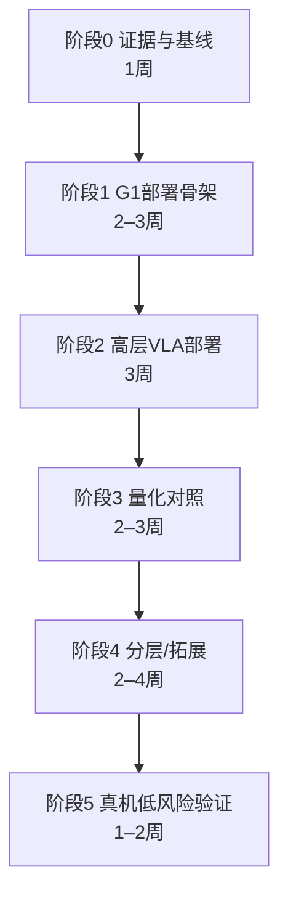

# 实验路线规划

> 目标：在现有 G1-EDU + Orin NX + RTX 4070 Laptop 条件下，用 10–14 周形成三项可展示的部署成果。  
> 原则：先安全骨架，后模型；先离线/仿真，后真机；先 FP16，后 INT8/INT4；所有结论必须有对照和可复现命令。

---

## 1. 总体路线

### 推荐主路线：B0 → A1 → Q

1. **B0：G1 部署骨架**（方向 4b）
2. **A1：SmolVLA 高层 VLA**（方向 1）
3. **Q：FP16/INT8 量化对照**（方向 5）
4. 选做：方向 3 分层导航仿真；方向 2 蒸馏小实验

### 为什么不按 A → Q 直接开始

- 没有 G1 控制骨架，VLA 输出无法安全落地；
- 没有控制周期/延迟基线，量化收益无法解释；
- 没有 dry-run 和回放，调参结果不可复现。

---

## 2. 阶段 0：证据与基线（第 1 周）

### 交付物

- 论文与项目索引（本资料库）；
- G1 状态/控制接口清单；
- 现有 ROS 2 工作空间依赖树；
- 机载性能基线：空载 CPU/GPU/内存、DDS 往返延迟、`/lowstate` 频率。

### 验收

- 能用一条命令记录 10 分钟系统状态；
- 能明确 `/lowstate`、`/dog_odom` 的实际频率与抖动；
- 能导出当前 ROS 2 包版本、DDS 实现、TensorRT 版本。

### 风险

- 机器人固件与 SDK 版本不一致；
- CycloneDDS 与项目默认 RMW 冲突；
- 机载系统被其他服务占用。

---

## 3. 阶段 1：G1 部署骨架（第 2–4 周）

### 目标

建立一个与具体策略无关的部署骨架，验证“状态→推理→动作→安全→执行”的链路。

### 任务分解

| 任务 | 内容 | 验收 |
|---|---|---|
| 1.1 状态适配 | 读取 `/lowstate`、`/dog_odom`，转换为策略观测 | 维度/频率/时间戳正确 |
| 1.2 关节映射 | 仿真顺序 ↔ 真机顺序、符号、限位 | 单元测试覆盖 29 关节 |
| 1.3 dummy 推理 | 固定 MLP ONNX，输入观测，输出 29 维动作 | ONNX Runtime 在 Orin NX 跑通 |
| 1.4 动作后处理 | 缩放、限幅、变化率限制、平滑 | 越界/NaN 自动拒绝 |
| 1.5 安全监督 | 看门狗、状态超时、推理超时、急停 | 故障注入测试通过 |
| 1.6 dry-run | 发布到测试话题，不进入电机 | 30 分钟无异常 |
| 1.7 性能记录 | 周期抖动、p50/p95/p99、CPU/GPU/内存 | 形成基线报告 |

### 关键指标

- 控制循环频率：目标 50 Hz；
- 周期抖动 p99：先记录，不预设达标；
- 状态到动作端到端延迟；
- 30 分钟内存增长（泄漏检查）；
- 故障注入恢复时间。

### 回退方案

- 若 ONNX Runtime GPU 在 ARM64 不可用：先用 CPU provider 验证逻辑，再解决 GPU；
- 若 DDS 不稳定：改用同机共享内存/本地 IPC 做最小闭环；
- 若关节映射不确定：只做只读状态链路，不进入动作阶段。

---

## 4. 阶段 2：高层 VLA 部署（第 5–7 周）

### 目标

把 SmolVLA 作为“高层策略”，输出离散技能/waypoint/末端目标，经安全层执行；不直接输出 29DoF。

### 任务

1. 在 RTX 4070 上跑通 SmolVLA 官方推理；
2. 选择一个小型公开任务（如桌面抓取/推动）做离线评估；
3. 导出 ONNX，逐模块验证；
4. 在 Orin NX 上跑 FP16（若可行）；
5. 设计 ROS 2 服务/话题接口；
6. 与 G1 低风险技能层对接（仅在仿真/回放）。

### 对照组

| 组 | 模型 | 精度 | 输入 | 输出 |
|---|---|---|---|---|
| A | SmolVLA | FP32/FP16 | RGB+语言+状态 | 高层动作块 |
| B | 小型行为克隆基线 | FP16 | 同 A | 同 A |
| C | 随机/固定动作 | - | - | 下限对照 |

### 指标

- 离线任务成功率；
- 单次推理 p50/p95；
- 端到端延迟（图像→动作）；
- 显存/内存；
- 动作平滑度/超限率；
- 与底层控制器解耦后的控制频率。

### 风险

- SmolVLA 官方输出维度与 G1 不匹配；
- ONNX 导出遇到动态 shape/注意力算子；
- TensorRT 对 flow matching 动作专家支持不完整；
- 图像预处理成为瓶颈。

### 回退

- 只部署视觉编码器 + 小分类头，验证端侧视觉；
- 将 VLA 放笔记本/外部 GPU，G1 只接收高层目标；
- 改用轻量 CNN/MLP 基线，先完成系统闭环。

---

## 5. 阶段 3：量化对照（第 8–10 周）

### 目标

在同一模型、同一输入、同一任务上比较 FP16、INT8，条件允许时增加 W4A16/W4A8。

### 必做对照

| 组 | 权重 | 激活 | 校准 | 说明 |
|---|---|---|---|---|
| FP16 | FP16 | FP16 | 无 | 基线 |
| INT8 | INT8 | INT8 | 有 | 标准 Q/DQ |
| 敏感层回退 | INT8+FP16 | 混合 | 有 | 视觉/动作头保留 FP16 |
| W4A16 | INT4 | FP16 | 有 | 仅权重量化 |
| W4A4（选做） | INT4 | INT4 | 有 | 需自定义插件，风险高 |

### 指标

- 模型大小；
- 峰值内存/显存；
- p50/p95 延迟；
- 吞吐；
- 动作 MSE/余弦相似度；
- 闭环任务成功率；
- 失败模式分类（越界、抖动、停滞、错误抓取）。

### 公平性要求

- 同一测试集/同一初始状态；
- 同一预处理/后处理；
- 同一 warm-up 次数；
- 至少 3 次重复，报告均值与波动；
- 不把“单帧加速”当作“任务成功率提升”。

### 回退

- TensorRT INT8 精度崩：改用敏感层 FP16 回退；
- 自定义 W4A4 插件失败：只做 W4A16 或模拟量化评估；
- Orin NX 不支持某算子：拆分 subgraph，CPU fallback 并记录开销。

---

## 6. 阶段 4：分层导航/蒸馏拓展（第 11–13 周，选做）

### 方向 3 最小实验

- 输入：离线视频/仿真场景；
- 输出：前进/转向/停止三类中层指令；
- 底层：固定低速控制器；
- 指标：指令准确率、端到端延迟、碰撞次数；
- 不上真实楼梯/复杂地形。

### 方向 2 最小实验

- 公开数据集；
- 小教师（如 ResNet/ViT-S）→ 更小学生；
- 对照：无蒸馏、logit 蒸馏、feature 蒸馏；
- 指标：精度、模型大小、Orin NX 延迟；
- 不训练十亿级教师。

---

## 7. 阶段 5：真机低风险验证（第 14 周）

### 前置条件

- 阶段 1 全部验收通过；
- 阶段 2/3 在仿真/回放中稳定；
- 有物理防护与独立急停；
- 有完整的回退策略；
- 有见证人，不在疲劳/无人看护时测试。

### 测试顺序

1. 只读状态 + 固定姿态；
2. 低增益、单关节小幅度；
3. 双臂低幅度；
4. 固定轨迹回放；
5. 策略输出经安全层限幅执行；
6. 只在通过后增加速度/幅度。

### 记录

- 视频（正面/侧面）；
- ROS bag；
- 控制周期日志；
- 推理延迟日志；
- 安全事件日志；
- 失败原因与恢复过程。

---

## 8. 里程碑与验收

| 里程碑 | 时间 | 验收标准 |
|---|---|---|
| M0 证据基线 | 第 1 周 | 资料库、依赖清单、系统基线报告 |
| M1 安全骨架 | 第 4 周 | dry-run 30 分钟无异常；故障注入通过 |
| M2 高层 VLA | 第 7 周 | 离线任务成功；Orin NX FP16 延迟数据 |
| M3 量化对照 | 第 10 周 | FP16/INT8 公平对照；误差分析 |
| M4 拓展 | 第 13 周 | 分层仿真或蒸馏对照完成 |
| M5 真机低风险 | 第 14 周 | 安全测试通过；完整证据包 |

---

## 9. 资源估算

| 项目 | 需求 | 备注 |
|---|---|---|
| 笔记本 GPU | RTX 4070 8 GB | SmolVLA 推理/导出；大模型训练不足 |
| Orin NX | 16 GB | 只跑推理，不在机上训练 |
| 存储 | ≥ 200 GB | 数据集、模型、日志、视频 |
| 时间 | 10–14 周 | 不含论文写作 |
| 机器人 | G1-EDU | 仅低风险阶段使用 |
| 数据 | 公开数据 + 自采小数据 | 自采需标注/对齐 |

---

## 10. 失败判定与止损

出现以下情况应停止该子路线，转为文档/仿真成果：

- 权重无法获取且作者不回应；
- ONNX 导出存在无法替换的自定义算子；
- Orin NX 上端到端延迟 > 控制周期 2 倍且无异步方案；
- 真机测试出现不可恢复的关节越限/通信中断；
- 量化后任务成功率下降 > 20% 且无法通过敏感层回退修复；
- 训练/数据成本超过 4 周仍无可用基线。

---

## 11. 最终推荐三项实验

1. **G1 安全部署骨架**（必做，方向 4b）
2. **SmolVLA 高层动作闭环与端到端延迟**（方向 1）
3. **SmolVLA/OpenVLA 的 FP16/INT8 公平对照**（方向 5）

选做：

- 分层导航离线实验（方向 3）
- 小型蒸馏对照（方向 2）
