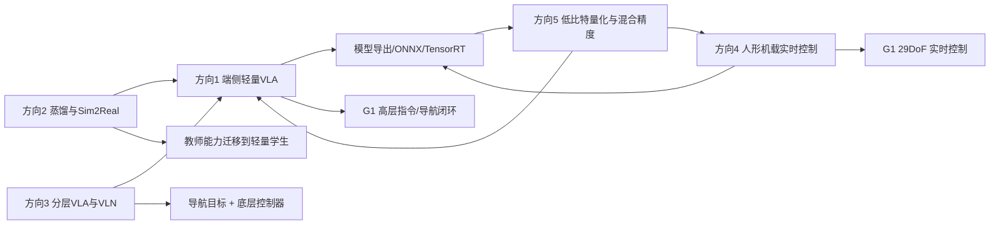
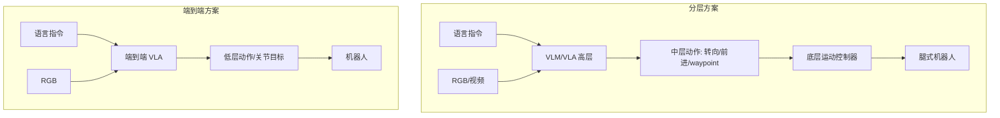
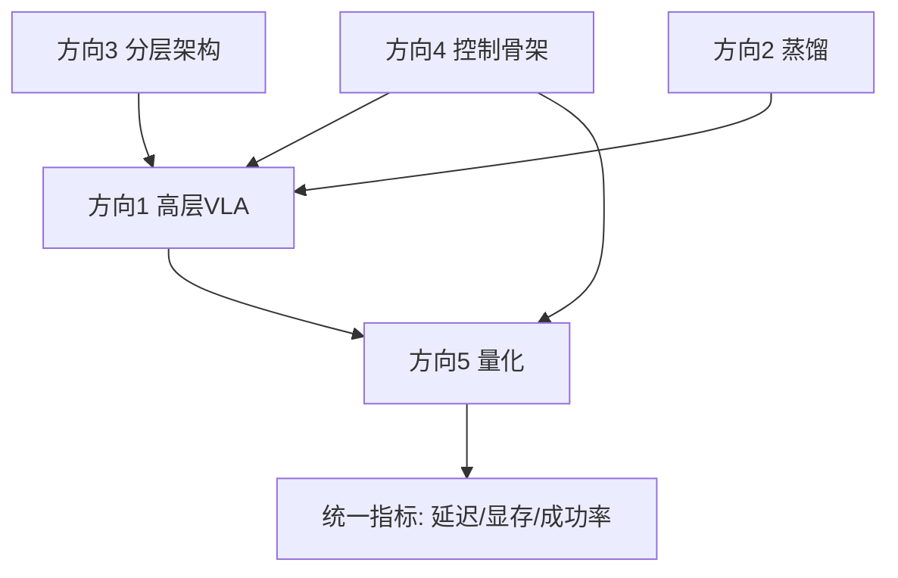

# 五条研究主线总览

> 本文件是资料库总入口。每条主线给出问题定义、技术脉络、核心论文、工程资源、与 G1 的关系和推荐等级。具体实验见 `实验方案/`，具体原文证据见 `论文笔记/`。

---

## 0. 一张图理解五条主线



五条线不是并列的五个“论文篮子”：

- **方向 4 是机器人闭环的地基**：状态、控制周期、安全、关节映射。
- **方向 1 是完整系统的上层入口**：视觉+语言→动作/目标。
- **方向 3 是系统架构选择**：直接端到端，还是高层 VLM + 低层控制器。
- **方向 2 是能力压缩手段**：把大模型能力迁移到小模型。
- **方向 5 是贯穿优化层**：只有作用于真实模型和真实闭环才有意义。

---

## 1. 方向一：端侧轻量 VLA 与端到端部署

### 1.1 研究问题

如何让一个参数量较小（亚十亿到数亿）的视觉—语言—动作模型，在 Orin NX 这样的边缘平台上完成：

```text
RGB/深度 + 语言指令 + 机器人状态
        ↓
      VLA 推理
        ↓
动作块 / waypoint / 高层技能
        ↓
    底层控制器
        ↓
      真实机器人
```

核心不是“模型能不能输出动作”，而是：

- 视觉编码器和语言模型的显存/算力是否可控；
- 动作头是否支持连续动作、动作块（action chunk）或离散 token；
- 输入是否为动态形状，能否被 TensorRT 接受；
- 推理频率与控制频率如何解耦；
- 输出动作是否与目标机器人的自由度、关节顺序、单位一致；
- 失败时是否有安全回退。

### 1.2 技术脉络

| 阶段 | 代表工作 | 主要特征 | 部署含义 |
|---|---|---|---|
| 大模型 VLA | OpenVLA（7B） | Prismatic VLM + Llama，离散动作 token，OXE 大规模预训练 | 能力强但显存/延迟高，官方量化主要是 bitsandbytes，非 TensorRT |
| 小模型 VLA | SmolVLA（约 450M） | SmolVLM-2 + 流匹配动作专家，异步推理 | 单卡可训练、消费级 GPU/CPU 可推理，工程参考价值高 |
| 端侧导航模型 | MiniCPM-RobotTrack | 轻量多模态模型 + 跟踪 waypoint | 官方 Go2 部署链完整，但不是 G1 关节策略 |
| 语义保持轻量 VLA | Evo-1（0.77B） | 原生多模态主干 + 交叉调制 DiT + 两阶段训练 | 模型效率好，但真机为 xArm6，非人形 |
| 量化协同 | QVLA / FoldQuantVLA / SQIL | 通道级混合精度、W4A4、显著性 QAT | 说明“算法压缩率”和“真实 TensorRT 加速”必须分开评价 |

### 1.3 核心论文与项目

| 类型 | 论文/项目 | 发表/状态 | 为什么选它 | 与 G1 的关系 |
|---|---|---|---|---|
| 核心 | **SmolVLA** | arXiv 2506.01844，2025；本次未核实正式会议页 | 小模型、异步推理、LeRobot 生态完整 | 可作为高层 VLA 参考，不是 G1 策略 |
| 核心 | **OpenVLA** | CoRL 2024，PMLR 270 | 开源 VLA 基线，量化与微调生态成熟 | 7B 不适合 Orin NX 直接闭环，可做对照 |
| 工程 | **MiniCPM-RobotTrack** | 官方模型/代码，非论文 | 真实 Go2 端侧部署、ONNX/TensorRT、waypoint 输出 | 可借鉴工程拆分，不能直接控制 G1 |
| 扩展 | **Evo-1** | CVPR 2026，pp. 13397–13406 | 0.77B、2.3 GB 显存、16.4 Hz（RTX 4090D） | 证明小模型可行，但平台不是 Jetson/G1 |

### 1.4 推荐等级

**B+：值得做，但应定位为“高层 VLA + 独立底层控制”，而不是端到端关节控制。**

关键原因：

- SmolVLA/OpenVLA 的官方真机平台是机械臂，不是人形；
- G1 的 29DoF 动作空间与机械臂 7DoF 差异巨大；
- 直接让 VLA 输出 29 维关节动作需要大量 G1 遥操作数据，超出“部署型”研究范围；
- 更现实的方案是 VLA 输出导航目标、抓取目标、技能标签或末端目标，由底层控制器执行。

---

## 2. 方向二：感知蒸馏与 Sim-to-Real 部署协同

### 2.1 研究问题

能否把大教师模型的感知/语义能力迁移到小学生在 Orin NX 上实时运行，同时在真实环境中保持鲁棒性？

需要区分三类工作：

1. **真正的知识蒸馏**：教师输出 logits、特征、动作或轨迹监督学生；例如 Miki 的教师—学生特权信息蒸馏、VITA-VLA 的动作专家蒸馏。
2. **语义对齐/表示保持**：不是蒸馏，而是训练时避免破坏预训练 VLM 的语义空间；例如 Evo-1 的两阶段训练。
3. **Sim-to-Real 域适应**：通过随机化、真实数据微调、在线适应缩小仿真—现实差距。

### 2.2 核心论文

| 论文 | 类型 | 教师/学生 | 监督信号 | 机器人/平台 | 部署价值 |
|---|---|---|---|---|---|
| **Miki et al., Science Robotics 2022** | 特权信息蒸馏 + Sim-to-Real | 教师用特权信息，学生用本体感知+深度/高度图 | 教师动作/潜变量 | ANYmal 四足 | 经典范式；证明学生可在机载实时运行 |
| **VITA-VLA** | 动作专家蒸馏 | 预训练小动作模型 → VLM | 动作空间对齐 + 动作 token | 机械臂（真机 5 任务） | 训练成本低；但代码链接不完整 |
| **Evo-1** | 语义保持（非蒸馏） | 无教师—学生 | 两阶段训练 | xArm6 | 0.77B 效率好；部署参考价值大于蒸馏价值 |

### 2.3 关键结论

- 蒸馏不是“免费压缩”：需要教师可访问、学生结构匹配、监督信号设计合理。
- 对 Orin NX，最值得借鉴的是 **Miki 的“特权信息只用于教师，学生只看可部署观测”** 思想，而不是照搬其四足网络。
- 25 ms 推理目标需要拆解：若控制周期 50 Hz（20 ms），25 ms 单次推理已经超周期；必须使用动作块、异步推理或降低高层频率。
- 不建议把 Evo-1 误归为蒸馏工作；它的贡献是“保持语义对齐的两阶段训练”。

### 2.4 推荐等级

**C+：阅读价值高，首项工程复现价值低。**

适合做：

- 在公开数据集上复现一个小型 feature/logit 蒸馏对照；
- 把蒸馏作为方向 1 的“模型压缩”补充；
- 用 Miki 的范式设计一个“教师用仿真特权信息、学生用真实可观测”的教学实验。

不适合做：

- 从零训练教师模型；
- 在没有真实机器人数据的情况下宣称 Sim-to-Real 成功；
- 把 Evo-1 的两阶段训练写成知识蒸馏。

---

## 3. 方向三：分层 VLA 与腿式视觉语言导航

### 3.1 研究问题

机器人应当让 VLA 直接输出底层关节动作，还是输出中层指令（方向、距离、waypoint、技能），再由底层控制器执行？



### 3.2 核心论文

| 论文 | 发表 | 架构 | 输出 | 真实平台 | 对 G1 的启示 |
|---|---|---|---|---|---|
| **NaVILA** | RSS 2025，DOI 10.15607/RSS.2025.XXI.018 | VLM 高层 + 视觉运动策略低层 | 中层语言动作（如转向角度） | 腿式机器人 | 最接近“高层 VLM + G1 底层控制器”的模块化思路 |
| **Uni-NaVid** | RSS 2025，DOI 10.15607/RSS.2025.XXI.013 | 视频型 VLA，多任务统一 | 导航动作/waypoint（按论文任务） | 真实机器人 | 说明视频时序与统一任务的价值，但训练/数据门槛高 |
| **Mobility VLA** | CoRL 2024，PMLR 270:3866–3887 | 长上下文 VLM + 拓扑图 | 图中 waypoint/子目标 | Google 移动机器人 | 强调环境先验和长程规划，非人形 |

### 3.3 关键结论

- 对人形机器人，**分层通常比端到端更可部署**：VLM 运行在 1–5 Hz，底层控制器运行在 50–1000 Hz。
- NaVILA 的“中层语言动作”便于跨 embodiment，但也带来语义解析和底层策略适配问题。
- Uni-NaVid/Mobility VLA 的代码和数据门槛高，不建议作为首个 G1 真机项目。
- G1 做 VLN 还缺：室内定位、地图、局部避障、楼梯/地形安全策略、急停。仅有一个 VLM 不能构成导航系统。

### 3.4 推荐等级

**B：系统架构学习价值高，真机落地应放在方向 4 之后。**

推荐做法：

1. 先在笔记本/仿真中复现 NaVILA 的输入输出和 prompt 协议；
2. 用 G1 的 `/dog_odom` 与固定低速底层控制器做“只输出前进/转向指令”的闭环；
3. 不让 VLM 直接控制关节。

---

## 4. 方向四：人形机器人机载实时控制

### 4.1 研究问题

如何把训练好的人形运动策略，以稳定频率、低延迟、安全的方式部署到 G1 机载计算平台，并形成状态—推理—动作—执行的闭环？

这是与用户现有硬件最匹配的方向，也是最能锻炼部署工程能力的方向。

### 4.2 三个子实验

#### 4a. PredActor

- **论文**：arXiv 2609.24840，预印本（v3），未核实正式会议录用。
- **核心**：仅用本体感知历史 + 可选任务上下文，联合预测动作和未来状态轨迹；支持 classifier-free guidance 和 classifier guidance。
- **G1 证据**：论文报告在 Unitree G1 上部署，Orin NX 上完整回调中位数 16.790 ms、p95 19.383 ms，控制在 20 ms 周期内。
- **代码**：项目页存在，但未提供明确 GitHub 代码/权重链接。
- **判断**：**指标极具参考价值，但不能直接复现**。适合作为“目标性能基线”和架构参考。

#### 4b. instinct_onboard

- **性质**：Project Instinct 的官方机载部署仓库，不是论文。
- **匹配点**：Ubuntu 22.04、ROS 2 Humble、Unitree G1 29DoF、ONNX Runtime、50 Hz 主循环、dry-run、关节限幅保护。
- **缺口**：仓库文件树未发现 ONNX 权重、模型文件或 LICENSE；运行时是 Python；依赖 `unitree_hg`、`crc_module` 等 ROS 2/Unitree 包；需确认与现有 G1 SDK2 环境兼容。
- **判断**：**最值得先拆解的工程入口，但不是“下载即运行”**。

#### 4c. Embrace Collisions

- **论文**：CoRL 2025（项目页与论文可核实），面向接触丰富、动态人形运动。
- **价值**：接触建模、鲁棒控制、Sim-to-Real 的系统性参考。
- **部署门槛**：训练与仿真栈复杂，真实接触场景安全风险高。
- **判断**：**学术拓展价值大于首项工程复现价值**。

### 4.3 核心论文/项目对比

| 项目 | 类型 | 机器人 | 控制频率/延迟 | 代码 | 权重 | G1 适配 |
|---|---|---|---|---|---|---|
| PredActor | 论文 | Unitree G1 | 20 ms 周期；16.790 ms 中位数 | 未确认 | 未确认 | 高（但需重实现） |
| instinct_onboard | 工程 | G1 29DoF | 主循环 50 Hz | 官方 | 仓库无 | 高（需补权重/接口） |
| Embrace Collisions | 论文 | 人形（Project Instinct） | 论文报告为准 | 项目页 | 待核实 | 中（训练门槛高） |
| ExBody | 论文 | Unitree H1 19DoF | 未在本次抽取中核实 | 项目页 | 待核实 | 低（19DoF≠29DoF） |

### 4.4 推荐等级

**A-：最推荐的方向，但第一步不是“跑策略”，而是“建立安全、可观测、可回退的部署骨架”。**

原因：

- 与现有 G1 硬件、ROS 2、C++17 能力最匹配；
- 能形成真实的延迟、抖动、CPU/GPU、内存、控制周期数据；
- 能拆成多个可交付模块：状态适配器、ONNX 推理节点、动作后处理、安全监督、录像/回放。
- 风险是权重缺失和真机安全，必须用 dry-run/仿真先行。

---

## 5. 方向五：VLA 低比特量化与混合精度

### 5.1 研究问题

在 Orin NX 上，如何通过 FP16/INT8/INT4、权重量化/激活量化、通道级混合精度，降低显存和延迟，同时不破坏闭环任务成功率？

### 5.2 核心论文

| 论文 | 发表 | 方法 | 平台/模型 | 关键结果 | 部署现实性 |
|---|---|---|---|---|---|
| **FoldQuantVLA** | arXiv 2609.24433，预印本 | 一致折叠 + SmoothQuant + 块 Hadamard + GPTQ + TensorRT 插件 | GR00T N1.5–1.7、π0.5；AGX Orin/Ada | Orin 1.20–1.33×；W4A4→W8A8 保留将真机成功率 80.0%→92.5% | 高价值但插件移植成本高 |
| **SQIL** | ICCV 2025 | 显著性感知 QAT + 选择性损失加权 | 4-bit 权重 VLA，边缘 GPU | 2.5× 加速、4× 显存降低、2.5× 节能 | 需要训练/微调，非纯 PTQ |
| **QVLA** | ICLR 2026 | 通道级 bit 分配（0/2/4/8/16）+ 敏感度 | OpenVLA-OFT，LIBERO | 29.2% 显存、98.9% 性能、1.49× 加速 | 目前主要是 PyTorch fake-quant，非 TensorRT 原生 |

### 5.3 关键概念区别

- **权重量化（W4A16）**：只压缩权重，激活仍 FP16；工程简单，但算力收益有限。
- **权重+激活量化（W4A4/W8A8）**：真正走整数张量核心，需要校准和算子支持。
- **PTQ**：训练后量化，成本低，但可能对动作精度敏感。
- **QAT**：量化感知训练，通常更稳，但需要训练资源与数据。
- **通道级混合精度**：不同通道用不同位宽，压缩率高，但部署需要自定义 kernel/插件。
- **KV Cache 量化**：只对自回归生成有效；对一次性动作块的 VLA，收益取决于解码结构。

### 5.4 TensorRT 10.3 的现实边界

- TensorRT 对标准 Q/DQ、INT8 卷积/矩阵乘有支持，但**不会自动支持论文中的自定义 W4A4 插件**。
- FoldQuantVLA 使用 CUDA + CUTLASS 自定义 plugin，并按 `(SM, TensorRT major.minor)` 缓存；Orin NX 与 AGX Orin 同为 sm_87，但算力/带宽不同且 engine 与 TensorRT 版本、插件 ABI 绑定，仍应在目标机重建。
- QVLA 的通道级 0/2/4/8/16 bit 分配目前不是标准 TensorRT 能力，需要自己实现 kernel 或退化为伪量化评估。
- 因此，**量化论文的“压缩率”不能直接换算为 Orin NX 的“加速比”**。

### 5.5 推荐等级

**B：必须做，但作为方向 1/4 的优化章节，而不是独立主线。**

推荐实验顺序：

1. FP16 baseline；
2. TensorRT 标准 INT8（有校准集）+ 敏感层回退；
3. W4A16（若工具链支持）；
4. 论文级 W4A4/通道混合精度（仅在有能力写 plugin 时）；
5. 统一评价：显存、p50/p95 延迟、吞吐、动作误差、闭环成功率。

---

## 6. 横向关系与依赖



- **先做方向 4 的骨架**，否则方向 1/3 的输出没有安全执行通道。
- **方向 1 先做高层输出**，不要一开始做 29DoF 端到端。
- **方向 3 提供架构选择**，但不应急于上真机。
- **方向 2 是选做**，适合已有训练基础后补充。
- **方向 5 必须绑定一个具体模型和闭环任务**，否则只是工具链练习。

---

## 7. 每条主线的延伸阅读清单

以下是“相关论文/工程”，不替代核心笔记；用于补齐技术脉络。

### 方向 1 延伸

| 工作 | 类型 | 链接 | 阅读理由 |
|---|---|---|---|
| TinyVLA | 小模型 VLA | https://arxiv.org/abs/2409.12514 | 另一条亚十亿参数 VLA 路线 |
| π0 | 流匹配 VLA | https://arxiv.org/abs/2410.24164 | 连续动作专家与大规模预训练 |
| Octo | 开源通用策略 | https://arxiv.org/abs/2405.12213 | 与 OpenVLA 对照的通用机器人策略 |
| RoboMamba | 高效机器人 Mamba | https://arxiv.org/abs/2406.04339 | 非 Transformer 的高效路线 |

### 方向 2 延伸

| 工作 | 类型 | 链接 | 阅读理由 |
|---|---|---|---|
| RMA | 快速运动适应 | https://arxiv.org/abs/2107.04034 | 特权信息/在线适应的经典对照 |
| DreamWaQ | 本体感知世界模型 | https://arxiv.org/abs/2301.10602 | 无视觉/有视觉的鲁棒运动 |
| Rapid Locomotion | 大规模并行 RL | https://arxiv.org/abs/2205.02824 | 训练效率与 Sim-to-Real |
| Egocentric Vision Locomotion | 第一视角感知运动 | https://arxiv.org/abs/2211.07638 | 视觉感知与运动结合 |

### 方向 3 延伸

| 工作 | 类型 | 链接 | 阅读理由 |
|---|---|---|---|
| VLN-CE | 连续环境 VLN | https://arxiv.org/abs/1904.04166 | 理解 VLN 任务定义 |
| SayCan | 高层语言规划 | https://arxiv.org/abs/2204.01691 | 语言模型+技能选择 |
| ViNT | 视觉导航基础模型 | https://arxiv.org/abs/2306.14846 | 目标图像导航 |
| NoMaD | 扩散导航策略 | https://arxiv.org/abs/2310.07896 | 多目标导航与扩散 |

### 方向 4 延伸

| 工作 | 类型 | 链接 | 阅读理由 |
|---|---|---|---|
| Deep Whole-Body Control | 全身控制 | https://arxiv.org/abs/2303.03381 | 人形/四足全身控制基础 |
| ASAP | Sim-to-Real 对齐 | https://arxiv.org/abs/2502.01143 | 真实—仿真动力学对齐 |
| H2O | 人形实时遥操作 | https://arxiv.org/abs/2403.04436 | 人形动作接口与实时性 |
| Humanoid Parkour | 动态运动 | https://project-instinct.github.io | Project Instinct 的跑酷工作 |

### 方向 5 延伸

| 工作 | 类型 | 链接 | 阅读理由 |
|---|---|---|---|
| SmoothQuant | 激活量化 | https://arxiv.org/abs/2211.10438 | W8A8 基础 |
| GPTQ | 权重量化 | https://arxiv.org/abs/2210.17323 | 逐层舍入 |
| AWQ | 权重量化 | https://arxiv.org/abs/2306.00978 | 激活感知权重保护 |
| TensorRT Developer Guide | 部署文档 | https://docs.nvidia.com/deeplearning/tensorrt/developer-guide/ | Q/DQ、INT8、插件约束 |

---

## 8. 每条主线的“最小可交付物”

| 方向 | 最小可交付物 | 可写进简历的证据 |
|---|---|---|
| 1 | 一个 VLA 在 RTX 4070 上导出 ONNX、在 Orin NX 上 FP16 推理，输出高层动作，附延迟/显存表 | ONNX/TensorRT 转换、ARM64 部署、闭环架构 |
| 2 | 一个教师—学生蒸馏对照（公开数据集），附精度/延迟/显存 | 蒸馏训练、模型压缩、指标对照 |
| 3 | 一个分层导航指令协议 + 仿真闭环，不接 G1 关节 | 分层系统设计、VLM 服务、ROS 2 解耦 |
| 4 | G1 dry-run 状态—推理—动作链路 + 50 Hz 抖动/延迟报告 + 安全监督 | 真实机器人部署、实时控制、安全设计 |
| 5 | FP16/INT8（可选 W4A4）在同一模型上的公平对照 + 闭环成功率 | 量化、TensorRT、误差分析 |

---

## 9. 最终建议

**先 4b（骨架）→ 1（高层 VLA）→ 5（量化）→ 3（分层导航）→ 2（蒸馏，选做）。**

这不是否认方向 3/2 的价值，而是从“现有硬件、公开资源、安全风险、可交付性”四个约束下的最优顺序。
