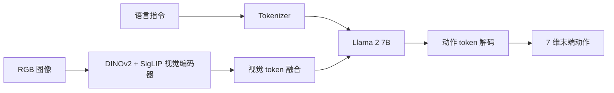

# 精读笔记 01 | OpenVLA: An Open-Source Vision-Language-Action Model

**中文标题**：OpenVLA：一个开源的视觉—语言—动作模型

- **作者**：Moo Jin Kim, Karl Pertsch, Siddharth Karamcheti, Ted Xiao, Ashwin Balakrishna, Suraj Nair, Rafael Rafailov, Ethan Foster, Grace Lam, Pannag Sanketi, Quan Vuong, Thomas Kollar, Benjamin Burchfiel, Russ Tedrake, Dorsa Sadigh, Sergey Levine, Percy Liang, Chelsea Finn
- **单位**：Stanford、UC Berkeley、Google DeepMind 等（以论文首页为准）
- **发表**：CoRL 2024，PMLR 270
- **arXiv**：2406.09246
- **官方论文**：https://arxiv.org/abs/2406.09246
- **官方代码**：https://github.com/openvla/openvla
- **官方模型**：HuggingFace `openvla/openvla-7b`
- **定位**：方向 1 的大模型基线；理解 VLA 的基本接口、动作离散化、量化与微调，但不作为 Orin NX 实时闭环方案。

---

## 一句话总结

OpenVLA 把 7B 视觉语言模型改造成能输出机器人动作的开源 VLA，用大规模机器人数据预训练并在真实机械臂上验证；它证明了“VLM 直接生成动作 token”的可行性，但也把参数量、推理延迟和部署成本问题暴露得很清楚。

---

## 1. 研究背景：为什么需要这项工作

在 OpenVLA 之前，机器人策略大致有三类：

1. **传统控制/规划**：依赖精确模型，难以处理开放语言指令和杂乱场景。
2. **任务专用模仿学习**：每个任务单独采数据、单独训练，泛化差。
3. **闭源机器人基础模型**：如 RT-2，能力强但模型、数据、训练细节不公开，学界难以复现和二次开发。

OpenVLA 的目标是做一个**开放的、可复现的、跨机器人本体**的 VLA 基线：

- 用公开机器人数据预训练；
- 用公开 VLM 作为骨干；
- 公开代码、权重和微调方法；
- 在真实机器人上验证语言条件操作。

它的意义不是“解决所有机器人问题”，而是给后续研究提供一个可比较的起点。

---

## 2. 论文核心贡献

1. **开源 7B VLA**：基于 Prismatic-7B VLM，公开权重与训练/微调代码。
2. **大规模机器人预训练**：使用 Open X-Embodiment（OXE）约 97 万条机器人轨迹。
3. **动作离散化接口**：把连续 7 维末端动作离散为 256 个 bin 的 token，让语言模型用 next-token prediction 生成动作。
4. **参数高效微调**：支持 LoRA，降低下游任务微调成本。
5. **量化推理探索**：使用 bitsandbytes 的 4-bit/8-bit 量化降低显存。
6. **真实机器人评估**：在多种物体、指令和场景下与 RT-2-X 等基线比较。

需要区分：

- **真正创新**：把开放 VLM、OXE 数据、动作 token 化和开源生态组合成一个强基线；
- **工程组合**：DINOv2/SigLIP 视觉特征、Llama 2 解码器、LoRA、bitsandbytes 都是已有技术。

---

## 3. 整体技术架构

### 数据流

1. 图像经过 DINOv2 和 SigLIP，得到视觉特征；
2. 视觉特征映射到语言模型 token 空间；
3. 语言指令被 tokenize；
4. 视觉 token 与文本 token 拼接，送入 Llama 2；
5. 模型自回归生成动作 token；
6. 动作 token 反离散化为连续动作；
7. 机器人执行末端增量动作。

---

## 4. 核心方法详解

### 4.1 动作 token 化

**通俗解释**：把连续关节/末端数值切成 256 个“档位”，让语言模型像预测下一个词一样预测动作档位。

**专业定义**：对每个动作维度，按训练数据的 1%/99% 分位数截断，再均匀离散为 256 个 bin；模型输出对应 token，推理时取 bin 中心或期望。

**部署影响**：

- 输出是离散 token，需要反量化；
- 动作精度受 bin 数限制；
- 自回归解码可能较慢；
- 不适合高频率、连续关节控制。

### 4.2 视觉—语言融合

Prismatic VLM 将 DINOv2（空间细节）与 SigLIP（语义）特征拼接，再投影到 Llama 的嵌入空间。这样既保留细粒度空间信息，又利用语义预训练。

### 4.3 微调与量化

- LoRA：只训练低秩适配器，降低显存；
- 4-bit/8-bit：bitsandbytes 量化，主要是权重量化，不是 TensorRT INT8；
- 量化后仍可运行，但延迟和吞吐需单独测。

---

## 5. 模型结构与输入输出

| 项目 | 内容 |
|---|---|
| 参数量 | 7B |
| 视觉编码器 | DINOv2 + SigLIP |
| 语言模型 | Llama 2 7B |
| 输入 | 单帧 RGB + 语言指令 |
| 输出 | 7 维末端增量动作（离散 token） |
| 动作空间 | 机械臂末端平移/旋转/夹爪 |
| 历史 | 主要单帧（无长历史） |
| 训练数据 | OXE 约 970k 轨迹 |

### 未报告/需核实

- Orin NX 上的官方延迟：未报告；
- TensorRT 官方支持：未报告；
- 29DoF 人形动作：不支持；
- 闭环控制频率：论文主要报告推理/评估设置，未针对 Orin NX。

---

## 6. 数据集与实验设计

### 数据

- Open X-Embodiment：多机器人、多任务、多场景；
- 下游任务使用少量演示进行微调；
- 图像分辨率与归一化按模型配置。

### 评估

- 真实机械臂操作任务；
- 语言条件；
- 与 RT-2-X、Octo 等基线比较；
- 关注泛化到新物体/新指令。

### 公平性注意

- 不同方法的预训练数据、模型规模、动作空间不同；
- “跨本体”不等于“任意本体可直接部署”；
- 真实任务数量有限，成功率方差需关注。

---

## 7. 实验结果详解

论文的核心结论：

1. OpenVLA 在多种真实操作任务上优于同类开源基线；
2. 大规模 OXE 预训练带来明显泛化收益；
3. LoRA 微调能以较低成本适配新任务；
4. 4-bit/8-bit 量化可降低显存，但会带来性能/速度权衡。

**本笔记不复制未经本次原文表格核对的具体百分比**。需要精确数字时，查阅论文 Results 表格与附录。

---

## 8. 部署视角分析

### 8.1 ONNX 导出

- 7B Llama + 双视觉编码器，计算图大；
- 自回归动作 token 生成包含循环/动态长度；
- 视觉编码器可单独导出，语言模型部分较复杂；
- 需要固定输入分辨率、序列长度和动作维度。

### 8.2 TensorRT

- 官方未提供 TensorRT 路径；
- bitsandbytes 量化不等于 TensorRT INT8；
- 7B 模型在 Orin NX 16 GB 统一内存上很难同时满足模型、KV cache、图像缓冲和系统开销；
- 即使能加载，实时闭环频率也很低。

### 8.3 适合的部署方式

- **离线评估**：在 RTX 4070 上做小规模推理/微调实验；
- **外部服务**：把 OpenVLA 放笔记本/服务器，G1 只接收高层动作；
- **量化对照**：作为“大模型量化”的反面/上限对照，而不是 G1 主策略。

### 8.4 结论

**暂不建议在 Orin NX 上做 OpenVLA 实时闭环。**  
适合作为方向 1 的基线、方向 5 的量化对照和论文阅读入口。

---

## 9. 论文局限性

### 作者承认/论文体现

- 动作空间主要是机械臂末端，不是人形全身；
- 单帧输入，缺乏长时序记忆；
- 推理成本高；
- 跨本体泛化仍有限。

### 我们的部署分析

- 7B 参数量与 Orin NX 实时控制不匹配；
- 离散动作 token 不适合 50 Hz 关节控制；
- 官方量化不是 TensorRT 原生；
- 缺少 ROS 2/DDS/安全层；
- 不能直接把 7 维动作映射到 G1 29DoF。

---

## 10. 初学者概念速查表

| 术语 | 通俗解释 | 在本文中的作用 |
|---|---|---|
| VLA | 看图、听指令、输出动作的模型 | 论文主体 |
| OXE | 大型多机器人数据集 | 预训练数据 |
| 动作 token | 把动作数值变成词表中的 token | 让 LLM 生成动作 |
| LoRA | 只训练小适配器 | 低成本微调 |
| bitsandbytes | 一种低比特量化库 | 降低显存 |
| 自回归 | 一个 token 一个 token 生成 | 动作解码方式 |

---

## 11. 整体评价与实际应用价值

### 最值得学习

- VLA 的输入输出接口设计；
- 大规模机器人数据预训练 + 小数据微调的范式；
- 动作离散化的取舍；
- 开源生态对复现的重要性。

### 最有部署价值

- 视觉编码器/语言模型分模块导出；
- 量化对照方法；
- 作为“大模型上限”与“小模型”比较。

### 不值得投入时间

- 试图把 7B OpenVLA 直接部署到 Orin NX 做 50 Hz；
- 直接套用到 G1 29DoF。

### 可结合方向

- 方向 5：FP16/INT8 对照；
- 方向 1：与 SmolVLA 做大小模型对比；
- 方向 2：作为教师模型（成本高，需谨慎）。

---

## 12. 延伸阅读

| 工作 | 链接 | 推荐理由 |
|---|---|---|
| OpenVLA 官方仓库 | https://github.com/openvla/openvla | 代码、权重、微调脚本 |
| Open X-Embodiment | https://robotics-transformer-x.github.io/ | 数据背景 |
| RT-2 | https://arxiv.org/abs/2307.15818 | 闭源前作，理解 VLA 脉络 |
| Octo | https://arxiv.org/abs/2405.12213 | 开源通用机器人策略对照 |
| SmolVLA | https://arxiv.org/abs/2506.01844 | 轻量替代路线 |
