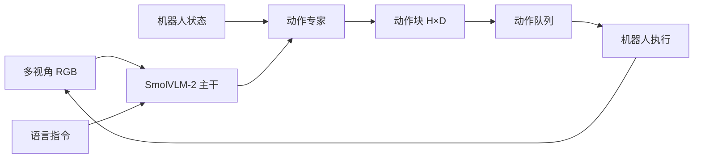

# 精读笔记 02 | SmolVLA: A Vision-Language-Action Model for Affordable and Efficient Robotics

**中文标题**：SmolVLA：面向低成本、高效率机器人的视觉—语言—动作模型

- **作者**：Mustafa Shukor, Dana Aubakirova, Francesco Capuano, Pepijn Kooijmans, Steven Palma, Adil Zouitine, Michel Aractingi, Caroline Pascal, Martino Russi, Andres Marafioti, Simon Alibert, Matthieu Cord, Thomas Wolf, Remi Cadene
- **单位**：Hugging Face 等（arXiv 摘要页未列单位，以论文首页为准）
- **发表**：arXiv 2506.01844，2025；本次核验未发现正式会议页
- **DOI**：10.48550/arXiv.2506.01844
- **官方论文**：https://arxiv.org/abs/2506.01844
- **官方代码**：https://github.com/huggingface/lerobot
- **定位**：方向 1 的核心轻量 VLA；最接近“消费级 GPU/边缘设备可部署”的开源候选，但官方任务为机械臂，不是 G1 全身控制。

---

## 一句话总结

SmolVLA 用一个约 4.5 亿参数的小型 VLA，把预训练 VLM、流匹配动作专家、异步推理和社区机器人数据结合起来，证明小模型也能在消费级硬件上完成语言条件操作；它的部署价值在于“小”和“异步解耦”，而不是人形全身控制。

---

## 1. 研究背景：为什么需要这项工作

现有 VLA 的问题：

1. **模型太大**：OpenVLA 7B、π0 3.5B，训练和推理成本高。
2. **依赖大机构数据**：普通研究者难以获得大规模机器人数据。
3. **推理同步**：感知→动作→执行串行，控制频率低。
4. **硬件门槛高**：官方往往只在高端 GPU 上验证。

SmolVLA 的目标：

- 单 GPU 可训练；
- 消费级 GPU 甚至 CPU 可推理；
- 利用社区采集的低成本机器人数据；
- 通过异步推理提高响应性；
- 保持与 10 倍大模型竞争的性能。

---

## 2. 论文核心贡献

1. **约 450M 参数的小型 VLA**：基于 SmolVLM-2，显著降低模型规模。
2. **流匹配动作专家**：用连续动作生成替代离散 token，适合精细操作。
3. **异步推理栈**：感知/动作预测与动作执行解耦，支持动作块。
4. **层跳过与视觉 token 缩减**：降低计算量。
5. **社区数据训练**：强调低成本机器人平台采集的数据。
6. **完整开源**：代码、预训练模型、训练数据进入 LeRobot 生态。

---

## 3. 整体技术架构



### 异步推理

```text
线程 A：感知 + VLA 推理 → 生成动作块 → 放入队列
线程 B：从队列取动作 → 以更高频率执行 → 队列不足时请求新块
```

这样高层推理不必每个控制周期都完成，适合边缘设备。

---

## 4. 核心方法详解

### 4.1 SmolVLM-2 主干

- 视觉编码器 + 小型语言模型；
- 视觉 token 经过压缩/跳层，减少计算；
- 语言指令与视觉特征融合。

### 4.2 流匹配动作专家

**通俗解释**：从噪声出发，逐步“去噪”成一条动作轨迹；相比离散 token，更适合连续控制。

**专业定义**：学习一个时间条件速度场，把噪声动作积分到目标动作分布；训练目标为预测速度场与真实速度场的均方误差。

**部署影响**：

- 需要多步去噪，推理步数是延迟关键；
- 可用蒸馏减少步数；
- ONNX/TensorRT 对迭代循环支持需验证；
- 动作块可摊薄单步成本。

### 4.3 动作块与异步执行

- 一次推理生成 H 步动作；
- 执行器按固定频率取用；
- 若新块未到，使用剩余动作/插值/安全保持；
- 需要时间戳和队列管理，避免动作过期。

### 4.4 层跳过与 token 缩减

减少 VLM 层数/视觉 token 数，直接降低计算量；代价是语义/空间细节损失，需要在任务上评估。

---

## 5. 模型结构与输入输出

| 项目 | 内容 |
|---|---|
| 参数量 | 约 450M |
| 主干 | SmolVLM-2 |
| 动作头 | 流匹配动作专家 |
| 输入 | 多视角 RGB + 语言 + 机器人状态 |
| 输出 | 连续动作块 `[H, D]` |
| 动作空间 | 机械臂（以官方配置为准） |
| 推理 | 支持异步、动作块 |
| 官方平台 | 低成本机械臂/LeRobot 生态 |

### 未报告/需核实

- Orin NX 官方延迟：未报告；
- TensorRT 官方支持：未报告；
- G1 29DoF：不支持；
- 50 Hz 全身控制：不适用。

---

## 6. 数据集与实验设计

### 数据

- 社区采集的机器人数据（LeRobot 生态）；
- 多任务、多场景；
- 数据格式统一，便于训练。

### 评估

- 仿真基准；
- 真实低成本机械臂；
- 与更大 VLA 比较；
- 关注成功率、训练成本、推理效率。

### 公平性注意

- 不同模型的数据集/预训练不同；
- “与 10 倍大模型可比”是特定任务结论，不是普遍规律；
- 真实任务数量与方差需看原文。

---

## 7. 实验结果详解

论文报告的核心结论：

1. 小模型在多个任务上与大模型可比；
2. 单 GPU 可训练；
3. 异步推理提升响应性；
4. 代码/权重/数据开放。

**具体成功率、延迟、显存数值需查阅论文表格**；本笔记不把摘要级结论扩写成未核实的精确数字。

---

## 8. 部署视角分析

### 8.1 ONNX 导出

- VLM 主干可尝试导出；
- 流匹配动作专家的迭代去噪是动态循环，ONNX 需展开或使用脚本化；
- 多视角输入、语言 tokenizer、状态拼接需要固定接口；
- 视觉预处理可能是端到端瓶颈。

### 8.2 TensorRT

- 官方无 TensorRT 路径；
- 需自行拆分视觉编码器/语言模型/动作专家；
- 动作专家多步去噪可用固定步数展开；
- 动态 shape 需固定分辨率/批量。

### 8.3 Orin NX

- 450M 参数比 7B 现实得多；
- 但 16 GB 统一内存仍需给系统、相机、ROS 2 留余量；
- 目标不应预设 50 Hz，先测 1–10 Hz 高层推理；
- 动作块+异步可弥补低推理频率。

### 8.4 G1

- 官方动作空间不是 G1；
- 最合理用途：输出高层技能/waypoint/末端目标；
- 由 G1 安全技能层执行；
- 不应直接输出 29 关节。

**结论：需适配后复现，适合作为方向 1 的主模型。**

---

## 9. 论文局限性

### 作者承认/论文体现

- 模型仍可能在复杂任务上弱于大模型；
- 社区数据质量参差；
- 异步推理带来队列/时序复杂性。

### 我们的部署分析

- 非人形、非 G1；
- 无 TensorRT 官方支持；
- 动作块与底层控制频率需匹配；
- 真实机器人安全层缺失；
- 量化后动作精度需单独评估。

---

## 10. 初学者概念速查表

| 术语 | 通俗解释 | 在本文中的作用 |
|---|---|---|
| VLM | 看图+语言的模型 | SmolVLA 的主干 |
| 流匹配 | 从噪声逐步生成动作轨迹 | 动作专家 |
| 动作块 | 一次生成多步动作 | 降低推理频率压力 |
| 异步推理 | 推理与执行分开 | 提高响应性 |
| 层跳过 | 少算几层 | 降计算量 |
| LeRobot | Hugging Face 的机器人软件栈 | 代码/数据/模型入口 |

---

## 11. 整体评价与实际应用价值

### 最值得学习

- 小模型 VLA 的完整工程栈；
- 异步推理与动作块设计；
- 消费级硬件部署思路；
- 开源数据/模型生态。

### 最有部署价值

- 高层 VLA 推理服务；
- 动作块队列与安全层；
- FP16/INT8 对照。

### 不值得投入时间

- 直接把 SmolVLA 输出映射到 G1 29DoF；
- 期待官方 TensorRT 一键部署；
- 在 Orin NX 上追求 50 Hz VLA。

### 可结合方向

- 方向 5：量化对照；
- 方向 3：高层指令；
- 方向 4：底层控制解耦。

---

## 12. 延伸阅读

| 工作 | 链接 | 推荐理由 |
|---|---|---|
| LeRobot | https://github.com/huggingface/lerobot | 官方代码/模型/数据 |
| OpenVLA | https://arxiv.org/abs/2406.09246 | 大模型对照 |
| π0 | https://arxiv.org/abs/2410.24164 | 流匹配 VLA 代表 |
| TinyVLA | https://arxiv.org/abs/2409.12514 | 另一条小模型路线 |
| SmolVLM | https://arxiv.org/abs/2504.05299 | 主干模型背景 |
