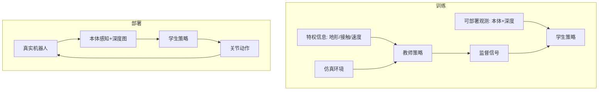

# 精读笔记 03 | Learning Robust Perceptive Locomotion for Quadrupedal Robots in the Wild

**中文标题**：学习野外四足机器人的鲁棒感知运动

- **作者**：Takahiro Miki, Joonho Lee, Jemin Hwangbo, Lorenz Wellhausen, Vladlen Koltun, Marco Hutter
- **单位**：ETH Zurich（Robotic Systems Lab）等
- **发表**：Science Robotics, 2022, 7(67): eabk2822
- **DOI**：10.1126/scirobotics.abk2822
- **arXiv**：2201.08117
- **官方论文**：https://arxiv.org/abs/2201.08117
- **代码**：作者/ETH RSL 公开代码（以论文页与实验室仓库为准；旧依赖需核对）
- **定位**：方向 2 的经典教师—学生 / 特权信息蒸馏范式；不是 VLA，也不是人形，但“教师用特权信息、学生只用可部署观测”的思想对 G1 极有价值。

---

## 一句话总结

论文先用仿真中的特权信息训练一个强大的教师策略，再把它蒸馏给只看本体感知和外部深度/高度图的学生策略，使四足机器人能在雪地、泥地、植被、台阶等野外地形中实时行走；它展示了“训练时用特权信息、部署时只用可获得的传感器”这一 Sim-to-Real 范式的威力。

---

## 1. 研究背景：为什么需要这项工作

四足机器人在野外行走的难点：

- 地形不规则、可变形（雪、泥、植被）；
- 视觉感知有噪声、遮挡、光照变化；
- 真实世界无法获得精确的接触力、摩擦系数、地形高度等“特权信息”；
- 仿真中训练的策略容易过拟合仿真，迁移到现实失败。

传统方法：

1. **纯本体感知盲走**：对地形变化反应慢；
2. **纯视觉端到端**：样本效率低、Sim-to-Real 困难；
3. **模型-based 规划**：依赖精确地图/动力学，复杂地形易失败。

论文的思路：**训练时让教师看“上帝视角”的特权信息，部署时让学生只看真实传感器能提供的信息**。

---

## 2. 论文核心贡献

1. **教师—学生蒸馏框架**：教师使用特权信息，学生学习可部署观测。
2. **学生输入设计**：本体感知 + 外部深度图/高度图，兼顾反应速度与地形预判。
3. **信念状态/历史编码**：学生维护对地形和接触的隐式估计。
4. **大规模域随机化**：地形、摩擦、负载、传感器噪声等。
5. **真实野外实验**：雪地、泥地、植被、台阶、溪流等。
6. **机载实时运行**：策略部署在机器人机载计算机上。

---

## 3. 整体技术架构

### 关键点

- 教师只在训练时存在；
- 学生输入必须是真实机器人可获得的；
- 学生输出关节目标/动作；
- 历史观测用于估计不可直接观测的状态（接触、地形）。

---

## 4. 核心方法详解

### 4.1 特权信息

教师可访问：

- 精确地形高度/法线；
- 足端接触状态/力；
- 真实速度；
- 摩擦/负载等参数。

这些信息在真实机器人上不可直接获得，因此不能作为部署输入。

### 4.2 学生网络

学生输入：

- 本体感知：关节位置/速度、IMU、上一帧动作；
- 外部感知：深度图或高度图；
- 历史帧。

学生输出：

- 关节动作；
- 可能包含信念状态/潜变量。

### 4.3 蒸馏监督

常见做法：

- 直接回归教师动作；
- 回归教师中间特征/潜变量；
- 用教师 rollout 数据做监督。

**部署影响**：蒸馏信号越接近动作，越容易部署；特征蒸馏可能需要额外对齐。

### 4.4 域随机化

- 地形形状/高度/摩擦；
- 传感器噪声/延迟；
- 负载/质心；
-  actuator 延迟/增益。

目的：让学生对真实世界的不确定性鲁棒。

---

## 5. 模型结构与输入输出

| 项目 | 内容 |
|---|---|
| 教师输入 | 特权信息 + 本体感知 |
| 学生输入 | 本体感知 + 深度/高度图 + 历史 |
| 学生输出 | 关节动作 |
| 网络 | MLP/CNN/RNN 组合（以论文配置为准） |
| 控制 | 关节位置/PD 目标 |
| 部署 | 机载 CPU/GPU（以论文为准） |

### 未报告/需核实

- 精确参数量：本笔记未从原文表格提取；
- 精确推理频率：需查论文实验节；
- G1 29DoF：不适用；
- TensorRT/ONNX：论文未以此为重点。

---

## 6. 数据集与实验设计

### 数据

- 仿真大规模并行 rollout；
- 教师生成监督数据；
- 真实测试在野外地形。

### 评估

- 仿真与真实地形成功率；
- 行走速度/稳定性；
- 对不同地形的泛化；
- 与盲走/纯视觉基线比较。

### 公平性注意

- 真实地形条件难以完全复现；
- 传感器配置不同会影响结果；
- 教师特权信息在真实中不可用，比较时必须区分。

---

## 7. 实验结果详解

论文的核心结论：

1. 学生策略能在多种野外地形行走；
2. 外部感知（深度/高度图）比纯本体感知更有预判能力；
3. 教师—学生蒸馏比直接 RL 更容易训练和迁移；
4. 机载实时运行可行。

**具体成功率/速度数值需查阅论文 Results 与扩展数据**；本笔记不把摘要级结论扩写成未核实数字。

---

## 8. 部署视角分析

### 8.1 可部署性

- 学生网络通常比教师小；
- 输入是真实传感器可获得的；
- 机载实时运行已被论文验证；
- 但传感器标定、时间同步、深度噪声是关键。

### 8.2 对 G1 的迁移

不能直接套用：

- 四足 vs 人形 29DoF；
- 关节顺序/动力学不同；
- 平衡控制更复杂；
- 安全风险更高。

可借鉴：

- 特权信息只用于教师；
- 学生输入设计；
- 历史/信念状态；
- 域随机化；
- 机载性能测量方法。

### 8.3 ONNX/TensorRT

- 学生若是 MLP/CNN，导出相对容易；
- 若含 RNN/动态历史，需固定序列长度；
- 深度图预处理需在 GPU 上优化；
- 论文未提供 TensorRT 路径，需自行实现。

**结论：需较大改造才能用于 G1；但方法论价值高。**

---

## 9. 论文局限性

### 作者承认/论文体现

- 依赖仿真训练；
- 极端地形仍可能失败；
- 传感器配置敏感；
- 教师特权信息不可部署。

### 我们的部署分析

- 四足结论不能直接推人形；
- 深度图在户外/室内光照下差异大；
- 旧代码依赖可能难复现；
- 无 ROS 2/Unitree 接口；
- 训练成本高，不适合作为首项工程。

---

## 10. 初学者概念速查表

| 术语 | 通俗解释 | 在本文中的作用 |
|---|---|---|
| 特权信息 | 真实机器人拿不到的“上帝视角” | 只给教师 |
| 教师—学生 | 大模型教小模型 | 核心训练范式 |
| 学生策略 | 部署时真正运行的网络 | 只看可部署观测 |
| 域随机化 | 训练时随机变化环境 | 提高 Sim-to-Real |
| 信念状态 | 对看不见状态的内部估计 | 处理接触/地形 |
| 高度图 | 地形高度的二维表示 | 学生外部感知 |

---

## 11. 整体评价与实际应用价值

### 最值得学习

- “训练用特权、部署用可观测”的思想；
- 学生输入/历史设计；
- 域随机化与真实测试方法；
- 机载实时性验证。

### 最有部署价值

- 学生网络导出与机载推理；
- 深度图预处理；
- 历史/信念状态管理。

### 不值得投入时间

- 直接复现四足训练栈并套 G1；
- 从零训练教师；
- 把四足步态直接迁移人形。

### 可结合方向

- 方向 2：蒸馏方法论；
- 方向 4：学生策略部署；
- 方向 1：感知编码器设计。

---

## 12. 延伸阅读

| 工作 | 链接 | 推荐理由 |
|---|---|---|
| Learning to Walk in Minutes | https://arxiv.org/abs/2109.11978 | 大规模并行 RL 基础 |
| RMA | https://arxiv.org/abs/2107.04034 | 快速运动适应 |
| ANYmal 野外行走 | Science Robotics 2022 | 本文 |
| Walk These Ways | https://arxiv.org/abs/2212.03238 | 多步态控制 |
| ExBody | https://arxiv.org/abs/2402.16796 | 人形全身控制对照 |
