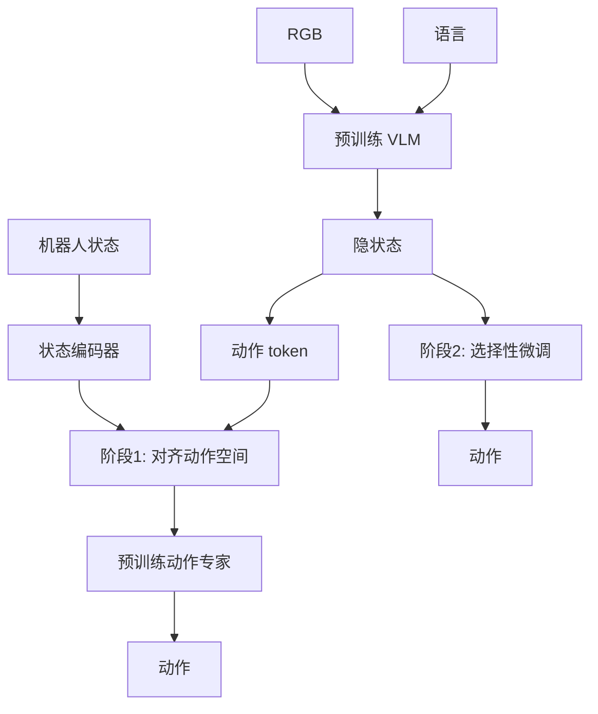

# 精读笔记 04 | VITA-VLA: Efficiently Teaching Vision-Language Models to Act via Action Expert Distillation

**中文标题**：VITA-VLA：通过动作专家蒸馏高效教会视觉语言模型行动

- **作者**：Shaoqi Dong, Chaoyou Fu, Haihan Gao, Yi-Fan Zhang, Chi Yan, Chu Wu, Xiaoyu Liu, Yunhang Shen, Jing Huo, Deqiang Jiang, Haoyu Cao, Yang Gao, Xing Sun, Ran He, Caifeng Shan
- **单位**：arXiv 摘要页未列，需查论文首页
- **发表**：arXiv 2510.09607（v2，2025-10-17）；本次未核实正式会议录用
- **DOI**：10.48550/arXiv.2510.09607
- **官方论文**：https://arxiv.org/abs/2510.09607
- **项目页**：https://ltbai.github.io/VITA-VLA/
- **代码**：摘要页未给出独立代码仓库；项目页是否开放需复核
- **定位**：方向 2 的动作专家蒸馏；重点在“降低 VLA 训练成本”，不是部署运行时优化。

---

## 一句话总结

VITA-VLA 不改动预训练 VLM 的主体，只增加动作 token 和状态编码器，先把 VLM 隐状态对齐到一个小型预训练动作模型的动作空间，再联合微调，从而以较低训练成本让 VLM 获得精确动作能力；它在 LIBERO 和真实机械臂任务上超过了教师模型，但这是一种训练方法，不是边缘部署方案。

---

## 1. 研究背景：为什么需要这项工作

VLA 的常见训练路径：

1. **从零训练大 VLA**：成本极高；
2. **在 VLM 上直接加动作头端到端训练**：容易破坏预训练语义，且需要大量机器人数据；
3. **蒸馏**：用已有小动作模型教 VLM，但如何对齐动作空间、保留语义仍是问题。

VITA-VLA 的观察：

- 已有小型动作模型（action expert）已经会生成精确动作；
- VLM 有强感知/语义，但不会把隐状态映射到动作；
- 如果先把 VLM 隐状态对齐到动作模型的空间，再微调，就能低成本获得动作能力。

---

## 2. 论文核心贡献

1. **动作专家蒸馏框架**：把小动作模型的知识迁移给 VLM。
2. **动作 token + 状态编码器**：在不改 VLM 主体结构的前提下注入物理输入。
3. **两阶段训练**：
   - 阶段 1：轻量对齐，把 VLM 隐状态映射到动作模型空间；
   - 阶段 2：选择性微调语言模型、状态编码器、动作模块。
4. **训练效率**：避免从零预训练大 VLA。
5. **实验结果**：LIBERO 平均 97.3%（+11.8），LIBERO-LONG 93.5%（+24.5）；真实 5 任务 82.0%（+17）。
6. **超过教师**：真实任务上学生表现优于教师模型。

---

## 3. 整体技术架构

### 两阶段

**阶段 1：动作专家对齐**

- 冻结 VLM；
- 训练映射层/动作 token，使 VLM 隐状态能驱动预训练动作专家；
- 复用动作专家的解码能力，避免昂贵预训练。

**阶段 2：选择性微调**

- 解冻语言模型、状态编码器、动作模块；
- 联合优化多模态输入与动作生成；
- 保留视觉主干/大部分语义能力（具体冻结策略以论文为准）。

---

## 4. 核心方法详解

### 4.1 动作 token

**通俗解释**：给 VLM 一个专门的“动作查询位”，让它知道当前要输出动作，而不是继续生成文字。

**作用**：

- 提供动作预测的直接句柄；
- 让 VLM 的隐状态与动作专家接口对齐；
- 避免改动 VLM 整体结构。

### 4.2 状态编码器

机器人状态（关节、末端、夹爪）不在图像/语言中，需要单独编码后注入。这样模型能感知自身动力学。

### 4.3 蒸馏监督

- 阶段 1 的监督来自动作专家的动作空间/输出；
- 不是简单的 logit 蒸馏，而是“隐状态→动作空间”的对齐；
- 阶段 2 用任务动作标签继续优化。

**部署影响**：

- 训练完的模型仍是一个 VLA，需要常规推理优化；
- 蒸馏本身不减少推理计算；
- 教师模型不需要部署。

---

## 5. 模型结构与输入输出

| 项目 | 内容 |
|---|---|
| 主干 | 预训练 VLM（具体型号以论文为准） |
| 动作模块 | 预训练小动作模型/动作专家 |
| 新增 | 动作 token、状态编码器 |
| 输入 | RGB + 语言 + 机器人状态 |
| 输出 | 连续动作（维度以任务为准） |
| 训练 | 两阶段蒸馏 + 微调 |
| 部署 | 仍是 VLM 规模，未针对边缘优化 |

### 未报告/需核实

- 参数量：摘要页未给出；
- Orin NX 延迟：未报告；
- ONNX/TensorRT：未报告；
- G1 29DoF：不支持。

---

## 6. 数据集与实验设计

### 数据

- LIBERO 仿真基准；
- 真实机械臂 5 个任务；
- 演示数据用于微调。

### 评估

- LIBERO 平均/长程成功率；
- 真实任务成功率；
- 与教师模型、其他 VLA 比较；
- 训练成本。

### 公平性注意

- 教师模型/动作专家不同，比较需看配置；
- 真实任务数量有限；
- “超过教师”是特定任务结论，不代表普遍规律。

---

## 7. 实验结果详解

论文报告：

| 基准 | 结果 | 相对提升 |
|---|---:|---:|
| LIBERO 平均 | 97.3% | +11.8% |
| LIBERO-LONG | 93.5% | +24.5% |
| 真实 5 任务 | 82.0% | +17% |

这些数字来自论文摘要/结果部分；具体每任务表格需查原文。  
**不能把 82% 直接外推到 G1**：真实任务是机械臂，不是人形。

---

## 8. 部署视角分析

### 8.1 部署价值

VITA-VLA 的主要价值在**训练效率**：

- 不需要从零训练大 VLA；
- 可复用已有动作专家；
- 适合数据/算力有限的团队。

但它**不解决推理部署**：

- 模型仍是 VLM 规模；
- 没有量化/TensorRT/边缘优化；
- 没有 ROS 2/实时控制。

### 8.2 对 G1 的迁移

- 动作空间是机械臂，不是 29DoF；
- 状态编码器需重设计；
- 需要 G1 演示数据；
- 真机安全层缺失。

**结论：需较大改造；适合作为方向 2 的方法参考，不作为方向 1/4 的直接部署模型。**

---

## 9. 论文局限性

### 作者承认/论文体现

- 依赖预训练动作专家；
- 真实任务规模有限；
- 训练仍需 VLM/机器人数据。

### 我们的部署分析

- 未针对边缘设备；
- 未报告 ONNX/TensorRT；
- 动作空间非人形；
- 代码链接不完整，复现门槛高；
- “超过教师”不等于跨本体泛化。

---

## 10. 初学者概念速查表

| 术语 | 通俗解释 | 在本文中的作用 |
|---|---|---|
| 动作专家 | 专门生成动作的小模型 | 教师 |
| 蒸馏 | 让小模型/新模型学教师 | 核心训练法 |
| 动作 token | VLM 中用于动作的专用 token | 接口 |
| 状态编码器 | 把机器人状态变成向量 | 注入物理信息 |
| 两阶段训练 | 先对齐，再联合微调 | 稳定训练 |
| LIBERO | 机器人操作 benchmark | 评估 |

---

## 11. 整体评价与实际应用价值

### 最值得学习

- 如何在不改 VLM 主体的情况下注入动作能力；
- 两阶段对齐思路；
- 复用预训练动作专家降低训练成本。

### 最有部署价值

- 训练流程；
- 动作 token/状态编码器设计；
- 可作为小模型 VLA 的训练方法。

### 不值得投入时间

- 直接把 VITA-VLA 当边缘部署方案；
- 在没有动作专家/数据的情况下硬复现；
- 套用到 G1 29DoF。

### 可结合方向

- 方向 1：轻量 VLA 训练；
- 方向 2：蒸馏方法论；
- 方向 5：训练后量化。

---

## 12. 延伸阅读

| 工作 | 链接 | 推荐理由 |
|---|---|---|
| VITA-VLA 项目页 | https://ltbai.github.io/VITA-VLA/ | 作者资源 |
| OpenVLA | https://arxiv.org/abs/2406.09246 | VLA 基线 |
| TinyVLA | https://arxiv.org/abs/2409.12514 | 小模型 VLA |
| SmolVLA | https://arxiv.org/abs/2506.01844 | 轻量部署对照 |
| Evo-1 | https://arxiv.org/abs/2511.04555 | 语义保持（非蒸馏）对照 |
