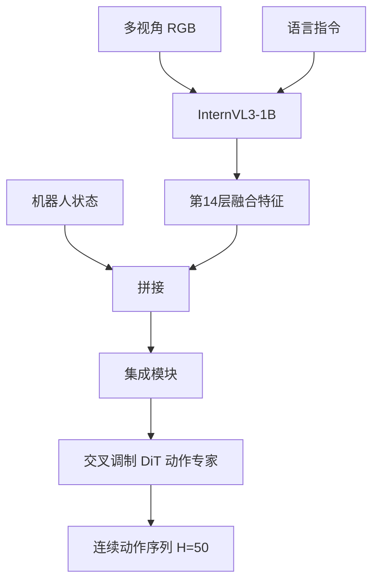

# 精读笔记 05 | Evo-1: Lightweight Vision-Language-Action Model with Preserved Semantic Alignment

**中文标题**：Evo-1：保持语义对齐的轻量视觉—语言—动作模型

- **作者**：Tao Lin, Yilei Zhong, Yuxin Du, Jingjing Zhang, Jiting Liu, Yinxinyu Chen, Encheng Gu, Ziyan Liu, Hongyi Cai, Yanwen Zou, Lixing Zou, Zhaoye Zhou, Gen Li, Bo Zhao
- **单位**：上海交通大学、EvoMind Tech、IAAR-Shanghai、CMU、Cambridge、NTU 等（以论文首页为准）
- **发表**：CVPR 2026，pp. 13397–13406（CVF Open Access 可核实）
- **arXiv**：2511.04555（v2，2025-12-05）
- **官方论文**：https://openaccess.thecvf.com/content/CVPR2026/html/Lin_Evo-1_Lightweight_Vision-Language-Action_Model_with_Preserved_Semantic_Alignment_CVPR_2026_paper.html
- **官方代码**：https://github.com/MINT-SJTU/Evo-1
- **定位**：方向 1 的轻量 VLA 架构参考；方向 2 的“语义保持”对照（不是蒸馏）。

---

## 一句话总结

Evo-1 用 0.77B 的 InternVL3-1B 主干、纯交叉注意力的流匹配 DiT 动作专家和“先冻结对齐、再全量微调”的两阶段训练，在不做大规模机器人数据预训练的情况下取得 LIBERO/Meta-World/RoboTwin 的强结果，并在 xArm6 真机上达到 78% 成功率、16.4 Hz、2.3 GB 显存；它的核心是“别把 VLM 的语义空间训坏”，而不是知识蒸馏。

---

## 1. 研究背景：为什么需要这项工作

现有 VLA 的四个问题（论文明确列出）：

1. **参数大**：常见数十亿参数，显存/算力成本高；
2. **推理慢**：控制频率低，难以实时交互；
3. **语义退化**：端到端训练破坏 VLM 预训练的视觉—语言表示，导致过拟合/泛化差；
4. **依赖大规模机器人数据**：OXE/DROID 采集成本高。

Evo-1 的目标：

- 小模型（0.77B）；
- 不做机器人数据预训练；
- 保持 VLM 语义空间；
- 在消费级 GPU 上可训练/推理。

---

## 2. 论文核心贡献

1. **轻量架构**：InternVL3-1B + 交叉调制 DiT 动作专家 + 集成模块。
2. **两阶段训练**：
   - 阶段 1：冻结 VLM，只训练动作专家/集成模块，对齐动作空间；
   - 阶段 2：解冻 VLM，全量微调。
3. **语义保持**：通过训练策略保留 VLM 的注意力/语义结构。
4. **无需机器人数据预训练**：仅用任务演示。
5. **强结果**：Meta-World 80.6%、RoboTwin 37.8%、LIBERO 94.8%；真机 78%。
6. **效率**：RTX 4090D 上 2.3 GB、16.4 Hz。

> **重要区分**：Evo-1 没有教师—学生蒸馏。它是“两阶段训练 + 语义保持”，不能归入方向 2 的蒸馏论文。

---

## 3. 整体技术架构

### 数据流

1. 图像 resize 到 448×448，像素 unshuffle 降 token；
2. InternVL3-1B 融合视觉/语言；
3. 取第 14 层特征（中间层语义更强）；
4. 与机器人状态拼接（不投影到共享空间，保留信息）；
5. 作为 key/value 输入 DiT；
6. 流匹配去噪生成动作块；
7. 执行前若干步动作。

---

## 4. 核心方法详解

### 4.1 视觉—语言主干

- InternVL3-1B：InternViT-300M + Qwen2.5-0.5B；
- 原生多模态预训练，不是“文本 LLM 后接视觉适配器”；
- 只保留语言分支前 14 层，利用中间层跨模态对齐；
- 视觉 token 通过 pixel unshuffle 降 4 倍。

### 4.2 交叉调制 DiT

**通俗解释**：动作专家只通过交叉注意力“查询”VLM 特征和机器人状态，不自己做自注意力堆叠。

**专业定义**：DiT 的每一层以噪声动作为 query，以 `[VLM 特征; 状态]` 为 key/value，学习流匹配速度场。

**部署影响**：

- 纯交叉注意力结构比交替 self/cross 更简单；
- 迭代去噪步数是延迟关键；
- ONNX 导出需固定步数/展开循环；
- 动作块 H=50 可摊薄推理成本。

### 4.3 集成模块

四种设计（Module A–D）：

- A：中间层 cross-attention，拼接状态作为 KV；
- B：cross/self 交替；
- C：多层特征注入；
- D：VLM+状态+噪声动作联合 KV。

消融显示 A 最好：信息传播连续、不打断。

### 4.4 两阶段训练

阶段 1：

- 冻结 VLM；
- 只训练动作专家 + 集成模块；
- 避免随机梯度破坏预训练语义。

阶段 2：

- 解冻 VLM；
- 全量微调；
- 动作/语义联合适配。

论文用注意力图对比：两阶段保留物体区域注意力；单阶段训练注意力弥散。

---

## 5. 模型结构与输入输出

| 项目 | 内容 |
|---|---|
| 参数量 | 0.77B |
| 主干 | InternVL3-1B（InternViT-300M + Qwen2.5-0.5B） |
| 动作专家 | 交叉调制 DiT，8 层，flow matching |
| 输入 | 多视角 RGB（448×448）+ 语言 + 状态（24 维 padded） |
| 输出 | 动作块 H=50，24 维 padded |
| 真机 | xArm6 6DoF + 平行夹爪 |
| 显存 | 2.3 GB（RTX 4090D 推理） |
| 频率 | 16.4 Hz（RTX 4090D） |
| 训练 | 8×A100；阶段 1 10k 步，阶段 2 65k 步（Meta-World 配置） |

### 未报告/需核实

- Orin NX 延迟：未报告；
- TensorRT/ONNX 官方支持：未报告；
- 人形 29DoF：不支持；
- 真机任务仅 4 个桌面操作。

---

## 6. 数据集与实验设计

### 仿真

- Meta-World：50 任务，每任务 50 演示；
- LIBERO：40 任务，四类；
- RoboTwin：4 个双臂任务，每任务 50 演示。

### 真机

- xArm6 + 平行夹爪；
- 两个 RGB：腕部 + 固定环境相机；
- 每任务 100 条遥操作演示；
- 4 任务：抓放罐、倒泡沫、递送、叠罐；
- 每任务 20 次测试。

### 公平性注意

- 基线结果来自原论文/官方复现；
- 不同模型参数量/预训练差异大；
- 真机任务桌面级，不是人形全身；
- 16.4 Hz 是 RTX 4090D，不是 Orin NX。

---

## 7. 实验结果详解

| 基准 | Evo-1 | 对比 |
|---|---:|---|
| Meta-World 平均 | 80.6% | 超 SmolVLA 68.2%、π0 47.9% |
| LIBERO 平均 | 94.8% | 超 π0 94.2%、SmolVLA 88.8% |
| RoboTwin 平均 | 37.8% | 超 π0 30.9% |
| 真机平均 | 78% | 超 π0 73%、SmolVLA 50% |
| 推理 | 16.4 Hz / 2.3 GB | RTX 4090D |

注意：

- RoboTwin 37.8% 绝对值不高，说明双臂任务仍难；
- 真机 78% 是 4 个桌面任务平均；
- “超过 π0”不意味着跨本体/人形更强。

---

## 8. 部署视角分析

### 8.1 ONNX 导出

- InternVL3 + DiT + 流匹配循环；
- 视觉 token 动态、语言长度可变；
- 动作专家迭代去噪需固定步数；
- 需要分别导出视觉主干/动作专家或整体固定 shape。

### 8.2 TensorRT

- 论文未提供 TensorRT 路径；
- DiT 的 cross-attention 可被 TensorRT 支持，但需验证；
- 流匹配循环可能需展开；
- 2.3 GB 显存说明模型不大，但 Orin NX 的统一内存/带宽仍需实测。

### 8.3 Orin NX

- 0.77B 比 7B 现实；
- 16.4 Hz 是 4090D 桌面 GPU，Orin NX 可能显著更低；
- 动作块 H=50 可降低高层频率压力；
- 需实测 FP16/INT8。

### 8.4 G1

- 输出 24 维 padded 动作，不是 29DoF；
- 真机是 xArm6，不是人形；
- 不能直接部署到 G1；
- 可借鉴架构/训练策略/动作块设计。

**结论：需较大改造；适合作为方向 1 的“轻量架构 + 语义保持”参考，不是 G1 策略。**

---

## 9. 论文局限性

### 作者承认/论文体现

- 真机任务规模有限；
- 依赖任务演示；
- RoboTwin 绝对成功率仍低；
- 未验证人形/腿式。

### 我们的部署分析

- 无 Orin NX/TensorRT 数据；
- 无 29DoF；
- 流匹配迭代延迟；
- 两阶段训练仍需 8×A100；
- 语义保持的注意力图是定性证据，不是部署保证。

---

## 10. 初学者概念速查表

| 术语 | 通俗解释 | 在本文中的作用 |
|---|---|---|
| 语义对齐 | 别让训练把 VLM 的看图/语言能力弄坏 | 核心主张 |
| 流匹配 | 从噪声生成动作轨迹 | 动作专家 |
| DiT | 用 Transformer 做扩散/流匹配 | 动作头 |
| 交叉注意力 | 动作 query 查询 VLM 特征 | 集成方式 |
| 两阶段训练 | 先冻结对齐，再全量微调 | 稳定训练 |
| 动作块 | 一次生成多步 | 提高效率 |

---

## 11. 整体评价与实际应用价值

### 最值得学习

- 轻量 VLA 的模块划分；
- 两阶段训练避免语义退化；
- 中间层特征 + 状态拼接；
- 动作块与流匹配。

### 最有部署价值

- 0.77B 规模；
- 动作块设计；
- 语义保持的训练策略。

### 不值得投入时间

- 直接把 Evo-1 部署到 G1；
- 把它当蒸馏论文；
- 期待官方 TensorRT 支持。

### 可结合方向

- 方向 1：轻量 VLA；
- 方向 5：FP16/INT8；
- 方向 2：语义保持 vs 蒸馏对照。

---

## 12. 延伸阅读

| 工作 | 链接 | 推荐理由 |
|---|---|---|
| Evo-1 代码 | https://github.com/MINT-SJTU/Evo-1 | 官方实现 |
| InternVL3 | https://arxiv.org/abs/2504.10479 | 主干 |
| SmolVLA | https://arxiv.org/abs/2506.01844 | 轻量对照 |
| π0 | https://arxiv.org/abs/2410.24164 | 流匹配 VLA |
| VITA-VLA | https://arxiv.org/abs/2510.09607 | 动作专家蒸馏对照 |
