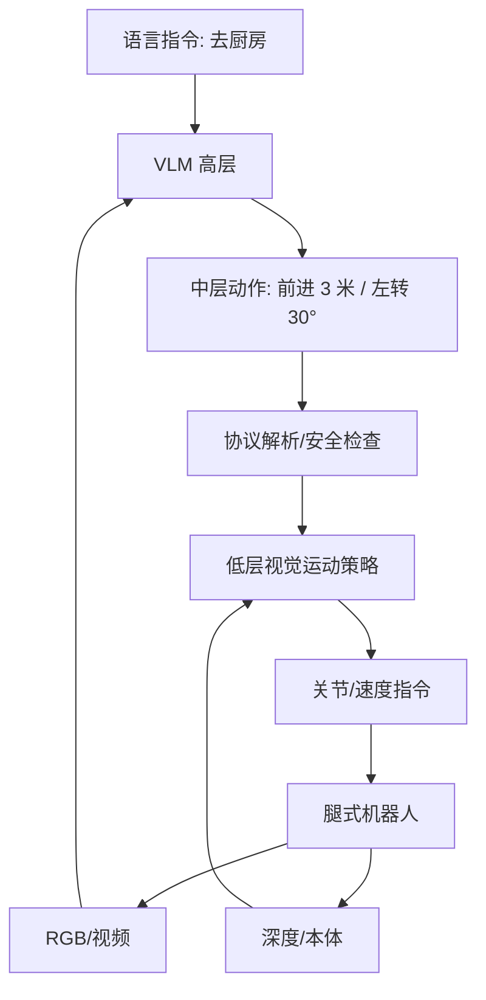

# 精读笔记 06 | NaVILA: Legged Robot Vision-Language-Action Model for Navigation

**中文标题**：NaVILA：面向腿式机器人导航的视觉—语言—动作模型

- **作者**：An-Chieh Cheng, Yandong Ji, Zhaojing Yang, Zaitian Gongye, Xueyan Zou, Jan Kautz, Erdem Biyik, Hongxu Yin, Sifei Liu, Xiaolong Wang
- **单位**：UC San Diego、NVIDIA 等（以论文首页为准）
- **发表**：RSS 2025（Robotics: Science and Systems XXI），DOI 10.15607/RSS.2025.XXI.018
- **官方论文**：https://roboticsproceedings.org/rss21/p018.html
- **PDF**：https://roboticsproceedings.org/rss21/p018.pdf
- **官方代码**：https://github.com/AnjieCheng/NaVILA
- **定位**：方向 3 的核心论文；两级架构（高层 VLM 中层语言动作 + 底层运动策略），最适合借鉴到 G1 的“高层低频、底层高频”设计。

---

## 一句话总结

NaVILA 让 VLM 输出“前进/左转 30 度/停止”这类中层语言动作，再由一个实时视觉运动策略执行，从而把语言理解与腿式机器人低层控制解耦；它说明对腿式机器人而言，分层输出比让 VLM 直接生成关节动作更现实。

---

## 1. 研究背景：为什么需要这项工作

语言导航（VLN）要解决：

- 人类用自然语言给机器人指路；
- 机器人需要在陌生、杂乱环境中导航；
- 腿式机器人还要处理楼梯、障碍、地形。

直接把语言映射到关节动作很难：

- 数据稀缺；
- 动作空间高维；
- 实时性要求高；
- 端到端可解释性差。

NaVILA 的选择：

- 高层 VLM 负责“理解语言 + 看场景 + 决定往哪走”；
- 低层视觉运动策略负责“怎么迈腿、避障”；
- 两者用中层动作协议连接。

---

## 2. 论文核心贡献

1. **两级 VLA 框架**：VLM + 低层视觉运动策略。
2. **中层语言动作**：VLM 输出方向/距离等可解释指令，而不是关节。
3. **面向腿式机器人**：在真实腿式平台验证导航。
4. **训练数据组合**：仿真导航、真实人类视频、问答数据等（具体配比以论文为准）。
5. **实时低层策略**：低层控制器独立高频运行，处理避障。
6. **开源代码/模型**：官方仓库提供训练/评估/部署参考。

---

## 3. 整体技术架构



### 频率分离

| 层级 | 典型频率 | 职责 |
|---|---|---|
| VLM 高层 | 低频（约 1–5 Hz，需实测） | 语义理解、方向决策 |
| 低层策略 | 高频（控制周期级） | 避障、平衡、步态 |

> 论文的具体频率/硬件配置需查实验节；本笔记不把估计值写成论文报告值。

---

## 4. 核心方法详解

### 4.1 中层语言动作

**通俗解释**：VLM 不说“第 3 个关节转 0.2 弧度”，而说“向前走 2 米”或“右转 45 度”。

**优点**：

- 可解释；
- 跨本体；
- 低层控制器可独立升级；
- 便于安全校验（限速/限距）。

**缺点**：

- 语言解析可能歧义；
- 离散化损失；
- 低层策略的能力上限决定最终效果。

### 4.2 低层视觉运动策略

输入：

- 深度/本体感知；
- 中层指令；
- 历史。

输出：

- 关节/速度指令。

它负责局部避障与步态，不依赖 VLM 的高频推理。

### 4.3 训练数据

论文组合了：

- 仿真导航数据；
- 真实人类视频（YouTube 等）；
- 视觉问答/导航问答；
- 真实机器人数据（以论文为准）。

这种组合提升泛化，但也带来数据对齐/质量挑战。

---

## 5. 模型结构与输入输出

| 项目 | 内容 |
|---|---|
| 高层 | VLM（具体型号/参数量以论文为准） |
| 高层输入 | RGB/视频 + 语言 + 历史 |
| 高层输出 | 中层语言动作 |
| 低层 | 视觉运动策略 |
| 低层输入 | 深度/本体 + 中层指令 |
| 低层输出 | 关节/速度 |
| 真机 | 腿式机器人（具体型号以论文为准） |
| 部署 | 高层可外部服务；低层需机载实时 |

### 未报告/需核实

- Orin NX 上的完整延迟；
- 高层 VLM 的精确参数量；
- 是否所有实验都在 G1 上；
- TensorRT/ONNX 官方支持。

---

## 6. 数据集与实验设计

### 数据

- 仿真室内导航；
- 真实人类视频；
- 导航问答；
- 真实机器人演示。

### 评估

- 导航成功率；
- 路径长度/效率；
- 语言指令遵循；
- 真实环境泛化；
- 与端到端/传统 VLN 基线比较。

### 公平性注意

- 不同方法的数据/仿真环境不同；
- 真实场景数量有限；
- 中层动作的定义/粒度可能不同。

---

## 7. 实验结果详解

论文的核心结论：

1. 两级架构在真实腿式机器人上可执行语言导航；
2. 中层语言动作比直接关节输出更稳、更可解释；
3. 低层策略能处理局部避障；
4. 组合数据提升泛化。

**具体成功率、频率、硬件数值需查论文表格**；本笔记不使用未核对数字。

---

## 8. 部署视角分析

### 8.1 对 G1 的启示

最值得借鉴的不是模型权重，而是**接口设计**：

```text
VLM 输出: {action: "forward", distance_m: 2.0, confidence: 0.8}
          {action: "turn", angle_deg: 30, confidence: 0.9}
          {action: "stop"}
```

G1 侧：

- 解析指令；
- 限速/限距；
- 检查障碍；
- 调用白名单技能/低速控制器；
- 超时回退。

### 8.2 部署位置

| 模块 | 建议位置 | 原因 |
|---|---|---|
| VLM 高层 | 笔记本/外部 GPU 或 Orin（若可） | 算力需求高、频率低 |
| 指令解析 | Orin | 安全关键、低延迟 |
| 低层控制 | Orin | 实时 |
| 状态/传感器 | Orin | 本地 |

### 8.3 ONNX/TensorRT

- 高层 VLM 导出难度大，官方未必提供；
- 低层策略通常是较小网络，较易导出；
- 中层指令是文本，需 JSON schema/解析器；
- 端到端延迟包括网络/VLM/解析/控制。

**结论：需较大改造；适合做分层架构与仿真，不是首个 G1 真机闭环。**

---

## 9. 论文局限性

### 作者承认/论文体现

- 依赖低层策略能力；
- 语言指令可能有歧义；
- 真实环境仍有限；
- 数据组合复杂。

### 我们的部署分析

- 没有 G1 专用权重；
- 室内定位/地图/避障仍需额外系统；
- 高层 VLM 在 Orin NX 上可能较慢；
- 安全层必须独立实现；
- 复杂地形/楼梯不能直接测试。

---

## 10. 初学者概念速查表

| 术语 | 通俗解释 | 在本文中的作用 |
|---|---|---|
| VLN | 看图+听语言找路 | 任务 |
| 两级架构 | 高层决策+低层执行 | 核心设计 |
| 中层动作 | “向前 2 米”这类指令 | 层间接口 |
| 低层策略 | 控制迈腿/避障 | 实时执行 |
| 视觉运动 | 用视觉指导运动 | 低层输入 |
| 分层频率 | 高层慢、低层快 | 实时性关键 |

---

## 11. 整体评价与实际应用价值

### 最值得学习

- 分层接口设计；
- 高层/低层频率分离；
- 可解释的中层动作；
- 真实腿式验证方法。

### 最有部署价值

- 指令 schema；
- 安全解析层；
- 高层外部服务 + 底层机载的架构。

### 不值得投入时间

- 直接复现完整 NaVILA 并上 G1；
- 把 VLM 输出直接当关节；
- 忽略定位/避障/安全层。

### 可结合方向

- 方向 1：高层 VLA；
- 方向 4：底层控制；
- 方向 5：高层 VLM 量化。

---

## 12. 延伸阅读

| 工作 | 链接 | 推荐理由 |
|---|---|---|
| NaVILA 官方代码 | https://github.com/AnjieCheng/NaVILA | 训练/评估参考 |
| Uni-NaVid | https://arxiv.org/abs/2412.06224 | 视频型统一导航 |
| Mobility VLA | https://proceedings.mlr.press/v270/xu25b.html | 长上下文+拓扑图 |
| VLN-CE | https://arxiv.org/abs/1904.04166 | 连续环境 VLN 基础 |
| Habitat | https://aihabitat.org/ | 仿真平台 |
