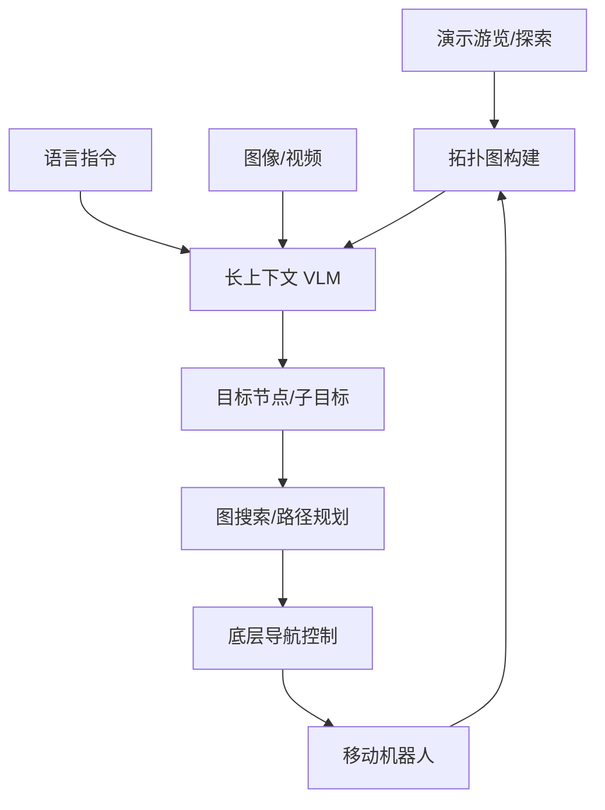

# 精读笔记 07 | Mobility VLA: Multimodal Instruction Navigation with Long-Context VLMs and Topological Graphs

**中文标题**：Mobility VLA：长上下文 VLM 与拓扑图的多模态指令导航

- **作者**：Zhuo Xu, Hao-Tien Lewis Chiang, Zipeng Fu, Mithun George Jacob, Tingnan Zhang, Tsang-Wei Edward Lee, Wenhao Yu, Connor Schenck, David Rendleman, Dhruv Shah, Fei Xia, Jasmine Hsu, Jonathan Hoech, Pete Florence, Sean Kirmani, Sumeet Singh, Vikas Sindhwani, Carolina Parada, Chelsea Finn, Peng Xu, Sergey Levine, Jie Tan
- **单位**：Google DeepMind、Stanford 等（以论文首页为准）
- **发表**：CoRL 2024；PMLR 270:3866–3887（正式书目年份 2025）
- **官方论文**：https://proceedings.mlr.press/v270/xu25b.html
- **PDF**：https://raw.githubusercontent.com/mlresearch/v270/main/assets/xu25b/xu25b.pdf
- **OpenReview**：https://openreview.net/forum?id=JScswMfEQ0
- **定位**：方向 3 的“环境先验 + 拓扑图 + 长上下文 VLM”路线；不是人形，不是端到端低层控制。

---

## 一句话总结

Mobility VLA 用长上下文 VLM 理解多模态指令（语言/图像/视频演示），再结合预先构建的拓扑图把高层意图落到具体路径点上，让移动机器人完成长程导航；它说明“环境先验 + 图搜索 + VLM”在复杂建筑里比纯端到端更可靠，但依赖预探索和地图。

---

## 1. 研究背景：为什么需要这项工作

移动机器人在大型室内环境导航的难点：

- 语言指令可能很抽象（“去我上次开会的地方”）；
- 需要理解图像/视频演示；
- 长程任务需要记忆和环境先验；
- 纯端到端 VLA 难以保证长程一致性。

Mobility VLA 的任务定义：

**MINT（Multimodal Instruction Navigation with demonstration Tours）**：

- 用户给语言 + 图像/视频演示；
- 机器人先“游览”环境，构建拓扑图；
- 之后根据多模态指令导航到目标。

---

## 2. 论文核心贡献

1. **MINT 任务定义**：多模态指令 + 演示游览。
2. **长上下文 VLM**：处理长视频/多帧/语言。
3. **拓扑图表示**：把环境表示为节点+边，支持长程规划。
4. **高层 VLM + 图搜索**：VLM 选择目标节点/路径，底层执行。
5. **真实移动机器人实验**：在真实建筑中验证。
6. **可解释性**：图节点/路径便于调试。

---

## 3. 整体技术架构

### 两阶段

1. **环境先验阶段**：机器人/人类演示游览，构建拓扑图；
2. **执行阶段**：VLM 理解指令，结合图选择目标，底层导航。

---

## 4. 核心方法详解

### 4.1 拓扑图

- 节点：关键位置/房间/物体；
- 边：可通行关系/距离；
- 可来自探索、SLAM、人工标注。

**部署影响**：

- 需要环境先验；
- 图维护/更新是工程负担；
- 但对长程导航非常有效。

### 4.2 长上下文 VLM

- 输入长视频/多帧 + 语言；
- 输出目标/路径点；
- 上下文越长，算力/显存越高。

### 4.3 高层决策 + 底层控制

VLM 不直接输出关节，而是选择图节点/子目标；底层导航栈负责路径跟踪与避障。

---

## 5. 模型结构与输入输出

| 项目 | 内容 |
|---|---|
| 高层 | 长上下文 VLM |
| 输入 | 语言 + 图像/视频 + 拓扑图 |
| 输出 | 目标节点/waypoint |
| 底层 | 移动机器人导航栈 |
| 平台 | Google 移动机器人（以论文为准） |
| 环境 | 真实室内建筑 |

### 未报告/需核实

- Orin NX 延迟；
- 开源权重；
- G1 适配；
- TensorRT 支持。

---

## 6. 数据集与实验设计

### 数据

- 真实建筑游览视频；
- 语言指令；
- 图像目标；
- 拓扑图。

### 评估

- 导航成功率；
- 目标到达精度；
- 长程任务完成；
- 与端到端/传统基线比较。

### 公平性注意

- 环境先验是重要优势；
- 不同方法的图/数据不同；
- 真实建筑数量有限。

---

## 7. 实验结果详解

论文报告的核心结论：

1. 长上下文 VLM + 拓扑图能处理多模态长程导航；
2. 环境先验显著提升可靠性；
3. 图结构提高可解释性；
4. 真实建筑实验可行。

**具体成功率/延迟需查论文表格**；本笔记不复制未核对数值。

---

## 8. 部署视角分析

### 8.1 对 G1 的启示

- 如果 G1 要做室内导航，拓扑图/环境先验比纯 VLA 更现实；
- VLM 只需低频选择目标，底层可用现有导航/技能；
- 图节点可作为安全停靠点。

### 8.2 部署难点

- 需要预探索/建图；
- 图维护；
- VLM 长上下文算力；
- 跨楼层/动态障碍；
- 没有 G1 专用实现。

### 8.3 ONNX/TensorRT

- 长上下文 VLM 导出困难；
- 图搜索是 CPU 逻辑，不是神经网络；
- 底层导航栈独立。

**结论：暂不建议作为 G1 首项复现；适合架构参考。**

---

## 9. 论文局限性

### 作者承认/论文体现

- 依赖环境先验；
- 长上下文成本高；
- 动态环境需更新图；
- 平台非人形。

### 我们的部署分析

- 需要地图/定位系统；
- G1 的楼梯/地形能力未覆盖；
- 无开源 G1 权重；
- 实时性未在 Orin NX 验证。

---

## 10. 初学者概念速查表

| 术语 | 通俗解释 | 在本文中的作用 |
|---|---|---|
| 拓扑图 | 用节点/边表示环境 | 长程导航 |
| 长上下文 VLM | 能看很多帧/长文本的模型 | 理解指令 |
| MINT | 多模态指令+演示游览任务 | 问题定义 |
| Waypoint | 路径点 | 高层输出 |
| 环境先验 | 事先知道环境结构 | 提升可靠性 |

---

## 11. 整体评价与实际应用价值

### 最值得学习

- 环境先验与图搜索的结合；
- 多模态指令接口；
- 长程任务分解。

### 最有部署价值

- 图节点作为安全目标；
- 高层低频、底层高频。

### 不值得投入时间

- 直接复现到 G1；
- 无地图条件下硬套；
- 把 VLM 当实时控制器。

### 可结合方向

- 方向 3：分层导航；
- 方向 1：高层 VLM；
- 方向 4：底层技能。

---

## 12. 延伸阅读

| 工作 | 链接 | 推荐理由 |
|---|---|---|
| Mobility VLA 官方页 | https://proceedings.mlr.press/v270/xu25b.html | 论文/引用 |
| NaVILA | https://arxiv.org/abs/2412.04453 | 腿式分层导航 |
| Uni-NaVid | https://arxiv.org/abs/2412.06224 | 视频型统一导航 |
| SayCan | https://arxiv.org/abs/2204.01691 | 高层语言规划 |
| VLN-CE | https://arxiv.org/abs/1904.04166 | 连续环境 VLN |
