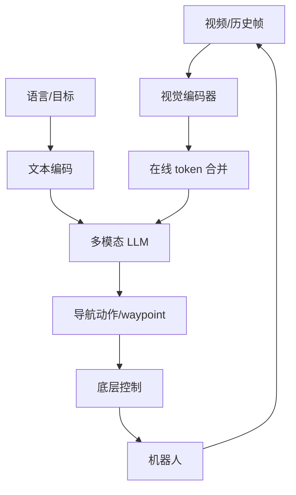

# 精读笔记 08 | Uni-NaVid: A Video-based Vision-Language-Action Model for Unifying Embodied Navigation Tasks

**中文标题**：Uni-NaVid：统一具身导航任务的视频型视觉—语言—动作模型

- **作者**：Jiazhao Zhang, Kunyu Wang, Shaoan Wang, Minghan Li, Haoran Liu, Songlin Wei, Zhongyuan Wang, Zhizheng Zhang, He Wang
- **单位**：北京大学、上海 AI Lab 等（以论文首页为准）
- **发表**：RSS 2025（Robotics: Science and Systems XXI），DOI 10.15607/RSS.2025.XXI.013
- **官方论文**：https://roboticsproceedings.org/rss21/p013.html
- **PDF**：https://roboticsproceedings.org/rss21/p013.pdf
- **官方代码**：https://github.com/jzhzhang/Uni-NaVid
- **定位**：方向 3 的视频型统一导航模型；强调时序信息、多任务统一和在线视觉 token 压缩。

---

## 一句话总结

Uni-NaVid 用视频作为主要输入，把多种导航任务统一到一个 VLA 模型中，并通过在线视觉 token 合并降低长视频的计算量；它代表了“端到端视频导航”的路线，但训练数据、算力和真实部署门槛都高于分层方案。

---

## 1. 研究背景：为什么需要这项工作

导航任务有多种形式：

- 指令导航（VLN）；
- 目标导航（ObjectNav）；
- 探索；
- 视觉跟踪；
- 多模态目标。

传统做法是每个任务一个模型/一套工程。Uni-NaVid 的目标：

- 用统一模型处理多任务；
- 利用视频时序，而不是单帧；
- 在真实机器人上执行；
- 控制长视频带来的 token 爆炸。

---

## 2. 论文核心贡献

1. **视频型 VLA**：以视频/历史帧为输入，统一多导航任务。
2. **在线视觉 token 合并**：减少长视频 token，提高效率。
3. **多任务统一**：一个模型覆盖多种导航目标。
4. **真实机器人实验**：腿式/移动机器人验证。
5. **开源代码/模型**：官方仓库提供训练/评估。
6. **任务接口统一**：语言/目标/动作的统一表示。

---

## 3. 整体技术架构

### 关键模块

- 视频编码/时序融合；
- token 合并（降低计算）；
- 多任务输入（语言/目标图像/历史）；
- 动作输出（具体形式以论文为准）。

---

## 4. 核心方法详解

### 4.1 视频输入

**通俗解释**：不只看当前一帧，而是看一段视频，理解“刚才看到了什么、目标在哪里、自己怎么动的”。

**部署影响**：

- 需要帧缓存/时间戳；
- 内存带宽压力；
- 延迟随窗口长度增加；
- 需要丢帧/压缩策略。

### 4.2 在线 token 合并

**通俗解释**：把相似/冗余的视觉 token 合并，减少 Transformer 计算量。

**部署影响**：

- 合并策略可能是动态的，ONNX/TensorRT 支持需验证；
- 合并会损失细节，影响小目标/障碍物；
- 需要在精度和延迟间调参。

### 4.3 多任务统一

- 不同任务用统一输入/输出接口；
- 训练数据混合；
- 可能通过任务提示/目标图像区分。

---

## 5. 模型结构与输入输出

| 项目 | 内容 |
|---|---|
| 输入 | 视频/多帧 RGB + 语言/目标 |
| 输出 | 导航动作/waypoint（以论文为准） |
| 主干 | 多模态 LLM + 视觉编码器 |
| 关键 | 视频时序 + token 合并 |
| 平台 | 真实移动/腿式机器人（以论文为准） |
| 部署 | 需 GPU；具体硬件/频率需查论文 |

### 未报告/需核实

- Orin NX 延迟；
- 精确参数量；
- TensorRT/ONNX 支持；
- G1 专用权重。

---

## 6. 数据集与实验设计

### 数据

- 多种导航数据集；
- 视频/轨迹；
- 语言/目标标注；
- 真实机器人数据。

### 评估

- 多任务成功率；
- 导航效率；
- 真实环境泛化；
- 与单任务/端到端基线比较。

### 公平性注意

- 多任务训练数据更多；
- 不同任务难度不同；
- 真实实验规模有限。

---

## 7. 实验结果详解

论文的核心结论：

1. 统一模型在多导航任务上有竞争力；
2. 视频时序提升决策；
3. token 合并降低计算；
4. 真实机器人可执行。

**具体成功率/频率需查论文表格**；本笔记不复制未核对数字。

---

## 8. 部署视角分析

### 8.1 优势

- 视频时序对动态障碍/目标跟踪有价值；
- 统一接口减少多模型工程；
- token 合并适合边缘部署。

### 8.2 难点

- 视频窗口增加内存/带宽；
- 动态 token 合并难导出；
- 训练数据/算力门槛高；
- 真实导航仍需定位/避障/安全层。

### 8.3 G1 适配

- 模型输出不是 G1 关节；
- 需要将导航动作映射为速度/waypoint；
- 需要 G1 底层控制器；
- 不建议首项真机复现。

**结论：暂不建议复现；适合方向 3 的架构/时序参考。**

---

## 9. 论文局限性

### 作者承认/论文体现

- 多任务仍需大量数据；
- 视频计算成本高；
- 真实环境有限。

### 我们的部署分析

- 非 G1；
- 无边缘优化；
- 无 ROS 2/安全层；
- 动态算子导出困难；
- 长视频延迟不确定。

---

## 10. 初学者概念速查表

| 术语 | 通俗解释 | 在本文中的作用 |
|---|---|---|
| 视频 VLA | 用一段视频而不是单帧做决策 | 核心输入 |
| Token 合并 | 合并冗余视觉 token | 降计算 |
| 多任务统一 | 一个模型做多种导航 | 目标 |
| 时序 | 利用历史帧 | 提升决策 |
| Waypoint | 路径点 | 输出形式 |

---

## 11. 整体评价与实际应用价值

### 最值得学习

- 视频时序建模；
- token 压缩；
- 多任务统一接口。

### 最有部署价值

- token 合并思路；
- 历史缓存管理。

### 不值得投入时间

- 直接复现到 G1；
- 无大规模数据硬训；
- 忽略导航栈。

### 可结合方向

- 方向 3：分层/端到端对照；
- 方向 1：视频 VLA；
- 方向 5：token/量化优化。

---

## 12. 延伸阅读

| 工作 | 链接 | 推荐理由 |
|---|---|---|
| Uni-NaVid 代码 | https://github.com/jzhzhang/Uni-NaVid | 官方实现 |
| NaVILA | https://arxiv.org/abs/2412.04453 | 分层腿式导航 |
| Mobility VLA | https://proceedings.mlr.press/v270/xu25b.html | 图+长上下文 |
| Video-LLaVA | https://arxiv.org/abs/2311.10122 | 视频多模态基础 |
| Habitat | https://aihabitat.org/ | 导航仿真 |
