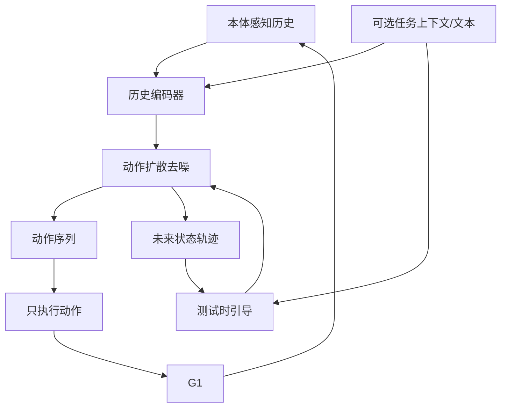

# 精读笔记 09 | PredActor: Predictive Action Diffusion for Steerable Onboard Humanoid Control

**中文标题**：PredActor：面向可引导机载人形控制的预测式动作扩散

- **作者**：Lei Ye, Haibo Gao, Yitang Li, Peng Xu, Zetong Jing, Junhan Sun, Fanrong Dong, Ziqi Han, Xue Wang, Jianhua Sun, Cewu Lu, Hao Zhao, Liang Ding
- **单位**：arXiv 摘要页未列，需查论文首页
- **发表**：arXiv 2609.24840（v3，2026-10-05）；未标注正式会议/期刊
- **DOI**：10.48550/arXiv.2609.24840
- **官方论文**：https://arxiv.org/abs/2609.24840
- **项目页**：https://masteryip.github.io/predactor.github.io/
- **代码/权重**：项目页未提供明确 GitHub 代码仓库；本次核验不能确认可直接下载
- **定位**：方向 4 的最强性能参考；与 G1 + Orin NX 的 20 ms 控制周期直接相关，但公开资源不足，不能列为直接复现。

---

## 一句话总结

PredActor 只用本体感知历史（可选任务上下文），联合预测“可执行动作 + 未来状态轨迹”，再用无分类器引导/分类器引导在测试时改变动作风格或目标；它在 G1 + Orin NX 上把完整回调压到 16.790 ms 中位数、19.383 ms p95，控制在 20 ms 周期内，是“人形机载动作扩散”的重要工程证据。

---

## 1. 研究背景：为什么需要这项工作

人形机器人运动生成有三条路线：

1. **分层生成—跟踪**：高层生成参考轨迹，底层 tracker 跟踪。问题是参考可能超出 tracker 能力，物理可行性由另一个模块兜底。
2. **纯动作扩散**：直接生成可执行动作，但没有显式未来状态，难以在测试时引导。
3. **联合状态—动作扩散**：同时预测动作和未来状态，但现有工作常依赖特权全身状态，行为选择与测试时引导未完全整合。

PredActor 的目标：

- 只用本体感知（可部署）；
- 一个策略同时支持文本条件运动与测试时目标引导；
- 直接执行动作，不需要参考 tracker；
- 在 Orin NX 上满足 20 ms 周期。

---

## 2. 论文核心贡献

1. **预测式动作扩散**：联合预测动作与内部未来状态轨迹。
2. **两种引导统一**：
   - classifier-free guidance：增强文本条件运动；
   - classifier guidance：把未来状态引导到测试时目标。
3. **仅用本体感知**：不需要特权全身状态。
4. **机载运行时优化**：rolling denoising + computation-preserving 优化。
5. **G1 真机验证**：文本条件运动、扰动响应、手柄控制、语义插值。
6. **明确延迟指标**：完整回调 16.790 ms 中位数、19.383 ms p95（Orin NX）。

---

## 3. 整体技术架构

### 关键点

- 未来状态是“内部预测”，不直接执行；
- 动作是最终执行输出；
- 引导在去噪过程中修改未来状态/条件；
- 滚动去噪降低每周期计算。

---

## 4. 核心方法详解

### 4.1 联合状态—动作扩散

**通俗解释**：模型一边生成“接下来怎么动”，一边生成“身体未来会到哪”，两者互相约束。

**专业定义**：在扩散/去噪过程中，对动作序列和未来状态序列联合建模；训练时用真实动作与状态监督，推理时只执行动作。

**部署影响**：

- 多预测一个状态分支会增加计算；
- 但可用于引导/稳定性；
- 需要固定预测 horizon；
- 输出维度/关节顺序必须与 G1 一致。

### 4.2 Classifier-free guidance

训练时随机丢弃文本条件，推理时用有条件/无条件预测的差增强文本跟随。代价是每次去噪需两次前向（或缓存技巧）。

### 4.3 Classifier guidance

用未来状态目标（如“向某个方向移动”）构造分类器/能量函数，引导去噪。适合测试时改变行为，而不重新训练。

### 4.4 机载运行时优化

- Rolling denoising：不每周期从纯噪声开始，而是复用上一周期部分去噪结果；
- 计算保持型优化：调整去噪步数/批处理/内存布局；
- 目标：完整回调 ≤ 20 ms。

---

## 5. 模型结构与输入输出

| 项目 | 内容 |
|---|---|
| 输入 | 本体感知历史 + 可选任务上下文 |
| 输出 | 动作序列 + 内部未来状态 |
| 执行 | 只执行动作 |
| 机器人 | Unitree G1（论文报告） |
| 控制周期 | 20 ms（50 Hz） |
| 硬件 | Jetson Orin NX |
| 延迟 | 16.790 ms 中位数；19.383 ms p95 |
| 引导 | CFG + classifier guidance |
| 代码 | 未确认 |

### 未报告/需核实

- 参数量/模型大小；
- 训练数据规模；
- ONNX/TensorRT 导出细节；
- 代码/权重下载；
- 29DoF 的具体动作维度（论文报告 G1，本笔记按 29DoF 语境使用，需以原文表格核对）。

---

## 6. 数据集与实验设计

### 数据

- 仿真运动数据/文本-运动配对（以论文为准）；
- 真实 G1 部署；
- 扰动/手柄/语义插值测试。

### 评估

- 45 个目的地目标中到达 44 个；
- 文本检索分数 0.539 vs 条件动作扩散 0.424；
- 扰动生存率；
- 机载延迟；
- 真机演示。

### 公平性注意

- 扩散基线/引导方式不同；
- 真机任务数量有限；
- 延迟是特定模型/优化下的结果；
- 代码未开放，独立复现困难。

---

## 7. 实验结果详解

论文报告的关键数字：

| 指标 | 结果 |
|---|---|
| 目的地到达 | 44 / 45 |
| 文本检索分数 | 0.539（对照 0.424） |
| 完整回调中位数 | 16.790 ms |
| 完整回调 p95 | 19.383 ms |
| 控制周期 | 20 ms |
| 平台 | G1 + Orin NX |

这些是**论文报告值**，不是本资料库实测值。  
其中“完整回调”应理解为论文定义的完整策略回调，不等同于从相机曝光到关节执行的端到端延迟。

---

## 8. 部署视角分析

### 8.1 价值

- 直接证明 G1 + Orin NX 上 50 Hz 动作扩散可行；
- 给出 p95 指标，比只报平均更有参考价值；
- 仅用本体感知，传感器需求低；
- 引导机制适合测试时调整行为。

### 8.2 复现难点

- 代码/权重未确认；
- 扩散模型导出 ONNX/TensorRT 复杂；
- rolling denoising 涉及状态缓存；
- 训练数据/仿真环境未公开；
- 真机安全风险高。

### 8.3 对 G1 的适配

- 若自行重实现，需要 G1 29DoF 动作数据；
- 需要与 Unitree 低层接口对齐；
- 需要安全层；
- 不能直接把论文数字当作自己的基线。

**结论：暂不建议直接复现；作为目标性能基线与架构参考。**

---

## 9. 论文局限性

### 作者承认/论文体现

- 依赖仿真训练；
- 真机任务有限；
- 引导/扩散计算仍需优化。

### 我们的部署分析

- 代码/权重不开放；
- 未报告 ONNX/TensorRT 细节；
- 未报告完整端到端传感器延迟；
- 29DoF 数据需求高；
- 真机安全验证不足。

---

## 10. 初学者概念速查表

| 术语 | 通俗解释 | 在本文中的作用 |
|---|---|---|
| 动作扩散 | 从噪声生成动作 | 核心生成器 |
| 未来状态预测 | 同时预测身体会到哪 | 提供引导 |
| CFG | 用有条件/无条件差异增强条件 | 文本跟随 |
| Classifier guidance | 用目标函数引导生成 | 测试时控制 |
| Rolling denoising | 复用上周期去噪结果 | 降延迟 |
| p95 | 95% 请求不超过的延迟 | 实时性指标 |

---

## 11. 整体评价与实际应用价值

### 最值得学习

- 联合动作—状态扩散；
- 两种引导的统一；
- 机载运行时优化；
- p50/p95 延迟报告方式。

### 最有部署价值

- 20 ms 周期内的工程目标；
- 仅本体感知的输入设计；
- rolling denoising 思路。

### 不值得投入时间

- 在没有代码/权重时硬复现；
- 直接把论文数字当自己的结果；
- 跳过安全层直接上真机。

### 可结合方向

- 方向 4：G1 实时控制；
- 方向 5：扩散模型量化；
- 方向 1：动作生成。

---

## 12. 延伸阅读

| 工作 | 链接 | 推荐理由 |
|---|---|---|
| PredActor 项目页 | https://masteryip.github.io/predactor.github.io/ | 作者资源 |
| Diffusion Policy | https://arxiv.org/abs/2303.04137 | 动作扩散基础 |
| π0 | https://arxiv.org/abs/2410.24164 | 流匹配 VLA |
| ExBody | https://arxiv.org/abs/2402.16796 | 人形全身控制 |
| Embrace Collisions | https://arxiv.org/abs/2502.01465 | 接触丰富运动 |
