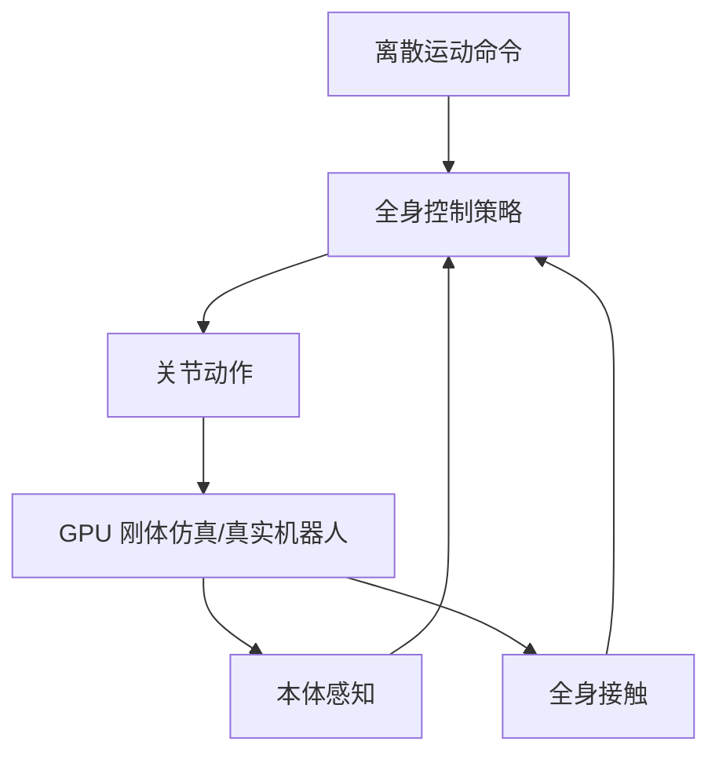

# 精读笔记 10 | Embrace Collisions: Humanoid Shadowing for Deployable Contact-Agnostic Motions

**中文标题**：拥抱碰撞：面向可部署接触无关运动的人形影子控制

- **作者**：Ziwen Zhuang, Hang Zhao
- **单位**：清华大学交叉信息研究院 / 上海期智研究院等（以论文首页为准）
- **发表**：CoRL 2025（项目页公布；arXiv 摘要页未标注会议）
- **arXiv**：2502.01465（v1，2025-02-03）
- **官方论文**：https://arxiv.org/abs/2502.01465
- **项目页**：https://project-instinct.github.io
- **代码**：Project Instinct 生态（具体仓库/权重需按项目页核对）
- **定位**：方向 4c 的学术拓展；接触丰富、全身影子控制，不是首个部署复现项目。

---

## 一句话总结

Embrace Collisions 不再假设人形机器人只用脚和手接触世界，而是让全身（躯干、背部、地面）都可能接触，并用 GPU 加速仿真训练一个实时全身控制策略，使机器人能跟随离散运动命令完成坐、躺、翻滚等接触丰富动作；它把“碰撞”从失败条件变成可学习的正常交互。

---

## 1. 研究背景：为什么需要这项工作

传统人形研究把机器人视为“双腿移动 + 双手操作”的平台：

- 只有脚着地、手抓取；
- 躯干/背部接触被视为碰撞/失败；
- MPC 难以处理不可预测的接触序列；
- RL 的零样本 Sim-to-Real 依赖简化碰撞检测。

但人类会用全身：

- 坐在椅子上；
- 从地上起身；
- 在地上翻滚；
- 用背部/躯干接触环境。

这些动作的挑战：

- 接触序列不可预测；
- 接触力/摩擦复杂；
- 终止条件、运动命令、奖励设计都非平凡；
- 真实机器人摔倒风险高。

---

## 2. 论文核心贡献

1. **接触无关的运动框架**：允许全身接触，而不是只脚/手。
2. **离散运动命令 + 实时全身控制**：高层离散命令，底层实时电机动作。
3. **GPU 加速刚体仿真训练**：利用大规模并行 RL。
4. **处理极端基座旋转/不可行命令**：策略在随机接触和大幅度姿态变化下仍能执行。
5. **真实人形部署**：在真实机器人上验证接触丰富动作。
6. **Project Instinct 生态**：训练/部署工具链的一部分。

---

## 3. 整体技术架构

### 训练与部署

- 训练：GPU 加速仿真，大规模并行，域随机化；
- 部署：策略接收离散命令 + 本体感知，输出关节动作；
- 真实：处理随机接触、基座大幅旋转、不可行命令。

---

## 4. 核心方法详解

### 4.1 接触无关建模

**通俗解释**：不预先规定“哪里可以碰”，而是让仿真/策略自己处理身体任何部位与环境的接触。

**技术难点**：

- 碰撞检测复杂；
- 接触力不连续；
- 奖励/终止条件难设计；
- Sim-to-Real 的接触参数差异大。

### 4.2 离散运动命令

高层给离散命令（如动作类别/目标），底层策略实时生成关节动作。这样避免高频语言/视觉推理。

### 4.3 GPU 仿真 + RL

- 大规模并行采样；
- 域随机化（摩擦、质量、延迟、接触）；
- 策略学习全身协调。

### 4.4 鲁棒性设计

- 随机接触；
- 极端基座旋转；
- 不完美/不可行命令；
- 真实部署的恢复行为。

---

## 5. 模型结构与输入输出

| 项目 | 内容 |
|---|---|
| 输入 | 离散运动命令 + 本体感知（具体配置以论文为准） |
| 输出 | 关节动作/PD 目标 |
| 训练 | GPU 刚体仿真 + RL |
| 机器人 | 人形（Project Instinct 工作流；具体机型/DoF 以论文为准） |
| 部署 | 实时全身控制 |
| 代码 | Project Instinct 生态，需核对 |

### 未报告/需核实

- 精确控制频率；
- 推理硬件/延迟；
- 29DoF G1 专用权重；
- ONNX/TensorRT 支持；
- 训练数据规模。

---

## 6. 数据集与实验设计

### 数据

- 仿真生成的运动/接触数据；
- 参考动作/影子目标；
- 真实机器人测试。

### 评估

- 接触丰富动作的成功率；
- 真实环境鲁棒性；
- 极端姿态/扰动恢复；
- 与只脚/手接触的基线比较。

### 公平性注意

- 接触丰富任务的定义/难度不同；
- 真机测试数量有限；
- 仿真参数与真实差异大。

---

## 7. 实验结果详解

论文的核心结论：

1. 全身接触策略能在真实人形上执行；
2. 随机接触/极端基座旋转下仍有鲁棒性；
3. 离散命令 + 实时控制可行；
4. 接触无关建模优于只允许脚/手接触的假设。

**具体成功率、频率、平台配置需查论文表格**；本笔记不复制未核对数字。

---

## 8. 部署视角分析

### 8.1 价值

- 接触丰富运动是人形真实应用的重要能力；
- 全身控制策略的安全/恢复设计值得学习；
- 对 G1 的“坐/躺/起身”技能有参考。

### 8.2 部署门槛

- 训练栈复杂（GPU 仿真 + RL）；
- 真实接触场景风险高；
- 需要大量域随机化调参；
- 没有确认的 G1 ONNX/权重；
- 安全层必须独立。

### 8.3 ONNX/TensorRT

- 策略可能是 MLP/Transformer，导出可行性需看结构；
- 高频控制要求低延迟；
- 论文未以 TensorRT 为重点；
- 接触状态观测可能包含历史/特权信息，需核对可部署性。

**结论：暂不建议作为首项真机复现；适合学术拓展/技能设计参考。**

---

## 9. 论文局限性

### 作者承认/论文体现

- 接触丰富动作仍难；
- 仿真—现实接触差距；
- 训练成本高；
- 真实测试有限。

### 我们的部署分析

- 非 G1 专用；
- 无公开权重/ONNX；
- 真机摔倒/损坏风险高；
- 需要大量安全验证；
- 不适合部署初学者首项。

---

## 10. 初学者概念速查表

| 术语 | 通俗解释 | 在本文中的作用 |
|---|---|---|
| 接触无关 | 不限定只有脚/手能碰 | 核心思想 |
| 影子控制 | 机器人跟随参考动作 | 任务 |
| 全身控制 | 控制所有关节协调 | 方法 |
| GPU 刚体仿真 | 大规模并行物理仿真 | 训练 |
| 域随机化 | 随机化物理参数 | Sim-to-Real |
| 离散命令 | 高层给动作类别/目标 | 接口 |

---

## 11. 整体评价与实际应用价值

### 最值得学习

- 接触丰富运动的建模；
- 全身协调/恢复策略；
- 离散命令 + 实时控制；
- 安全/鲁棒性设计。

### 最有部署价值

- 技能层设计；
- 接触状态估计；
- 真机安全策略。

### 不值得投入时间

- 作为首项真机复现；
- 无权重硬训；
- 直接套 G1。

### 可结合方向

- 方向 4：人形控制；
- 方向 2：Sim-to-Real；
- 方向 1：技能选择。

---

## 12. 延伸阅读

| 工作 | 链接 | 推荐理由 |
|---|---|---|
| Project Instinct | https://project-instinct.github.io | 官方项目群 |
| ExBody | https://arxiv.org/abs/2402.16796 | 人形全身表达控制 |
| Deep Whole-Body Control | https://arxiv.org/abs/2303.03381 | 全身控制基础 |
| ASAP | https://arxiv.org/abs/2502.01143 | 人形 Sim-to-Real 对齐 |
| Humanoid Parkour | Project Instinct | 动态运动拓展 |
