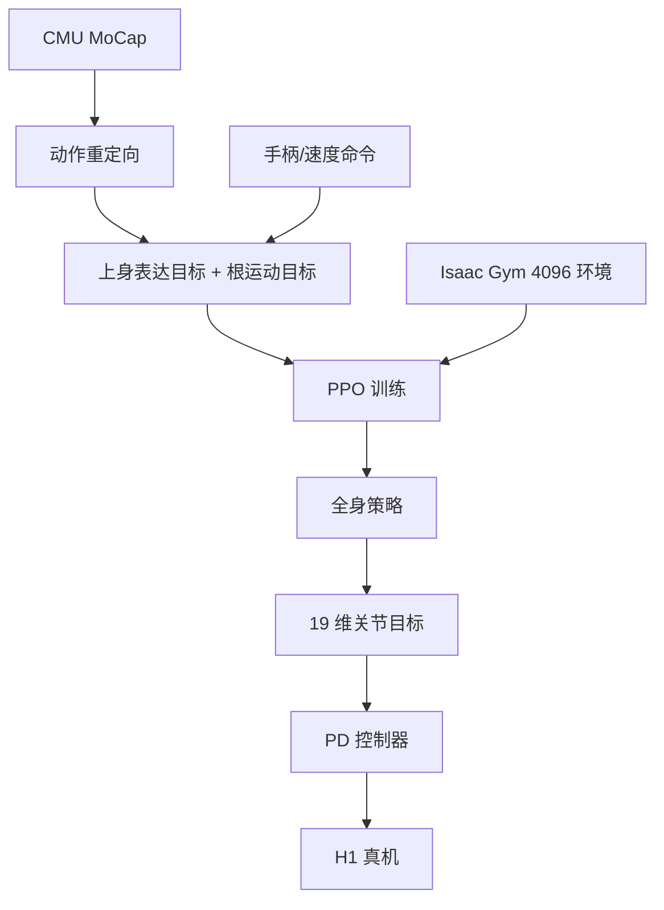

# 精读笔记 11 | Expressive Whole-Body Control for Humanoid Robots

**中文标题**：人形机器人的表达性全身控制

- **作者**：Xuxin Cheng, Yandong Ji, Junming Chen, Ruihan Yang, Ge Yang, Xiaolong Wang
- **单位**：UC San Diego
- **发表**：RSS 2024（Robotics: Science and Systems）
- **arXiv**：2402.16796（v2，2024-03-06）
- **官方论文**：https://arxiv.org/abs/2402.16796
- **项目页**：https://expressive-humanoid.github.io
- **代码/权重**：项目页资源需逐项核对；本笔记不把它列为可直接复现
- **定位**：方向 4 的人形全身控制基础；H1 19DoF，不是 G1 29DoF，但“上身模仿、下身速度跟踪”的分工非常适合理解人形策略接口。

---

## 一句话总结

ExBody 用 CMU 人体动捕数据训练一个“上身模仿动作、下身只管速度跟踪”的人形全身策略，让 H1 机器人能在真实世界走路、挥手、握手、跳舞；它的关键不是让全身精确复现人类，而是放松腿部约束，把表达性和鲁棒行走分开。

---

## 1. 研究背景：为什么需要这项工作

人形机器人做“有表现力”的动作很难：

- 人体动捕有 69DoF，H1 只有 19DoF；
- 人体动作包含大量机器人做不到的姿态；
- 直接全身模仿会被腿部约束拖垮，导致行走不稳；
- 物理动画的 PD 增益/力矩远超真实硬件。

作者的主张：

- 上身负责“表达”（关节 + 关键点）；
- 下身负责“稳走”（速度/姿态/高度）；
- 两者用同一个策略联合训练，但奖励分开。

---

## 2. 论文核心贡献

1. **ExBody 框架**：上身模仿 + 下身速度跟踪。
2. **大规模人体动捕数据**：CMU MoCap 780 段、约 3.7 小时。
3. **动作重定向**：把人体关节映射到 H1 19DoF。
4. **RL + 大规模并行仿真**：4096 环境、PPO、域随机化。
5. **真实 H1 部署**：走路风格、握手、跳舞、不同地形。
6. **系统消融**：全身体跟踪、AMP、随机采样、无 RSI 等对照。

---

## 3. 整体技术架构



### 输入输出

- 输入：上身参考关节/关键点、根速度/姿态/高度、本体感知、上一帧动作；
- 输出：19 维关节位置目标；
- 控制：PD 控制器转力矩。

---

## 4. 核心方法详解

### 4.1 上身表达目标

`g_e = <q, p>`：

- `q`：上身 9 个关节位置；
- `p`：双肩、双肘、双手 18 个 3D 关键点。

奖励鼓励上身匹配参考动作。

### 4.2 根运动目标

`g_m = <v, rpy, h>`：

- 线速度、roll/pitch/yaw、身体高度；
- 由参考动作或手柄给出；
- 腿部不被要求逐关节模仿，只要稳住根运动。

### 4.3 奖励

- 上身关节/关键点跟踪；
- 根速度/roll-pitch/yaw/高度；
- 足部高度、腾空时间、拖拽、接触力、绊倒；
- 关节加速度、动作变化率、能量、碰撞、限位、垂直速度、角速度、投影重力。

### 4.4 训练技巧

- **RSI（Reference State Initialization）**：从动捕数据的随机状态初始化，显著提升探索；
- **大规模并行**：4096 环境；
- **域随机化**：地形、摩擦、负载等；
- **单网络**：所有动作共享一个策略。

### 4.5 重定向

- 把人体球关节（四元数）映射到机器人 3 个垂直旋转关节；
- 1D 关节取投影角；
- 丢失部分自由度，但保留重要表达。

---

## 5. 模型结构与输入输出

| 项目 | 内容 |
|---|---|
| 机器人 | Unitree H1，19DoF |
| 输入 | 本体感知 + 上身参考 + 根运动目标 |
| 输出 | 19 维关节位置目标 |
| 策略 | 单个 MLP（具体层数/宽度以论文为准） |
| 训练 | Isaac Gym，4096 环境，PPO |
| 数据 | CMU MoCap 780 段，约 3.7 小时 |
| 真机 | H1 |
| 控制 | PD |

### 与 G1 的差异

- H1 19DoF vs G1 29DoF；
- 关节数量/构型/限位不同；
- 不能直接套权重；
- 但“上身表达 + 下身速度”的分工可借鉴。

---

## 6. 数据集与实验设计

### 数据

- CMU MoCap 子集：走路、跳舞、篮球、拳击、其他；
- 训练 780 段，约 13,383 秒；
- 真实测试 11 段 + 扩散模型生成动作。

### 评估

- 仿真：MELV（线速度跟踪）、MERP（roll/pitch）、MEL（episode 长度）、MEK（关键点）；
- 真机：多种动作的 roll/pitch 稳定性；
- 对照：ExBody、+AMP、+AMP NoReg、Random Sample、No RSI、Full Body Tracking。

### 公平性注意

- 真机测试动作数量有限；
- AMP 基线调参影响大；
- 动作重定向质量影响结果；
- H1 与 G1 不可直接比较。

---

## 7. 实验结果详解

关键结论（来自论文表格）：

- ExBody 在 MELV 上优于 AMP/随机采样/全身体跟踪；
- Full Body Tracking 的多个指标下降，说明腿部强模仿有害；
- No RSI 几乎学不到有效行为；
- 真机 roll/pitch 均值约 0.051（ExBody）vs 0.087（+AMP），说明更稳；
- 真实 H1 可完成走路风格、握手、跳舞、地形行走。

**注意**：这些是 H1 19DoF 的结果，不能外推为 G1 29DoF 性能。

---

## 8. 部署视角分析

### 8.1 优点

- 输出是关节位置目标，接口简单；
- 单网络、推理成本低；
- 上身/下身目标分离，便于技能设计；
- 真机验证充分。

### 8.2 部署难点

- 需要与训练一致的关节顺序/PD 增益；
- 需要参考动作/重定向管线；
- H1 权重不能用于 G1；
- 论文未以 ONNX/TensorRT 为重点；
- 真机安全依赖底层保护。

### 8.3 对 G1 的启示

可以设计：

```text
高层技能/表达目标 → 上身参考
手柄/导航 → 根速度目标
G1 全身策略 → 29 维关节目标
安全层 → 限幅/急停
```

但需要 G1 数据/训练，不能直接搬 H1。

**结论：需较大改造；适合作为方向 4 的架构与训练参考。**

---

## 9. 论文局限性

### 作者承认

- 重定向丢失自由度，动作偏离原参考；
- 人形摔倒可能损坏硬件；
- 需要保护/恢复系统；
- 未解决通用全身操作。

### 我们的部署分析

- H1 19DoF ≠ G1 29DoF；
- 未报告 Orin NX 延迟；
- 无 G1 权重；
- 依赖 Isaac Gym 旧栈；
- 真实安全风险高。

---

## 10. 初学者概念速查表

| 术语 | 通俗解释 | 在本文中的作用 |
|---|---|---|
| 全身控制 | 控制所有关节协调运动 | 任务 |
| 动作重定向 | 把人体动作映射到机器人 | 数据准备 |
| RSI | 从参考状态初始化 | 提升探索 |
| AMP | 对抗运动先验 | 基线 |
| 关键点 | 肩/肘/手等 3D 位置 | 上身表达 |
| PD 控制 | 位置误差转力矩 | 底层执行 |

---

## 11. 整体评价与实际应用价值

### 最值得学习

- 上身表达/下身稳定的分工；
- 大规模动捕 + RL；
- RSI/奖励设计；
- 真机验证方法。

### 最有部署价值

- 关节位置接口；
- 单网络低延迟；
- 技能分层。

### 不值得投入时间

- 直接把 H1 权重搬 G1；
- 复现完整 Isaac Gym 旧栈；
- 追求高动态动作首测。

### 可结合方向

- 方向 4：G1 全身控制；
- 方向 2：Sim-to-Real；
- 方向 1：技能选择。

---

## 12. 延伸阅读

| 工作 | 链接 | 推荐理由 |
|---|---|---|
| ExBody 项目页 | https://expressive-humanoid.github.io | 视频/资源 |
| Deep Whole-Body Control | https://arxiv.org/abs/2303.03381 | 全身控制基础 |
| Humanoid Parkour | Project Instinct | 动态运动 |
| ASAP | https://arxiv.org/abs/2502.01143 | Sim-to-Real 对齐 |
| Embrace Collisions | https://arxiv.org/abs/2502.01465 | 接触丰富运动 |
