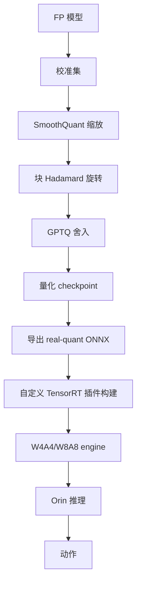

# 精读笔记 12 | FoldQuantVLA: Native Low-Bit Quantization of Vision-Language-Action Models via Consistent Folding

**中文标题**：FoldQuantVLA：通过一致折叠实现 VLA 的原生低比特量化

- **作者**：Hung T. Ho, Khanh D. Nguyen, Quang D. Nguyen, Thanh Q. Duong, Ngan Le, Meng Guo, Vien A. Ngo, An T. Le
- **单位**：arXiv 摘要页未列；代码组织 `cair-vinuni`，推测与 CAIR/VinUniversity 相关，需查论文首页
- **发表**：arXiv 2609.24433（v1，2026-09-21）；预印本，未标注正式会议
- **DOI**：10.48550/arXiv.2609.24433
- **官方论文**：https://arxiv.org/abs/2609.24433
- **官方代码**：https://github.com/cair-vinuni/FoldQuantVLA
- **License**：Apache 2.0
- **定位**：方向 5 的核心论文；目前少数真正把 VLA 的 W4A4/W8A8 跑到 TensorRT 原生整数 kernel 的工作，但依赖定制插件，不能当作 TensorRT 10.3 原生能力。

---

## 一句话总结

FoldQuantVLA 用“一致的离线折叠”把 SmoothQuant 缩放、块 Hadamard 旋转和 GPTQ 舍入统一到同一坐标系统，再通过自定义 TensorRT/CUTLASS 插件在语言主干预动作专家上执行原生 W4A4/W8A8；它在 AGX Orin 上相对 FP16 TensorRT 取得 1.20–1.33× 加速，并证明把部分敏感投影保留 INT8 能显著恢复真机成功率。

---

## 1. 研究背景：为什么需要这项工作

VLA 低比特推理的难点：

- 视觉编码器、语言模型、动作专家的敏感度不同；
- 动作误差会累积成任务失败；
- 仅权重量化（W4A16）省内存但算力收益有限；
- W4A4 需要整数张量核心和自定义 kernel；
- 量化校准、舍入、执行若不在同一坐标系，误差会叠加。

FoldQuant 的目标：

- 不重新训练策略；
- 让 W4A4/W8A8 真正在硬件整数单元执行；
- 保持动作保真度；
- 在 Orin 上可部署。

---

## 2. 论文核心贡献

1. **一致折叠（consistent folding）**：校准、舍入、执行共享同一激活变换。
2. **SmoothQuant + 块 Hadamard + GPTQ 组合**：分别处理激活离群、旋转、权重量化。
3. **原生低比特 TensorRT 插件**：CUTLASS 整数 GEMM，支持 W4A4/W8A8。
4. **选择性 INT8**：在 W4A4 塔中保留 `o_proj`/`down_proj` 为 INT8，提高动作保真度。
5. **多模型支持**：GR00T N1.5/N1.6/N1.7、π0.5。
6. **真机验证**：两个机器人平台，报告闭环成功率与 Orin 延迟。

---

## 3. 整体技术架构

### 关键设计

- 每个共享激活点只用一个变换；
- 变换在校准后固定，折叠进所有消费权重；
- 运行时只做一个融合 prologue；
- 视觉编码器/解码器保持浮点，仅投影 GEMM 低比特。

---

## 4. 核心方法详解

### 4.1 一致折叠

**通俗解释**：量化时用的缩放/旋转，必须和运行时用的完全一致；否则校准看到的数值和实际执行不一致，误差会累积。

**做法**：

- 选一个共享激活点；
- 固定 SmoothQuant scale + block rotation；
- 折叠进每个消费权重；
- GPTQ 在该坐标系下舍入；
- 运行时融合 prologue 应用同一变换。

### 4.2 SmoothQuant

把激活的离群值“平滑”到权重侧，降低激活量化难度。需要校准数据估计通道缩放。

### 4.3 块 Hadamard 旋转

用正交旋转把离群能量分散，减少量化误差；可用 FWHT 高效实现。

### 4.4 GPTQ

逐层/逐通道的权重舍入，最小化输出误差；需要校准数据。

### 4.5 选择性 INT8

W4A4 塔中，`o_proj`、`down_proj` 保留 INT8：

- 提高 held-out 动作保真度；
- 代价是约 1 ms（GR00T N1.7 on Orin）；
- 说明“全 W4A4”不一定最优。

### 4.6 TensorRT 插件

- CUDA + CUTLASS 实现整数 GEMM；
- 按 `(SM, machine, TensorRT major.minor)` 缓存；
- Orin 是 sm_87，Ada 是 sm_89；
- 插件需在目标机编译，不能直接拷贝 engine。

---

## 5. 模型结构与输入输出

| 项目 | 内容 |
|---|---|
| 支持模型 | GR00T N1.5/N1.6/N1.7、π0.5 |
| 量化范围 | 语言主干 + 动作专家的投影 GEMM |
| 视觉编码器 | 保持浮点 |
| 位宽 | W8A8、W4A4、W4A8；选择性 INT8 |
| 校准 | 离线校准集 |
| 硬件 | Ada GPU、Jetson AGX Orin（sm_87） |
| 加速 | Orin 1.20–1.33×；桌面 1.25–1.52× |
| 真机 | 两个机器人平台（非 G1；以论文为准） |

### 未报告/需核实

- Orin NX 实测：未报告；
- TensorRT 10.3 精确兼容性：README 标注 TensorRT 10/11，需按版本构建；
- G1 策略：不支持；
- 端到端传感器延迟：未报告。

---

## 6. 数据集与实验设计

### 数据/评估

- LIBERO；
- SimplerEnv；
- 两个真机平台；
- 4 个 GR00T checkpoint + π0.5；
- held-out 动作保真度（32 个观测，余弦相似度）；
- 真机 80 trials/config。

### 对照

- FP16/BF16 TensorRT；
- W8A8；
- W4A4；
- W4A4 + 选择性 INT8；
- ModelOpt AWQ W4A16 基线。

### 公平性注意

- 不同模型/平台不能直接横比；
- 加速比依赖 batch/分辨率/引擎；
- 真机任务数量 80 次/config，仍有限；
- AGX Orin ≠ Orin NX 性能。

---

## 7. 实验结果详解

论文报告的关键结果：

| 指标 | 结果 |
|---|---|
| Orin 加速（W4A4 vs 浮点 TRT） | 1.20–1.33× |
| 桌面加速 | 1.25–1.52× |
| W4A4 真机成功率（GR00T N1.7） | 80.0% |
| W4A4 + 选择性 INT8 | 92.5% |
| 选择性 INT8 额外延迟 | 约 1 ms（Orin） |
| 真机 trials | 80/config |

解读：

- 选择性 INT8 显著恢复成功率，说明动作专家/语言投影敏感；
- 1.2–1.33× 不是“4 倍”；
- 低比特主要收益可能在内存/能耗/可部署性，而非线性加速。

---

## 8. 部署视角分析

### 8.1 优点

- 真正使用整数张量核心；
- 支持 W4A4/W8A8；
- 代码完整、Apache 2.0；
- 有 Jetson 部署文档；
- 有真机闭环结果。

### 8.2 对 Orin NX 的适配

- Orin NX 与 AGX Orin 同为 sm_87，插件架构上支持；
- 但算力/内存带宽/功耗不同，1.2–1.33× 不能直接外推；
- 必须在 Orin NX 上重新校准/构建 engine；
- TensorRT 10.3 需核对插件 API；
- CUTLASS 版本/CUDA 12.6 需匹配。

### 8.3 对 G1 的适配

- FoldQuant 支持的是 GR00T/π0.5，不是 G1 策略；
- 需要先把 G1 策略转成支持的模型结构；
- 动作空间/机器人接口仍需自己实现；
- 不能直接拿 LIBERO/ALOHA 权重控制 G1。

### 8.4 工程量

- 自定义 plugin 编译；
- 校准数据；
- ONNX 导出；
- engine 构建；
- 精度/延迟调优；
- 安全层。

**结论：需较大改造；不建议作为首项，但值得作为量化方向的深水区。**

---

## 9. 论文局限性

### 作者承认/论文体现

- 需要自定义插件；
- 量化仍可能损失动作精度；
- 依赖校准数据；
- 真机任务有限。

### 我们的部署分析

- 未验证 Orin NX；
- 未验证 G1；
- 插件与 TensorRT 版本强绑定；
- 1.2–1.33× 加速有限；
- 工程量大于标准 INT8。

---

## 10. 初学者概念速查表

| 术语 | 通俗解释 | 在本文中的作用 |
|---|---|---|
| PTQ | 训练后量化 | 整体方法 |
| W4A4 | 权重/激活都 4bit | 目标精度 |
| SmoothQuant | 平滑激活离群值 | 降低量化难度 |
| Hadamard 旋转 | 分散离群能量 | 减少误差 |
| GPTQ | 逐层舍入优化 | 权重压缩 |
| TensorRT 插件 | 自定义算子 | 实现原生低比特 |
| 选择性 INT8 | 敏感层保留 8bit | 恢复成功率 |

---

## 11. 整体评价与实际应用价值

### 最值得学习

- 量化坐标一致性；
- 敏感层混合精度；
- 原生整数 kernel 工程；
- 真机成功率与延迟并报。

### 最有部署价值

- 选择性 INT8 思路；
- 校准/导出/构建流程；
- Jetson 部署文档。

### 不值得投入时间

- 首项就复现 W4A4 插件；
- 直接把 AGX Orin 数字当 Orin NX；
- 套到 G1。

### 可结合方向

- 方向 1：SmolVLA/GR00T 量化；
- 方向 4：G1 策略低比特；
- 方向 5：其他量化方法对照。

---

## 12. 延伸阅读

| 工作 | 链接 | 推荐理由 |
|---|---|---|
| FoldQuantVLA 代码 | https://github.com/cair-vinuni/FoldQuantVLA | 插件/校准/部署 |
| SmoothQuant | https://arxiv.org/abs/2211.10438 | 激活量化基础 |
| GPTQ | https://arxiv.org/abs/2210.17323 | 权重量化基础 |
| QVLA | https://arxiv.org/abs/2602.03782 | 通道级混合精度 |
| SQIL | https://arxiv.org/abs/2505.15304 | 显著性 QAT |
