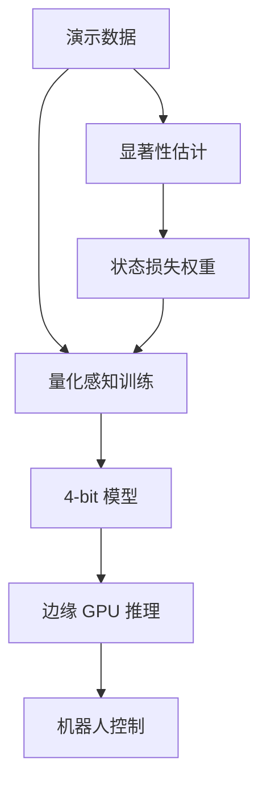

# 精读笔记 13 | Saliency-Aware Quantized Imitation Learning for Efficient Robotic Control

**中文标题**：面向高效机器人控制的显著性感知量化模仿学习

- **作者**：Seongmin Park, Hyungmin Kim, Sangwoo Kim, Wonseok Jeon, Juyoung Yang, Byeongwook Jeon, Yoonseon Oh, Jungwook Choi
- **单位**：汉阳大学、现代汽车等（以论文首页为准）
- **发表**：ICCV 2025（Poster）
- **arXiv**：2505.15304
- **官方论文页**：https://iccv.thecvf.com/virtual/2025/poster/958
- **项目页**：https://aiha-lab.github.io/sqil/
- **官方代码**：https://github.com/aiha-lab/SQIL
- **定位**：方向 5 的 QAT 路线；强调“关键任务状态”而不是均匀量化，适合理解动作敏感度与量化训练。

---

## 一句话总结

SQIL 发现量化后的 VLA 失败主要发生在“任务关键状态”，于是用显著性分数找出这些状态，在量化感知训练中对它们加权，从而用 4-bit 权重把 VLA 压到边缘 GPU 可运行，同时尽量保持决策成功率；它不是纯 PTQ，需要微调。

---

## 1. 研究背景：为什么需要这项工作

VLA 量化不能照搬 LLM：

- LLM 关注 token 似然，VLA 关注动作是否导致任务失败；
- 动作的小误差会累积成灾难性失败；
- 大多数状态对量化不敏感，少数关键状态决定成败；
- 均匀量化/均匀损失权重会忽略这些关键状态。

SQIL 的目标：

- 找出关键状态；
- 在量化训练中强化它们；
- 低比特下保持任务成功率；
- 在边缘 GPU 上获得真实加速。

---

## 2. 论文核心贡献

1. **首次系统研究 Quantized Imitation Learning**。
2. **显著性感知**：识别 mission-critical states。
3. **选择性损失加权**：关键状态损失权重更高。
4. **QAT**：量化感知训练，不是纯 PTQ。
5. **4-bit 权重 VLA**：在边缘 GPU 上加速/省内存。
6. **多域验证**：机器人操作、自动驾驶、物理仿真、真实任务。

---

## 3. 整体技术架构

### 关键点

- 显著性估计可以在训练前/训练中；
- 关键状态加权；
- QAT 模拟量化误差；
- 导出低比特权重；
- 边缘推理。

---

## 4. 核心方法详解

### 4.1 显著性分数

**通俗解释**：给每个状态/样本打一个“有多关键”的分数，越容易导致任务失败的状态分数越高。

**可能来源**：

- 动作误差对任务的影响；
- 价值/回报敏感度；
- 状态访问频率/不确定性；
- 教师/全精度模型的差异。

具体定义以论文为准。

### 4.2 选择性损失加权

训练损失不是所有样本等权，而是关键状态加权更高。这样量化误差在关键处被重点优化。

### 4.3 QAT

在训练中插入伪量化，让模型适应低比特舍入；比 PTQ 更能保持精度，但需要训练数据/算力。

### 4.4 4-bit 权重

论文强调 4-bit 权重 VLA；激活位宽/是否 W4A16 需看具体配置。不能默认是 W4A4。

---

## 5. 模型结构与输入输出

| 项目 | 内容 |
|---|---|
| 基础模型 | VLA（代码以 OpenVLA/LIBERO 微调为主） |
| 量化 | 4-bit 权重（具体激活位宽以论文为准） |
| 训练 | QAT + 显著性加权 |
| 输入 | 图像 + 语言 + 状态 |
| 输出 | 动作 |
| 部署 | 边缘 GPU |
| 加速 | 最高 2.5×；显存 4× 降低；能耗 2.5× 节省（论文报告） |

### 未报告/需核实

- Orin NX 具体延迟；
- TensorRT 原生支持程度；
- G1 29DoF；
- W4A4 还是 W4A16 的精确组合。

---

## 6. 数据集与实验设计

### 数据

- LIBERO；
- 真实机器人操作；
- 自动驾驶；
- 物理仿真；
- 跨域任务。

### 评估

- 任务成功率；
- 延迟；
- 显存；
- 能耗；
- 与 PTQ/其他量化基线比较。

### 公平性注意

- QAT 需要训练，PTQ 不需要；
- 不同模型/硬件加速比不可直接横比；
- “最高 2.5×”是特定配置。

---

## 7. 实验结果详解

论文报告：

| 指标 | 结果 |
|---|---|
| 机器人操作加速 | 最高 2.5× |
| 显存降低 | 4× |
| 能耗节省 | 2.5× |
| 自动驾驶延迟 | 最高 3.7× 降低 |
| 自动驾驶能耗 | 3.1× 节省 |
| 精度 | 接近全精度（具体任务看表格） |

这些是论文报告值；Orin NX 上需自行实测。

---

## 8. 部署视角分析

### 8.1 优点

- 关注任务关键状态，符合机器人控制特点；
- QAT 可恢复精度；
- 有真实机器人/边缘 GPU 结果；
- 官方代码可参考。

### 8.2 缺点

- 需要训练/微调，不是“拿到模型就能压”；
- 需要演示数据；
- 量化配置/位宽需核对；
- 边缘 GPU 不一定是 Orin NX；
- 与 TensorRT 的集成需自己做。

### 8.3 对 G1

- 不是 G1 策略；
- 需要 G1 数据微调；
- 4-bit 权重可降低内存，但控制频率仍需实测；
- 安全层不可少。

**结论：需适配后复现；适合作为方向 5 的 QAT 对照，不是首个 G1 项目。**

---

## 9. 论文局限性

### 作者承认/论文体现

- QAT 成本；
- 显著性估计依赖数据；
- 真实任务有限。

### 我们的部署分析

- 非 Orin NX 专用；
- 非 G1；
- 量化算子/后端未明确；
- 训练数据需求；
- 成功率方差需关注。

---

## 10. 初学者概念速查表

| 术语 | 通俗解释 | 在本文中的作用 |
|---|---|---|
| QAT | 训练时模拟量化 | 保持精度 |
| 显著性 | 状态有多关键 | 加权依据 |
| Mission-critical | 容易导致失败的关键状态 | 重点优化 |
| 4-bit 权重 | 权重用 4bit 存 | 压缩 |
| 边缘 GPU | 机器人/车载 GPU | 部署目标 |

---

## 11. 整体评价与实际应用价值

### 最值得学习

- 任务敏感度驱动的量化；
- 关键状态加权；
- QAT 与部署指标联合评估。

### 最有部署价值

- 敏感层/关键状态分析；
- 4-bit 权重压缩；
- 真实任务成功率对照。

### 不值得投入时间

- 没有训练资源时硬做 QAT；
- 直接套 G1；
- 把最高加速比当普遍结果。

### 可结合方向

- 方向 1：VLA 量化；
- 方向 5：与 PTQ/FoldQuant 对照；
- 方向 2：蒸馏+量化。

---

## 12. 延伸阅读

| 工作 | 链接 | 推荐理由 |
|---|---|---|
| SQIL 代码 | https://github.com/aiha-lab/SQIL | 官方实现 |
| SQIL 项目页 | https://aiha-lab.github.io/sqil/ | 结果/图 |
| AWQ | https://arxiv.org/abs/2306.00978 | 权重量化 |
| SmoothQuant | https://arxiv.org/abs/2211.10438 | 激活量化 |
| QVLA | https://arxiv.org/abs/2602.03782 | 通道级混合精度 |
