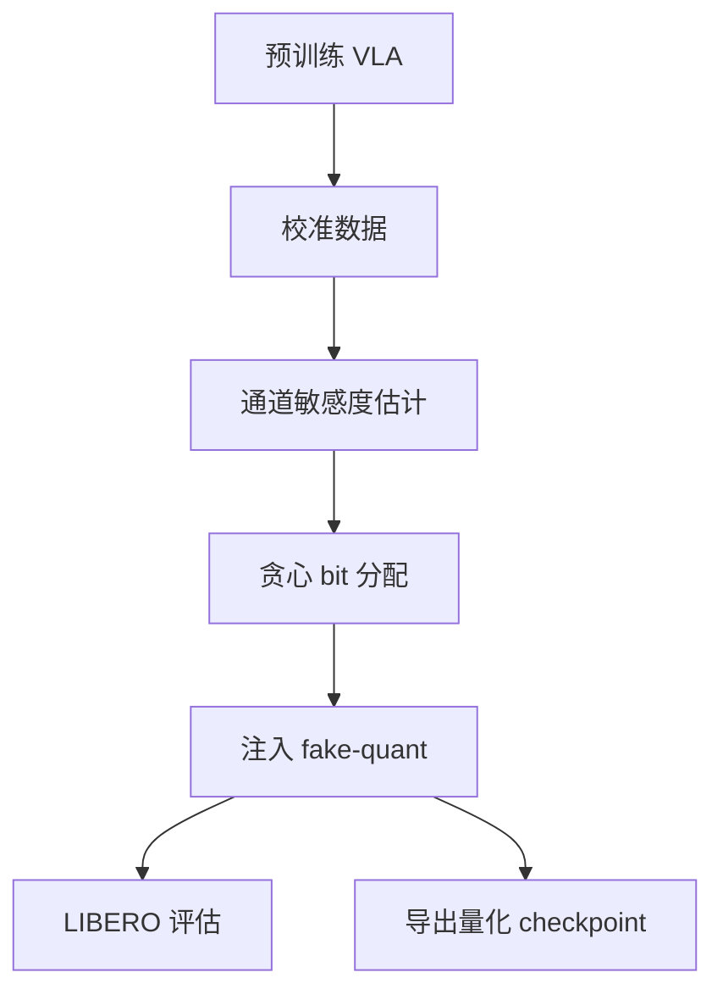

# 精读笔记 14 | QVLA: Not All Channels Are Equal in Vision-Language-Action Model's Quantization

**中文标题**：QVLA：视觉—语言—动作模型量化中并非所有通道都平等

- **作者**：Yuhao Xu, Yantai Yang, Zhenyang Fan, Yufan Liu, Yuming Li, Bing Li, Zhipeng Zhang
- **单位**：上海交通大学 AutoLab、Anyverse Dynamics、中科院自动化所、蚂蚁集团等
- **发表**：ICLR 2026（2026-01-26 接收；OpenReview 有页面）
- **arXiv**：2602.03782
- **官方代码**：https://github.com/AutoLab-SAI-SJTU/QVLA
- **定位**：方向 5 的通道级混合精度；强调“动作敏感度”而非 LLM 的被动数据保真，但目前主要是 fake-quant 评估，不等同于 TensorRT 原生加速。

---

## 一句话总结

QVLA 认为 VLA 量化不能照搬 LLM 的均匀位宽，因为不同通道对最终动作的影响差异巨大；它用动作空间敏感度为每个通道分配 0/2/4/8/16 bit（0 bit 即剪枝），在 LIBERO 上把 OpenVLA-OFT 的显存降到 29.2%、保留 98.9% 性能，并报告 1.49× 加速。

---

## 1. 研究背景：为什么需要这项工作

LLM 量化方法通常：

- 均匀位宽；
- 最小化权重/激活重建误差；
- 关注语言 token 似然。

但 VLA：

- 输出连续动作；
- 小动作偏差会累积成任务失败；
- 不同通道对动作敏感度不同；
- 需要“动作中心”的量化目标。

QVLA 的核心观察：**不是所有通道都同等重要**。

---

## 2. 论文核心贡献

1. **首个动作中心 VLA 量化框架**（论文主张）。
2. **通道级 bit 分配**：`{0,2,4,8,16}`。
3. **代理敏感度估计**：测量每个通道量化到不同位宽对最终动作的影响。
4. **贪心门分配**：在目标平均位宽下选择通道位宽。
5. **量化+剪枝统一**：0 bit 即剪枝。
6. **强结果**：OpenVLA-OFT 在 LIBERO 上 29.2% VRAM、98.9% 性能、1.49× 加速。

---

## 3. 整体技术架构

### 注意

README 明确：当前流程是 **weight-only fake quant + checkpoint export**，用于评估/后续导出；不是直接生成 TensorRT 引擎。论文的 1.49× 加速来自其实现/实验设置，需核对后端。

---

## 4. 核心方法详解

### 4.1 通道敏感度

**通俗解释**：逐个通道试量化，看最终动作偏差多大；越敏感，给的 bit 越多。

**专业定义**：以动作空间损失/代理 Hessian 衡量通道量化到某位宽后的影响。

### 4.2 位宽集合

`{0,2,4,8,16}`：

- 0：剪枝；
- 2/4：激进压缩；
- 8：常用 INT8；
- 16：接近 FP16。

### 4.3 贪心分配

在目标平均 bit 约束下，优先给敏感通道高位宽，给不敏感通道低位宽/剪枝。

### 4.4 作用范围

- `language_model.*`、`vision_backbone.*` 的 Linear/Conv2d；
- 排除 `projector.*`、`action_head`、`lm_head`；
- 说明动作头/投影层对精度关键。

---

## 5. 模型结构与输入输出

| 项目 | 内容 |
|---|---|
| 基础模型 | OpenVLA / OpenVLA-OFT |
| 量化 | 通道级 0/2/4/8/16 bit |
| 校准 | LIBERO 数据 |
| 评估 | LIBERO |
| 显存 | 29.2% of original |
| 性能 | 98.9% of original |
| 加速 | 1.49× |
| 代码 | PyTorch fake-quant + 导出 |

### 未报告/需核实

- TensorRT 原生 kernel；
- Orin NX 延迟；
- 真机闭环；
- G1 29DoF；
- 激活量化细节（README 强调 weight-only fake quant）。

---

## 6. 数据集与实验设计

### 数据

- LIBERO 四类任务；
- 校准集与测试集需分离。

### 对照

- 原模型；
- SmoothQuant；
- 均匀位宽；
- 其他 PTQ。

### 公平性注意

- fake-quant 的“加速”不一定等于真实硬件；
- 不同 bit 分配的平均位宽需一致；
- LIBERO 成功率方差；
- 显存口径（峰值/平均）。

---

## 7. 实验结果详解

论文/README 报告：

| 指标 | 结果 |
|---|---|
| 显存 | 29.2% |
| 性能保持 | 98.9% |
| 加速 | 1.49× |
| 对比 SmoothQuant | +22.6% 性能 |

解读：

- 29.2% 显存是强压缩；
- 98.9% 性能说明通道级分配有效；
- 1.49× 加速需要看后端/硬件；
- 不是 W4A4 原生 TensorRT。

---

## 8. 部署视角分析

### 8.1 优点

- 动作敏感度思路适合机器人；
- 通道级混合精度压缩率高；
- 0 bit 剪枝统一；
- 代码可做算法对照。

### 8.2 部署难点

- 非均匀位宽需要自定义 kernel/后端；
- TensorRT 标准 INT8 不支持任意 0/2/4/8/16 组合；
- fake-quant 不等于真实加速；
- 需要校准数据；
- 动作头未量化，实际端到端收益受限。

### 8.3 对 G1

- OpenVLA-OFT 不是 G1 策略；
- 需要替换模型/数据；
- 通道位宽映射到 TensorRT 很难；
- 不建议首项。

**结论：需较大改造；适合作为量化算法/敏感度分析参考。**

---

## 9. 论文局限性

### 作者承认/论文体现

- 通道级位宽需要专门实现；
- 依赖校准；
- 评估主要在 LIBERO。

### 我们的部署分析

- 无 TensorRT 原生支持；
- 无 Orin NX 数据；
- 无真机/G1；
- 非均匀 bit 的工程复杂度高；
- 1.49× 不能直接外推。

---

## 10. 初学者概念速查表

| 术语 | 通俗解释 | 在本文中的作用 |
|---|---|---|
| 通道级量化 | 每个通道不同位宽 | 核心 |
| 敏感度 | 通道量化对动作的影响 | 分配依据 |
| Fake-quant | 训练时模拟量化，不一定真加速 | 当前实现 |
| 0 bit | 直接剪枝 | 压缩 |
| 平均位宽 | 所有通道的加权平均 | 约束 |

---

## 11. 整体评价与实际应用价值

### 最值得学习

- 动作中心量化思想；
- 通道敏感度估计；
- 混合精度+剪枝统一。

### 最有部署价值

- 敏感层分析；
- 动作头保留高精度；
- 与标准 INT8 对照。

### 不值得投入时间

- 首项就实现非均匀 kernel；
- 把 fake-quant 加速当 TensorRT 结果；
- 直接套 G1。

### 可结合方向

- 方向 1：VLA 量化；
- 方向 5：与 FoldQuant/SQIL 对照；
- 方向 4：策略压缩。

---

## 12. 延伸阅读

| 工作 | 链接 | 推荐理由 |
|---|---|---|
| QVLA 代码 | https://github.com/AutoLab-SAI-SJTU/QVLA | 官方实现 |
| SmoothQuant | https://arxiv.org/abs/2211.10438 | 激活量化基线 |
| AWQ | https://arxiv.org/abs/2306.00978 | 权重量化 |
| FoldQuantVLA | https://arxiv.org/abs/2609.24433 | 原生 W4A4 |
| SQIL | https://arxiv.org/abs/2505.15304 | 显著性 QAT |
