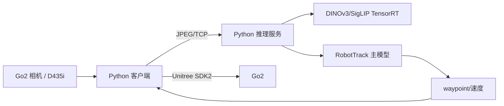

# 项目卡 15 | MiniCPM-RobotTrack 端侧导航部署

> 这不是论文笔记，而是工程项目核验卡。MiniCPM-RobotTrack 目前应按“官方模型 + 官方部署工程”评价，不能当成已正式发表的学术论文。

---

## 1. 项目定位

- **官方仓库**：https://github.com/OpenBMB/MiniCPM-Robot
- **模型页**：https://huggingface.co/openbmb/MiniCPM-RobotTrack
- **模型族**：MiniCPM-Robot（含 RobotTrack / RobotManip）
- **任务**：视觉语言导航/目标跟踪，输出导航 waypoint/速度
- **目标平台**：Unitree Go2 + Jetson Orin NX
- **论文**：本次核验未发现独立正式论文；不要标注 DOI/会议

---

## 2. 为什么关注

对方向 1 的价值：

1. 官方给出真实机器人 + Orin NX 的完整部署链；
2. 视觉编码器使用 TensorRT engine；
3. 服务端/客户端分离，便于理解“推理服务与机器人控制解耦”；
4. 有 dry-run、急停、速度限幅等工程细节；
5. 模型规模小，适合边缘设备。

---

## 3. 技术架构（官方部署）

### 关键事实

- 服务端：`sample/http_minicpm_robot_track_server.py`
- 客户端：`client/http_minicpm_robot_track_client.py`
- 视觉主干：DINOv3/SigLIP，TensorRT engine；
- 主模型：PyTorch/CUDA（非全量 TensorRT）；
- 传输：HTTP + TCP JPEG；
- 控制：Go2 SportClient / unitree_sdk2py；
- 官方验证栈：TensorRT 10.7（与 G1 的 10.3 不同）；
- 输出：导航 waypoint/速度，不是关节动作。

---

## 4. 模型输入输出

| 项目 | 内容 |
|---|---|
| 输入 | RGB（640×480 左右，中心裁剪/缩放） |
| 语言 | 指令字符串 |
| 视觉编码 | DINOv3 + SigLIP |
| 输出 | waypoint / 速度（具体格式以代码为准） |
| 控制 | `vx`、`wz` 限幅 |
| 模型规模 | 官方材料口径约 0.9B 级；以 config 为准 |

---

## 5. 与 G1 的差异

| 维度 | MiniCPM-RobotTrack | G1-EDU |
|---|---|---|
| 机器人 | Go2 四足 | G1 人形 29DoF |
| SDK | unitree_sdk2py / SportClient | ROS 2 / Unitree SDK2 |
| 动作 | 速度/waypoint | 关节/技能 |
| 相机 | Go2 内置 / D435i | 需确认 |
| 网络 | `enP8p1s0` 等 | 机载网卡不同 |
| TensorRT | 10.7 | 10.3 |
| 控制频率 | 速度指令 | 50 Hz 策略/底层 |

**结论：不能直接控制 G1；可借鉴服务拆分、TRT 视觉编码、dry-run/急停设计。**

---

## 6. 复现条件

### 可获取

- 代码（GitHub）
- 模型权重（HuggingFace）
- 部署脚本
- 视觉 engine 构建流程（需按目标机重建）

### 缺口

- 非 G1；
- 非 ROS 2 原生（Python DDS）；
- 主模型非 TensorRT；
- 依赖 Go2 网络接口/相机；
- 需要 RealSense/相机标定；
- 无 G1 安全层。

---

## 7. 可借鉴的部署设计

1. **推理服务与控制客户端分离**；
2. **视觉编码器单独 TensorRT**；
3. **dry-run 默认 + live 二次确认**；
4. **速度限幅/死区/EMA/偏航增强**；
5. **急停 `StopMove` + 独立停止命令**；
6. **日志/tegrastats/诊断**；
7. **启动前相机预检**。

这些设计可直接迁移到 G1 的部署骨架，但接口需重写。

---

## 8. 推荐实验

- 在 RTX 4070 上跑通 RobotTrack 推理；
- 在自己的 Orin NX 上重建视觉 engine，测延迟；
- 把 waypoint 输出映射为 ROS 2 消息；
- 不接 G1 关节，只做“高层目标”验证；
- 与 SmolVLA 对比延迟/精度。

---

## 9. 结论

**需较大改造。**  
它是“端侧导航模型工程化”的好参考，但不是 G1 策略，也不是正式论文。适合作为方向 1 的工程案例，而不是主复现目标。
